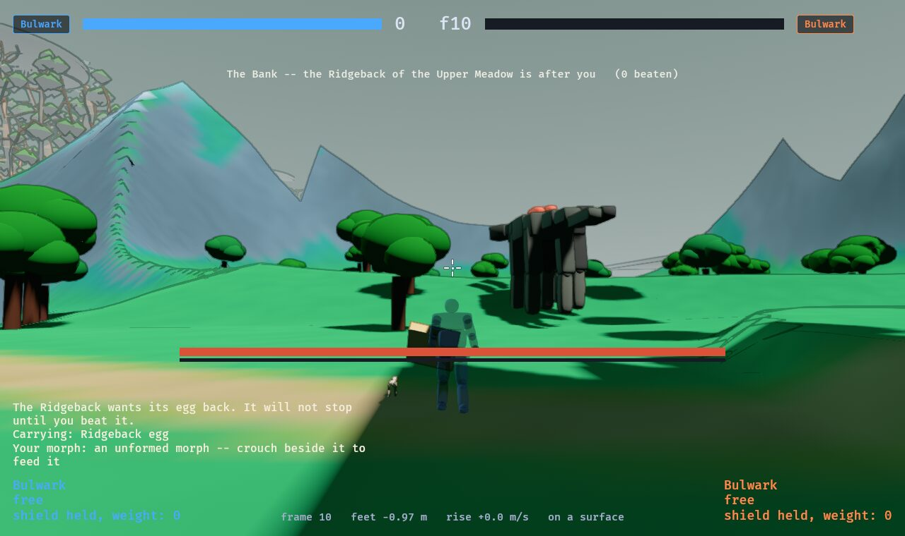

# 0023 · Creatures that leave their range

*2026-10-19. Built the same day: `sim::valley::roam`, `tests/roam.rs`,
`tests/valley.rs` (`a_change_of_frame_changes_nothing_in_a_hunt`). Unplayed.*

The owner's brief: valley creatures can travel across the whole map, without
limit, but prefer their own area. **The egg chase is what makes a creature
leave home**: a player carrying its egg (`sim::keep`) is pursued across the
valley until the creature is beaten, or the egg is dropped or taken back.
Without that reason it drifts back toward its range and settles there.

Until today a creature existed only inside its own room or range: it was
clamped to its arena's bounds, and its hunt ended (or, under an egg chase,
held the world in place) when everybody left. Both of those came from one
fact -- **the world runs in the coordinates of one place at a time** (atlas.md)
-- and the rule that the world never moved with a hunt in it.

## 1 · A hunt that survives a change of place

- **`World::shift` moves the hunt.** Bodies (position, what each last saw,
  where its move is aimed), critters, the pack's den and sight, unanchored
  floor hazards and noises, and -- through a new species hook,
  `FightDecl::shift` -- whatever a species keeps of its own as a point: lore
  cells, `Monster::own` words, a pack's memo. Points kept in centimetres move
  by a rounded whole number of centimetres (`lore::cm_of`), halves away from
  zero, so a shift by `-d` undoes one by `d` exactly. "No wall" and other
  zero sentinels are left alone: shifting a nothing and back would make it a
  point.
- **A hunt remembers its den** (`Journey::den`): the room or range it began
  in, set by `begin_hunt` and by arriving in a room. **Everything a creature
  reads of its own arena it reads through `arena::Den`** -- its arena, the
  offset from its origin to the world's, its own bounds in the world's
  coordinates, and where it is kept this frame. `World::den()` builds it, and
  every `Terrain` the world makes carries it (`Terrain::den`). At home, and in
  every fight that is not the valley, the offset is zero and it is kept in its
  own bounds, so **every pinned checksum holds**: the journey's new bytes are
  hashed only once a hunt has left home.
- **The test is the old one, with a hunt in it.** Every creature in the valley,
  at its den, is fought for four seconds, then twenty-four times moved into
  the coordinates of the nearest other place and played on, against the same
  fight never moved. The first version of it failed for every creature,
  including the plain Ridgeback; the causes, in the order found: a room's
  hunt arrived in had no den; a fighter's last floor height (`Rise::floor`)
  and wall sentinels were not shifted; unplayed seats were parked under the
  *current* place's middle (now its den's); and then eight species' own
  points and arena reads. It passes for every creature now.
- **Two ways a species' own point survives**, both used: moved by the hook,
  or **written relative to its den's origin** and read back by adding it --
  the Pair's perches, the Mantis's glimpses, the Galewing's lanes, the
  Veilstalker's footprints, whose encodings (half-metre halves, nine-bit
  prints) could not take a shift of hundreds of metres. And heights: every
  species measured "on the floor" from zero, which is its den's floor only at
  home; they measure from `Den::off.y` now.
- **A centimetre decodes rounded up** (`lore::from_cm`), where it truncated
  toward zero: a point decoded either side of zero then moves by exactly a
  whole-metre shift, and `to_cm(from_cm(c)) == c`. Every pinned fight hashes
  as it did.

## 2 · Where the world runs while a hunt is out

The obvious rule -- the world follows the first fighter into whatever place
they are in -- broke on the numbers. **A reach's origin is the map's**, and
the Saddle is 900 m from it; a creature's lore keeps points as sixteen-bit
centimetres, ±327 m. A Mantis chasing you into the Saddle would have had its
memory clamped to the wrong place.

So **while a hunt is out, the world runs in the coordinates of the place with
its own origin nearest the first fighter** -- a room, a range, the town, the
High Plane, the Deep; never a reach, never the Ring -- and moves only once
another is `Roam, out, the world moves to a nearer place by` (30 m) nearer
(`World::nearest_anchor`). The valley has one of those every 100--200 m along
the road, so every point of a chase stays within a couple of hundred metres
of the world's origin. The HUD names where you stand, not the world's frame
(`game::valley::text`), and says whose creature is after you.

**Back near its home** (inside `Hunt, held this far outside its room`), the
world goes home with the hunt, so a creature fights in its own arena as
tuned.

## 3 · Out of its bounds

- **Kept**: a creature is kept in its own bounds until one of its bodies is
  out of them, or it is after somebody who is (`Den::kept` is then the map's
  extent). So nothing changes in a fight at home: a Ridgeback is still kept
  off its room's walls while you fight it there, and leaves only when you do.
- **Who pursues** (`World::pursuing`): anything after its egg; a hunting
  range and every room's creature; a territorial or peaceful one once roused;
  never a skittish one, which runs.
- **Travelling**: further than `Roam, fights as at home within` (18 m) from
  whoever it is after, it heads for them at `Roam, travelling, at` times its
  gallop, by `roam::way_toward`: through a walled room's doorway when one of
  them is in it and the other is not, then the first heading -- straight at
  them, then turning either way in twelfths of a turn, the side it already
  faces first so it does not dither -- whose next `Roam, looks ahead` (5 m)
  are walkable for its width. Closer, its own brain has the say, but if a
  solid stands on the straight line it goes round (`roam::detour`).
- **Walkable** (`roam::ground_step`, `step_onto`): on the map, not a step up
  past `Roam, steps up at most` (0.6 m) or down past `Roam, steps down at
  most` (3 m), and not a climb of land steeper than `Terrain, steepest
  walkable` -- **measured as the step's own rise over its run**, in integers
  squared, because a frame's step is millimetres and both the fixed-point
  length and the land's gradient read a dip it can walk out of as a wall.
  Solids it slides along (`Terrain::fence`) rather than being refused, or a
  body a charge left against a tree could never leave it.

All of it asks the terrain (`around`, `relief_at`, `on_land`, `fence`), never
a table; nothing allocates; a chase far from home is the dearest scenario in
`tests/budget.rs` at about 120 µs a frame against a 520 µs budget.

## 4 · Home

- **Giving up** (`World::step_roam`): with nobody carrying its egg, a creature
  more than `Roam, far from home past its edge` (15 m) out of its bounds
  counts frames; it gives up after `Roam, gives up after this long far from
  home` (20 s), or at once `Roam, gives up at once this far past its edge`
  (160 m) out -- both times its temperament's share (`Roam, a territorial one
  keeps at it` 60%, `a peaceful one` 35%, a hunter all of it). **Under an egg
  chase it never gives up.**
- **Walking home** it starts nothing, and walks at `Roam, walking home, at`
  (half its gallop) -- the pull of home. A pack runs home as a broken pack
  does, to its den's middle.
- **What ends it**: home with somebody near it, it settles -- its temperament
  has it again, roused forgotten. Home with nobody near, or walking home with
  nobody within `Roam, walking home, gone once nobody is within` (90 m), its
  hunt calms, unwon, and the next walk in finds it fresh on its marks.

## 5 · What ends a far-away hunt, decided

- **Beaten** far from home: its trophies drop where it fell (they always used
  its position), it is credited, and **its home range rests**, read from the
  den rather than the place the world is in.
- **Lost** far from home -- the egg's carrier down and nobody standing: there
  is no outside to wake at, so everybody stands up on their last cairn, as a
  death in a reach does; **it took its egg back** from every satchel and off
  the floor. (Losing in its own room is as before: you wake outside its door.)
- **A chase through another creature's range does not wake it.** The world has
  two creature slots and one pack, and they are the chaser's: a second hunt
  would need a third slot, or the chaser evicted mid-chase -- and a creature
  that vanished because you ran past somebody else's den would read as a bug.
  The other range wakes **once the chase is over** if somebody is standing in
  it (`Journey::wake`), as if just walked into. Two packs at once, or a
  creature from one range fighting one from another, would need the snapshot
  to hold more than one hunt; not now.

## 6 · Seen

`SHOT_CHASE=1` with `--range <name>` starts fighter one carrying the range's
egg out on the road nearest it, with its creatures out of their range after
them: `DEMO=0 SHOT_FRAME=90 SHOT_CHASE=1 GAME_ARGS="--range upper-meadow"
./scripts/screenshot.sh` (with `SHOT_YAW=-1.57` to look back at them).

## Open

- **ROAM-1** Nobody has played it. Twenty seconds of following before giving
  up, half a gallop home, are first guesses.
- **ROAM-2** Fliers keep their own sky: the Galewing's flight is its species'
  hooks, which circle its own home's middle; it follows an egg carrier only as
  far as its dives reach. A flier that travels would be its flight hooks
  asking `Den::out`.
- **ROAM-3** The steering looks five metres ahead and no further: it walks
  round a tree, a crag or a waystone's door, and through a room's doorway, but
  a maze (the Deep's warrens) or a long cliff it has to go a long way round
  would hold it. A path search over the tiles is the next step if play finds
  one stuck.
- **ROAM-4** One live hunt (§5).
