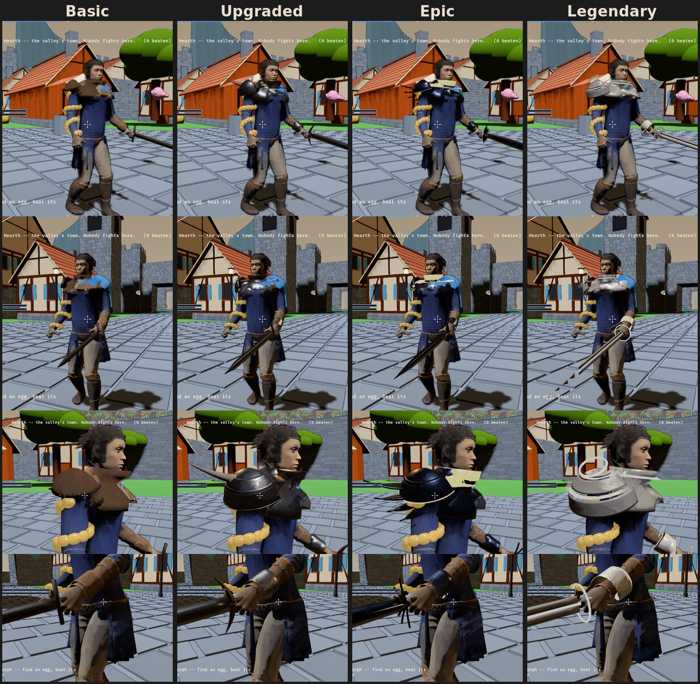
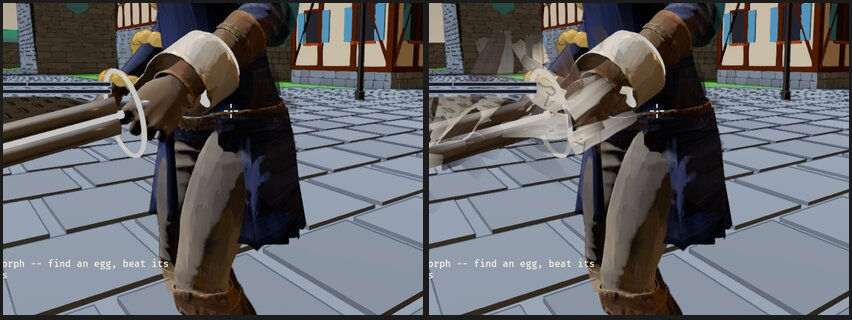

# 0026 -- What gear would look like, tier by tier

**Asked** (the owner, 2026-10-22): *"Give me a couple samples for what basic,
upgraded, epic, and legendary armour and weapons would look like in this
style. I need to see a sample before making a call. Go pull reference images
of MMO and Monster Hunter weapons, but no copying."*

Gear is parked ([parked.md](../parked.md); [intent.md](../intent.md) §4 caps
any gear ramp early). This is a look, to decide on, not a system.

## 1. What the references say

The game sites themselves (the Monster Hunter, Guild Wars 2 and FFXIV wikis,
ArtStation, Fandom) are outside this environment's network; what was read of
them came through search, and the pictures looked at were real armour, from
Wikimedia Commons -- a plain munition harness, a bronze-finished one, a
blackened and gilt parade armour, an etched one, a ceremonial and a
presentation sword. What each source teaches, as a rule rather than a shape:

- **Monster Hunter**: a weapon tree starts in bone and ore, and every step
  up is *made of what you hunted* -- the first upgrades half bone and half
  monster, the late ones wholly the creature's. The players' complaint is
  the useful part: late weapons that stop changing look. So **every tier
  changes the look**, and the look says what was hunted.
- **Guild Wars 2**: legendaries have the same numbers as the tier below;
  what they buy is a unique look and effects, and in the newest set, a
  theme across all of them. So **the top tier is a look, not a number** --
  which suits a game whose gear ramp is capped.
- **FFXIV's relic weapons**: each stage changes the name, the colour and
  the glow, and the glow escalates to the last. Glow is the cheapest
  ladder there is, and the most worn out; here it is one of four.
- **Real armour**: from munition grade to parade, the *shape* barely
  changes; the finish does -- blued, etched, gilt. Value is shown by the
  surface and the ornament first, the outline last.
- **Readability guides** (the Dota 2 and Warframe workshop guides): rarity
  should read before the item does -- by outline, material and effect
  together, not colour alone -- and complexity wants areas of rest beside it.

## 2. The ladder

Four things climb at once, so a tier reads from across the arena by any of
them:

| | Outline | Materials | Ornament | Magic |
| --- | --- | --- | --- | --- |
| **Basic** | the body's own | one: boiled leather, iron | rivets | none |
| **Upgraded** | layered plates | two: steel edged in bronze | a trophy: a Hornback's horn | none |
| **Epic** | the creature's: Galewing feathers fanned off the shoulder, a feather guard | blued steel, gold | etched gold, a gem | faint: the gold and the gem glow |
| **Legendary** | not physical: plates hung apart, a blade in two halves, its point in pieces | pale Siegeshell plate | rings of light | strong: gold light holds it together |

What it is made of follows the bestiary's tiers: the Hornback is a tier 1
creature, the Galewing tier 4, the Siegeshell tier 5. Gear made of a
creature *is* its trophy, worn -- the hunt you did is what people see.

**The painting is the fifth ladder, and the one only this game has.** The
painted cast (exploration 0025) paints every piece in strokes that ride it.
A legendary's light is read from the picture by the strokes over it, so its
glow is painted, not bloomed; and when free hems run past the line (0025
§12), a legendary's edges are the place for the most of it -- gear that
dissolves into paint at its edges as the cloak does into flame.

## 3. The sample

`art/samples/gear_tiers.py` puts each tier on the Champion -- a shoulder of
plates, a forearm guard, a plate at the throat and a sword in his free hand
-- and exports it as his model, so the game draws it with `--painted-cast`.
Built with the same tools as his clothes: the forearm guards cut from his
body inflated (`wardrobe.piece`); the shoulder and throat plates as bands of
a sphere and a ring sized from the body; horns, feathers, gems and the sword
as rigid meshes on a joint. A sample to judge: the game's `champion.glb` is not changed.

## 4. What the sample shows (2026-10-22)

Filmed in the game with `--painted-cast`, at frame 40 of a standing
Champion: two three-quarter views, his shoulder, his sword hand.

- **The ladder reads from across the screen.** Brown leather, then a dark
  steel shoulder with a horn, then blued steel edged in gold with feathers
  off it, then pale plates hanging apart. Each tier is a different outline
  as well as a different colour, which is what the references asked for.
- **What did not work first.** Plates cut from his inflated body, as his
  clothes are, read as padding; plate is a geometric shape, so they are
  bands of a sphere round the shoulder sized from the body. And the game
  draws this model mirrored from the joint names the sample first assumed:
  the shoulder went under his cape.
- **What is weakest.** The legendary's gold light reads near white: the
  strokes take the picture's colour and the bright core sits on the
  tonemapper's knee. The swords are long and dark, and at the camera's usual
  distance a tier is told by the shoulder, not the blade. The feathers are
  small for the creature they come from. None of these is the approach; all
  are dials.

## 5. The legendary dissolving into paint (2026-10-22)

The owner: *"Try the extra brushwork on the high tier sample weapon."*

- **How a surface says it dissolves.** A `paint` vertex group in the art
  build, exported as a second set of texture coordinates only on a piece
  that has one (`art/lib/glb.py`), so every other model is byte for byte
  what it was. The sample marks the legendary sword: blade, light and
  shards fully, grip and pommel a little.
- **What the painting does with it** (`brushwork.rs`, `DISSOLVE_DENSE`,
  `DISSOLVE`). What dissolves is painted all over, whatever holds it (the
  hands' rule of leaving a held thing alone gives way); it gets six times
  its share of strokes, since a blade is too small for the cloth's spacing;
  and about two in three of them are tongues of paint leaving the surface,
  swaying on the renderer's clock as the hem's wisps do. They are not held
  inside the lines or inside a colour shape -- leaving is the point -- and
  only what stands in front of them hides them.
- **What it looks like.** Standing still, the blade breaks into a fan of
  pale strokes along its whole length; in motion they sway and change while
  staying rooted on the blade, so it reads as a weapon shedding paint, not
  a texture. Busy, and pale: the strokes take the blade's near-white. A
  gold blade would shed gold.
