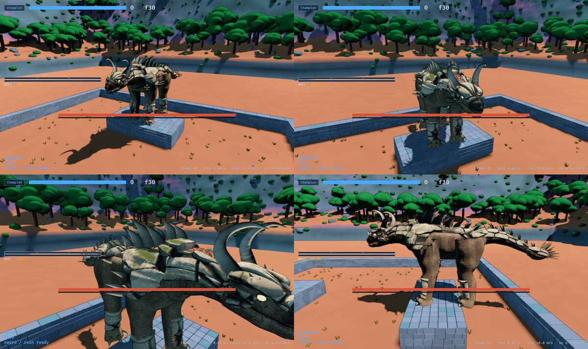
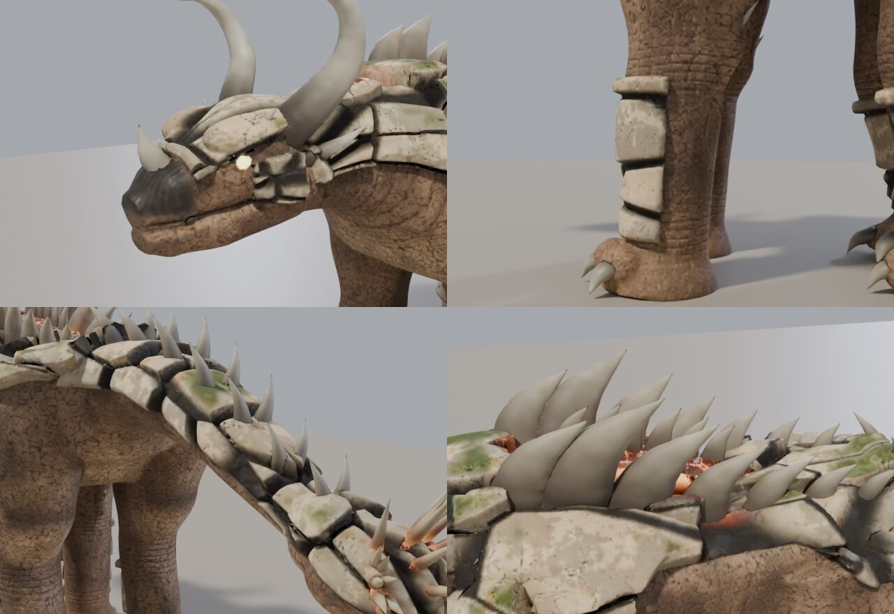

# 0029 — A target body: the Ridgeback formed by hand

The owner (2026-10-23), on the contoured grown body of exploration 0027:
*"Better, and it works probably better in motion than stillframe, but it
still reads like a trash bag over some hay. I think we need a target for the
algorithms to move toward rather than trying to build ground up on the
algorithm. Take the current model, form it by hand into a creature you might
find in Monster Hunter or Dark Souls — something intricate, interesting, with
flare and details, clear posture, well-shaped form on the tail, feet, joints,
head, body. We'll refine that first, then update the algorithms to get there
without manual effort."*

So this is the target, not the method. It is built the way the cast is — a
script, never a file edited by hand — so it can be changed, rebuilt and,
most of all, *read*: every choice that makes it look like an animal is a
line with a reason beside it, and the next step is to turn those lines into
rules a grown body follows.

## Round one, and why it was not it

The first target (commit 5f329768) was forms lofted in numpy, unioned into one
skin, with plates, horns and nails on it and colour in its vertices. The
owner: *"Conceptually fine, but school art project armadillo dog is not the
vibe here. This needs to read like something you'd find in a triple A game."*
It was right. What separates the two is not one idea but three, and round one
had none of them:

1. **Proportion and design.** A uniform body on four tubes, against a
   front-heavy mass with a designed head.
2. **Detail at three scales.** Big masses, then muscle groups and plate
   groups, then wrinkles, scale, cracks and chips. A game gets the last from
   a sculpt of millions of polygons *baked* into textures on a light mesh;
   vertex colour on 117,000 triangles cannot hold it.
3. **Materials that read as different things**: stone, hide, horn, heat.

## Round two: sculpted and baked

```
cargo run -p anim --bin export_beast -- ridgeback
art/blender.sh art/ridgeback/build.py            # about ten minutes; --fast for a draft in six
```

**The design** is a living ruin, after Shadow of the Colossus and Monster
Hunter's elders: a front-heavy grazer that bites, the barrel deepest under the
shoulders and the withers a hump, a domed back of thick shingled scutes split
down the middle by a seam of heat, dorsal spines tallest over the shoulders
for a crown to its silhouette, a mantle of spikes flaring over each shoulder,
a low head with horns that sweep back and curl up and a row of nubs along
each brow, a jaw with tusks and teeth, shins banded like an armadillo's,
three hooked claws a foot, and a tail ending in an armoured club that the
spray of quills fans from.

**The pipeline** (`art/lib/beast.py`, `art/ridgeback/build.py`):

1. **Forms** -- tubes of superellipse sections, muscles running down them --
   unioned by a voxel remesh into a coarse skin.
2. **Carapace** -- a `Plan` says where armour is (back and mantle, collars,
   helm and cheeks, tail, shins) as distances inside each region's edge,
   measured on the body's own axes. Each region is a closed shell grown off
   the skin: its thickness full over a scute, sunk in a crisp groove between
   scutes, rising toward each scute's back edge so it lies over the next
   (shingled), a keel down its middle, a chunky rim. The scutes are cellular
   noise laid on the body's own along-and-round coordinates with little
   jitter, so they fall in rows, largest along the spine, mirrored.
3. **The sculpt** -- skin and shells unioned at 1.2 cm into about two million
   triangles, carrying which is which through the remesh. Then the detail,
   all vectorised noise: on the hide a crazed crease network, folds at the
   joints and round the neck, pebbled scale down the legs, a belly of
   transverse scales; on the stone erosion, grit, pits, long cracks and chips
   at the grooves; on the soft places a crust split by fissures, as cooling
   lava is; on the face nostrils, sunken eye sockets and the line of the mouth.
4. **Paint** on the sculpt's vertices: a striped hide paler beneath, mud up
   the legs; pale bone-stone, each scute its own tint, dark in its grooves,
   moss and lichen on what faces the sky, charred beside the ridge; **edge
   wear and cavity from the sculpt's own curvature** -- convex edges rubbed
   pale, hollows dark -- which is most of what makes a surface read as a
   material. The glow is the fissures, and the scute seams beside the ridge,
   as if its heat showed through the joins.
5. **The bake** -- the coarse union decimated to 60,000 triangles plus the
   hard pieces is unwrapped, and Cycles reads the sculpt onto it: normals,
   colour, glow and roughness, its occlusion multiplied in, through a cage
   pushed out centimetres for the body and millimetres for a thin spike.
   Every texel the creature does not cover is filled from the nearest that
   it does (push-pull), because a far creature is drawn from the texture's
   smaller copies and black between the islands darkened the whole animal.
6. **The file** -- one skinned primitive, the four maps in it as JPEGs, the
   joints the species' bones.

## In the game

`game::grown::model_of` names the file; `beast::setup_bodies` loads its mesh
and its material through Bevy's glTF loader (so a page gets it as a desktop
does), the grown body standing in until both arrive, and
`beast::install_models` puts it in place, its textures squeezed into the
GPU's compressed formats as the cast's are. The part each vertex belongs to
rides in the second texture coordinates, so a broken foot darkens where it is
(`grown::own_colours`). The boxes are still what is hit and stood on; F1 draws
them. `--grown-creatures` draws the algorithm's body instead, to compare.

About 102,000 triangles and four 2048 textures, 10 MB.




Judged lit, in the game: it was too dark three times running in a game whose
sky light is blue and whose sun was behind the camera's subject. The studio
flatters by a lot; the palette is warmer and brighter than looks right there.

## What the algorithm has to learn from it

1. **Hard and soft are different things.** A grown body is one smooth field;
   this is a soft skin with shells grown off it where a plan says armour, and
   their crisp grooves, shingled overlaps and rims are most of what reads as
   "monster" rather than "blob". The `Plan` here -- regions as distances on
   the body's own axes, scutes as cellular noise in its own coordinates -- is
   written so a species table could state it.
2. **Detail lives in a sculpt, and reaches the game as textures.** The grown
   body can make the same sculpt (it is a field already) and the same bake.
3. **Paint from curvature and occlusion** as much as from facing.
4. **Silhouette parts are geometry with rules** -- rows of spines along a
   back, a crown, a collar of spikes, nails round a pad, quills off a club.

## Still open

- The legs are still long, straight columns: the rest pose is the skeleton's,
  and the posture a concept artist would give it (a forward knee, a lifted
  heel) belongs in its clips as much as its sculpt.
- The scutes read as stone slabs; a more organic plate (osteoderm with a boss,
  keratin sheath) is a second style to try.
- The shin bands are blocky.
- Smart UV projection still cuts the spines into many small islands; a
  hand-written unwrap for a tube would pack better.
