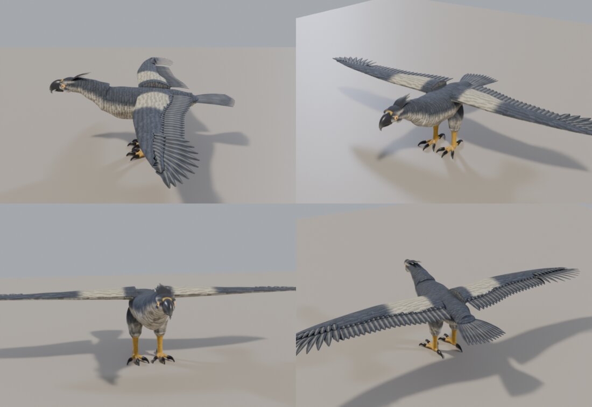
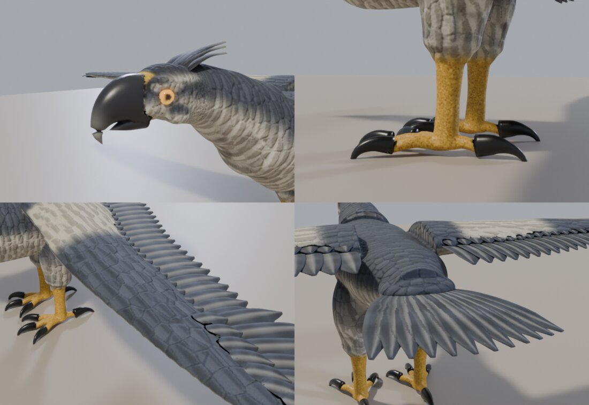
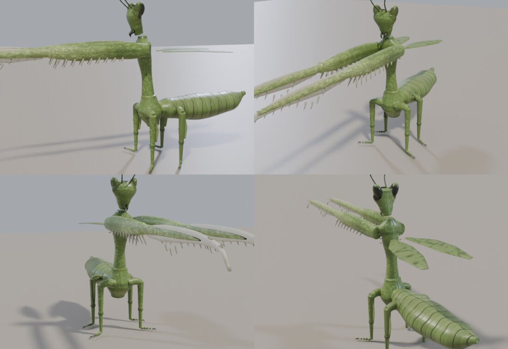
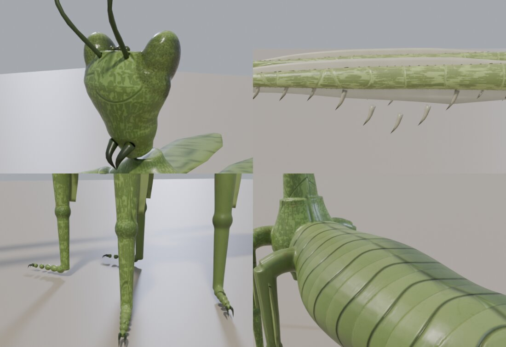
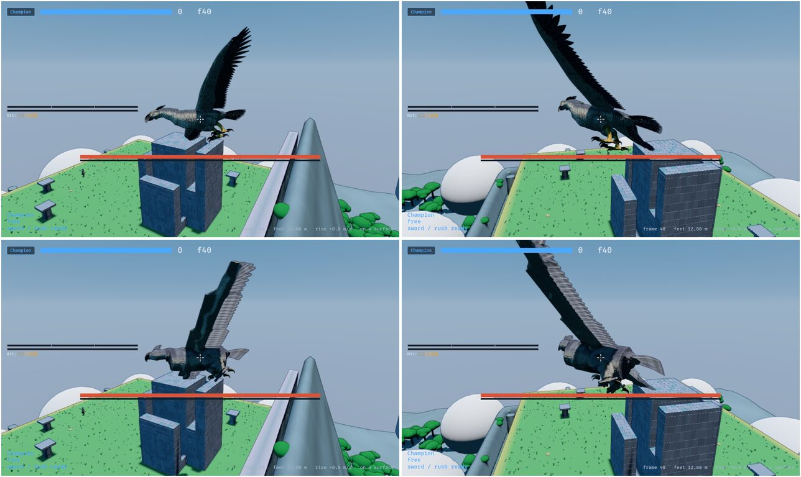
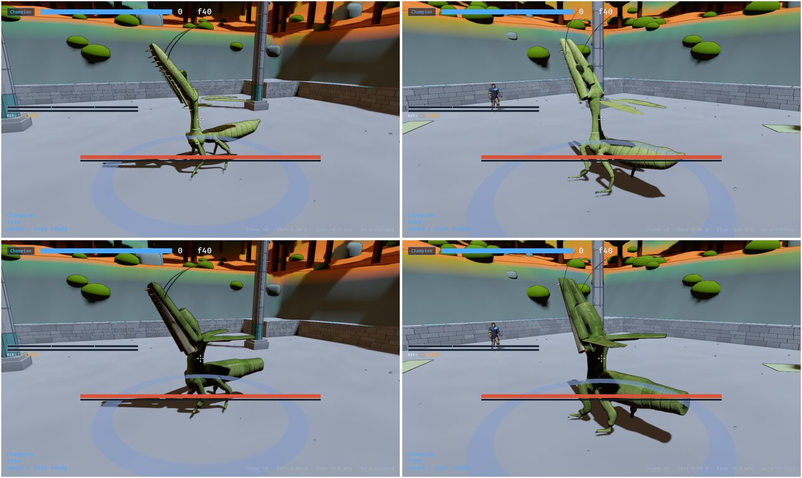

# 0030 — Two more targets: the Galewing and the Mantis

*2026-10-24.* The owner, after the Ridgeback (0029): *"Now we need two other
creatures hand crafted then a growing algorithm to match. I imagine the
galewing is a prime candidate, you choose the other."*

The second is the **Mantis**, because it is the body least like the other two:
an insect -- a shell rather than a hide, scythes, legs as thin as sticks, a
segmented abdomen, compound eyes. A growing algorithm that only had the
Ridgeback and a bird to learn from would have learned "a big animal". With an
insect beside them, what it learns has to be about parts, not about animals.

## The targets

Both are built on one builder now, `art/lib/creature.py`: the Ridgeback's
pipeline (forms unioned into a skin, an optional shell, a sculpt with its
detail and paint, hard pieces, a bake onto a light mesh, weights, a glTF) with
each species a spec of what is its own. Two new kinds of hard piece came with
them: `vane`, a flat cambered blade that is a feather, a scythe or a wing; and
the Ridgeback's `ringed_horn`, moved into the library.

**The Galewing** (`art/galewing/build.py`): storm-grey, slate above and pale
below, so it reads dark against the sky and light from beneath; an eagle's
build pushed toward a monster -- a deep keeled breast, a heavy brow over
amber eyes, a hooked beak on a yellow cere, a crest of blade feathers that
rises for the screech, coverts shingled over the body and wings, long barred
flight feathers with worn nicks, a covert over each one's base, the primaries
fanning from back to out past the hand, a fan of tail feathers, feathered
thighs over yellow scaled legs, and black talons as long as a forearm. The
wing roots -- where a hit counts double -- are a pale band across the back.
About 132,000 triangles, 9 MB.

**The Mantis** (`art/mantis/build.py`): pale green chitin with the blades
bone-white, because the arms are what the fight is read from; plates parted by
dark sutures and glossy where they curve; the pronotum a long stalk rising
from a bulb where the legs meet to a flared shield under the arms, with
leaf-like flanges; a triangular head with two dark compound eyes at its top
corners, antennae swept back, small mandibles; forearms spined in two rows
underneath, scythes serrated along the cutting edge and hooked at the end; a
leaf-like lobe on every walking femur; an abdomen in overlapping rings;
veined wings. About 80,000 triangles, 6 MB.

What went wrong on the way, so the next one need not: feathers too narrow
read as a **comb** (they must overlap, about 1.6 times their spacing); a
wing whose flesh and feathers were deeper than its hit box showed feathers
nobody could hit (the box is the truth: the slab keeps the front of it and the
feathers end at its trailing edge); a cere painted by `x` alone ringed the
eye in yellow like a clown's; a single dark pupil on a compound eye is a
cartoon's googly eye; and painting edges by the sculpt's fine curvature turns
chitin's grain into **camouflage blotches** -- chitin's fine detail is gloss,
not grime.

## The algorithm: parts by rule

The grown body (`game::grown`, `--grown-creatures`) now grows the Galewing and
the Mantis too, and what they needed is a new module, `game::anatomy`, every
rule read off the species table:

- **A part's role** (`anatomy::role`) from its box and bone: a *wing* is flat
  and off to one side; a *fan* is flat on the middle line (a bird's tail); a
  *blade* is breakable, long and thin. Each is contoured flat.
- **Feathers** (`Build::feathers`): a wing's flesh keeps the front 55% of its
  box, half as thick as the box, and carries secondaries back to the box's
  trailing edge with a covert over each base; the outermost wing part fans ten
  primaries from pointing back to pointing out, each reaching the box's edge;
  a fan keeps a stub at the body and spreads twelve feathers to fill its box.
  Feathers are painted barred, darker to the tip, with a pale shaft and fringe,
  in the body's colour or the part's tint where that is darker -- so a
  cracking wing still goes rust and a broken one dark.
- **A beak and a crest** (`Build::beak`, `crest`): the head's flesh is its
  back, a hooked upper and a lower mandible grow out of its front, a raptor's
  eyes are set under the brow where a ray meets the skull, a crest sweeps back
  off the crown.
- **Feet** (`Build::foot`): a paw (0029), a bird's talons (three toes forward
  and one back off the ankle bone, a talon on each), or an insect's tarsus
  (beads along the floor round a core, two claws).
- **An insect**: a blade's cutting edge serrated and its end hooked, the arm
  that carries it spined beneath (`Build::grip`), antennae (`antennae`),
  compound eyes on the head's top corners (`eyes`), segment rings in the
  abdomen's field that fade before its tip (`chitin`), and a new contour,
  **Stalk** -- a bulb, a slender stalk, a flare -- for a thorax stood on end.
- **The skin knows what it is**: the skin shader's detail has plumage
  (feather cells with dark seams and fine barbs) and chitin (broad plates,
  sutures, fine pits, a gloss the hide does not have) beside the hide, chosen
  by the build; a feathered body is countershaded.
- **A tint reaches every body**: the Galewing's wings crack rust and break
  dark on the modelled body and the grown one alike (`grown::own_colours`
  takes the species' `Tint`), not only on boxes.

`grown::tests` holds all three grown bodies to one piece -- the Mantis lost
the tip of its abdomen to a ring groove and the end bead of a foot until the
rings faded and the beads had a core -- and holds each to the parts its target
has.

## Still short

- The grown wing's flesh still reads as a plank beside the target's thin
  airfoil: the field is sampled about seven centimetres apart on an
  eighteen-metre bird, and the slab cannot be thinner than a few cells.
- The grown Galewing's body is a smooth sack where the target's breast and
  back are shaped; its neck disappears into it.
- The grown Mantis's legs are thicker than the target's, the blend that joins
  parts swelling every joint of a leg that thin.
- The Ridgeback's build still carries its own copy of the pipeline; moving it
  onto `creature.py` is mechanical and wants one checked rebuild.
