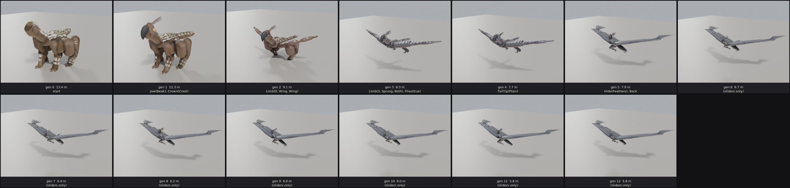
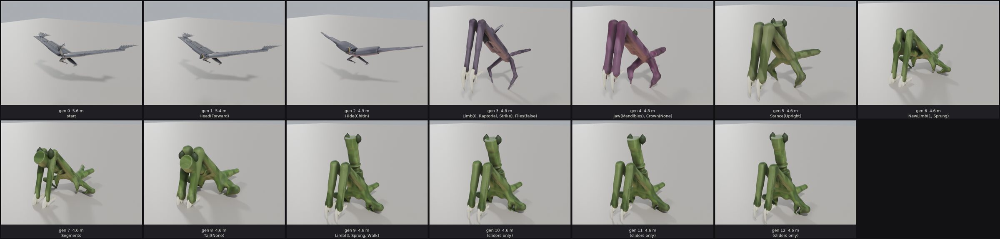
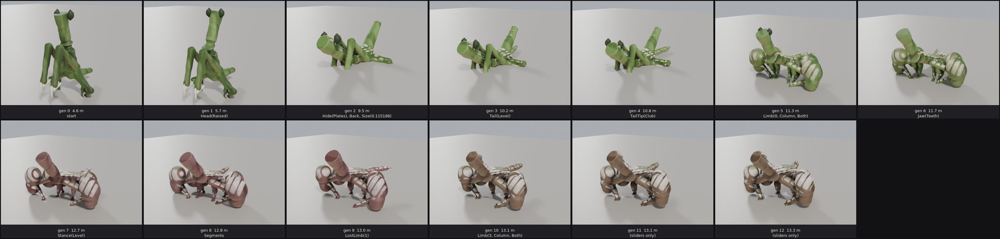
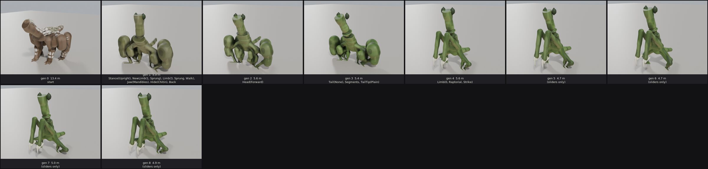

# 0032 — Growing crossbreeds, and how the growing works

*2026-10-24.* The owner: *"bring the growing algorithms over the crossbred
skeletons. Each crossbreed needs to read like a plausible creature ... Show
me a few versions of crossbreed lines over the course of their evolution ...
and explain to me how the growing algorithm works in some detail."*

This note is in three parts: what was built, the lines it produces, and how
the growing works end to end -- written so the places it does and does not
interpolate are visible, since that is where the next work is.

## What was built

- **`game::grown::Anatomy`**: everything the growing reads, and nothing else.
  A skeleton (`Bone`s with rest offsets), parts (boxes) with **the frame each
  box is written in**, legs, a build (the knobs) and a look (the colours).
  `Anatomy::of_species` makes one from a species table; `game::bred::anatomy`
  makes one from a genome. Before this the growing took `&'static Species`
  and read boxes in their bone's frame, which a bred body does not have: its
  boxes run along their own axes (`sim::breed::build::Body::axes`).
- **`game::bred`**: a genome read as the growing's knobs (`build_of`), the
  parts' roles and contours from what the genome says each part *is* (not
  from how its box leans), and its colour blended from the cast's by
  **affinity** -- a soft nearest-neighbour over the genes -- so colour moves
  by degrees down a line.
- **Fixes the bred bodies found**, each true of every body:
  - a foot's size from the part's own thickness, not its world bounds (a
    leaning leg's bounds are its length);
  - a capsule end on bred parts, which meet joint to joint;
  - the field's grid sized to everything in the field, not only the boxes
    (a sinew past every box was cut open -- the "pipes");
  - a part-to-joint sinew placed in the part's own frame, not its bone's
    (the "rods" sticking out of bred wings);
  - feathers laid in a wing part's own plane when its box runs along its
    axis (a bred wing is swept and lifted).
- **Lines**: `game::bred::lines`, written out by `GROWN_LINES=1 cargo test -p
  game --bin game grown_lines` and rendered by `art/blender.sh art/lineage.py`.
- The Ridgeback's art build moved onto the shared builder
  (`art/lib/creature.py`); it builds the same model.

## The lines

Four lines. Three are **fed**: a morph eats the other creature's trophies one
at a time, in the order that creature drops them (`sim::breed::cross::feed`),
each feeding a visible step. One is **backcrossed**: crossed back into the
other parent every generation (`cross::breed`) with the slow rates' mutation.
Each tile is a stage: its generation, its length, and what the feeding
changed (the morph's own account, `sim::breed::morph::changes`; "sliders
only" is a step that moved proportions and no gene).






What they show:

- **Most of a line's change is in its first five steps.** Feeding moves a
  major or a minor nearly every step until the genome is the donor's; after
  that only the sliders creep. Twelve feedings is more than any line needs.
- **The jumps are the discrete genes.** Wings appear the step the fore pair's
  role becomes `Wing`; feathers the step the hide does; the body changes
  pose the step `Flies` turns on (a winged genome is grown with its wings
  spread). Colour and proportions do interpolate.
- **Backcrossing is a cliff**: the first cross takes the stance, the hide,
  the jaw and two limb pairs from the Mantis at once, because `breed` draws
  every major from one parent or the other. One generation in, it is a mantis.
- **A line need not end at its donor.** Feeding blends a limb pair's length
  and girth only while its build matches the donor's, so the Galewing fed
  toward the Mantis keeps its wing's girth on a raptorial fore pair: it ends a
  mantis's plan with arms twice a mantis's thickness.
- **Colour is honest about relatives.** Affinity blends every member of the
  cast, so a stage whose nearest relative is briefly a purple creature goes
  purple (the Galewing's line toward the Mantis, generations 3 and 4).
- **The bred bodies are not the species tables.** The bred Ridgeback is the
  builder's Ridgeback -- upper legs nearly a metre thick and splayed past a
  torso three metres wide -- and the growing follows its boxes faithfully.
  Where a stage looks wrong, it is often the body plan it was handed.

## How the growing works

`game::grown::grow(&Anatomy) -> Grown` is about 1,800 lines with no I/O, run
once per species when the game loads (about 2.5 s for the Ridgeback, under a
second for the Mantis) and once per stage here. Seven steps:

### 1. Lumps: one implicit solid per part

Every part box becomes a **lump**: a signed distance function (negative
inside) in the box's own frame. The box is the *extent*; the **contour** is
the shape inside it (`game::contour`):

- A contour is a point in a **simplex of eight kinds** -- Column, Taper,
  Barrel, Whip, Keel, Wing, Wedge, Stalk -- plus two dials, `fat` and
  `muscle`. Each kind is a **profile** `r(t)` along the part (`t` from the
  joint end to the far end) times a **cross-section** `s(t, θ)` round it
  (bellies, a spine ridge, ribs where the fat is thin, a thickened leading
  edge). The surface radius at `(t, θ)` is `Σ wₖ rₖ(t) · Σ wₖ sₖ(t, θ)`.
  **This is the one place the growing genuinely interpolates**: a contour
  halfway between Column and Taper is a surface halfway between theirs
  (`a_contour_between_two_kinds_is_between_their_surfaces`).
- `roundness` pulls the box's elliptical section toward a circle by kind (a
  tail is round whatever its box; a wing never is).
- **A chain of parts is one contour** (`chain_span`): a tail's three segments
  thinning to one point, a leg's two to one foot. Each part gets the share
  `(from, to)` of its chain's length, so `t` runs continuously across parts.
- The distance is exact across the axis (in the section's own ellipse) and
  bounded along it; past the ends it is a flat cap or, for a bred part, a
  hemisphere of the end's radius.
- Which kind a part is: the species' own word for it (`Build::contours`), or
  the anatomy's (a bred part's, from the genome), or **inferred** from its
  role, bone name and whether it stands (`inferred`).

Lumps are changed before they are contoured by what the build says: a barrel
hangs a `belly` below its box, a leg is `girth` times thicker, a feathered
wing keeps the front 55% of its box as flesh, a beaked head its back half, a
foot ends at its wrist where a paw is grown below.

### 2. The union

The body is the **smooth minimum** of everything, in four tiers:

```
d = smin_k(lumps)          k = blend = median part thickness × 0.55
d -= armour(p)             near the surface only
d = smin_k(d, sinews)      k = blend
d = smin_0.15(d, extras, crests)
d = smin_0.05(d, digits)   toes: tight, so a cleft stays a cleft
```

`smin` is the polynomial smooth minimum: within `k` of each other two
surfaces fillet; further apart they are a plain union. **Sinews** are
capsules along every bone that carries a part, joint to parent joint, and
from every part's middle to its bone's joint: they make the body connected
by construction, whatever gaps the boxes leave. **Extras** are what the
boxes do not say (paws and toes, a club, a jaw, brows, leg muscle);
**crests** are the soft weak points standing out of the skin.

**Armour** is not geometry added on; it is *thickness subtracted from the
distance* (`game::carapace`). Where a part is armoured -- over its top,
further round where a leg hangs from it, down a lower leg's front -- scutes
are 2D cellular (Worley) noise in the part's own (along, round) coordinates;
the height is full over a scute, sunk in the groove between two, domed,
rising toward each scute's back edge (shingled), stepped at the rim, and
parted round every weak point. It is blended across neighbouring parts by
distance so the step from one part's armour to the next is never a cliff.

### 3. Sampling

The field is sampled on a regular grid, `CELLS = 260` cells along the
body's longest side, sized to everything in it plus a margin. Each lump,
sinew and extra carries a bounding box so a sample only evaluates what is
near it. About two million samples for the Ridgeback (260 × 114 × 65).

### 4. One piece

A six-connected flood fill over the inside cells; anything not joined to the
largest component is set outside and counted (`Grown::dropped`). With the
sinews it should be zero; the tests hold the cast's three to that. A stage
of a line is allowed a few cells, which are always a sliver at a thin joint.

### 5. Surface nets

A vertex in every cell the surface crosses, at the mean of the edge
crossings (linear interpolation of the field along each of the cell's twelve
edges); a quad between the four cells round every crossed edge. Normals are
the field's central-difference gradient. This is dual contouring without the
QEF: smooth, watertight, no sharp features -- which is why every crisp edge on
the target (a scute's chamfer, a feather) is either shader detail or a hard
part, never the field.

### 6. Skin

Each vertex is bound to up to four bones: the bones of the lumps near it,
weighted `exp(-(d - d_min) / (0.6 · blend))`, so a joint's skin stretches
between the two bones it joins. Below a wrist or an ankle the lower leg's
weight passes to the paw bone over a band. Hard parts are bound wholly to
one bone.

### 7. Hard parts, paint and detail

- **Hard parts** are explicit meshes, not field: horns, spines, claws and
  quills are ringed tubes along splines (`game::horns`); feathers, scythes'
  edges and wings are cambered vanes. They are placed by rule off the boxes
  -- spines flanking a weak strip, primaries fanning off a wing's last part,
  a beak hooked out of the head's front -- and set onto the body where a ray
  meets the field (sphere tracing).
- **Paint** is per vertex: up to three parts' colours weighted sharply by
  distance, then by region -- skin, stone (armour) or soft flesh, each with its
  own palette (`look::hide`) -- shaded by facing, a band pattern, a crease or
  ridge read off the mesh's curvature, and occlusion read off the field
  itself (how much of the space just outside along the normal is body).
- **Detail at the pixel** (`skin.wgsl`): a grown body has no UVs, so its
  rest-pose position and one number for what it is (stone 0–1, soft 2–3, hard
  −1) ride in its two texture-coordinate sets, and the shader works out
  creases, pebbling, feather cells, chitin sutures, erosion and cracks from
  cellular noise on the rest position, bumping the normal by the screen's
  derivatives and fading anything finer than two pixels.

## Where it does and does not interpolate

Everything continuous in the pipeline is continuous in the sliders. What is
not, from the genome to the screen:

| Stage | What is discrete | What it looks like |
| --- | --- | --- |
| Genome | majors (stance, segments, each pair's role, build, tip) and minors (hide, jaw, crown, tail tip, back) | a part appears or vanishes; a pose changes |
| Body | the builder's topology: bones and parts exist or not | the field gains or loses a lump whole |
| Knobs | `build_of` gates every feature on a gene: feathers iff the hide is feathers, a beak iff the jaw is | feathers, beak, rings, armour pop in on one step |
| Roles | thresholds: a wing is flat below 0.3, a blade longer than 6× its thickness | a part's contour snaps |
| Contours | which kind a part *is* is chosen, though the kinds themselves blend | a limb's shape flips at the step its build does |
| Union | `blend` is the median thickness of all parts: one new part moves every fillet | the whole body softens or sharpens a little |
| Hard parts | counts are `ceil(span / spacing)`; placement by ray-meet | feathers pop in one at a time; a horn hops to another surface |
| Mesh | a fresh surface-nets mesh per stage, its resolution tied to the bounds | no vertex correspondence between stages: nothing to morph between |
| Pose | a winged genome is grown in flight | the stage wings appear, the whole body lifts |
| Colour | -- | **continuous**: blended by affinity |

So the starting point for better interpolation is: the field and the
contours could carry a continuous blend today; the genome, the topology, the
knob gates, the hard parts' counts and the meshing are where the steps are.
