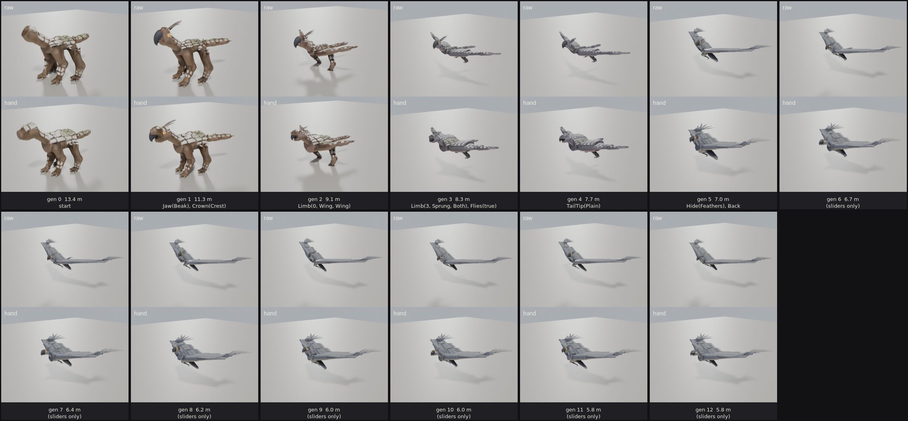
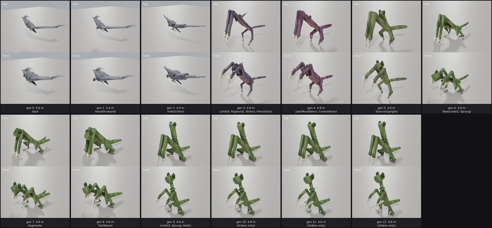
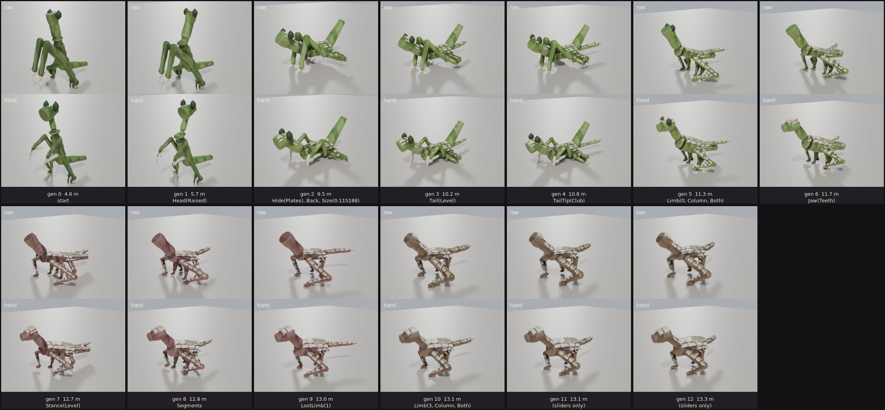
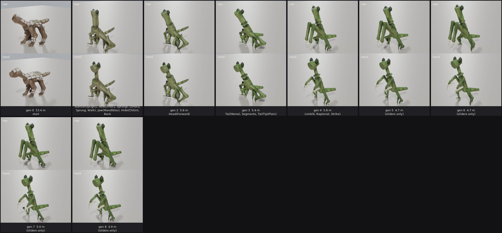
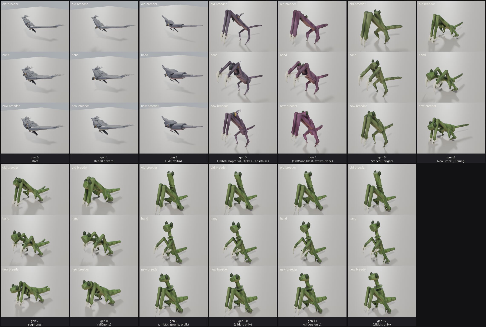
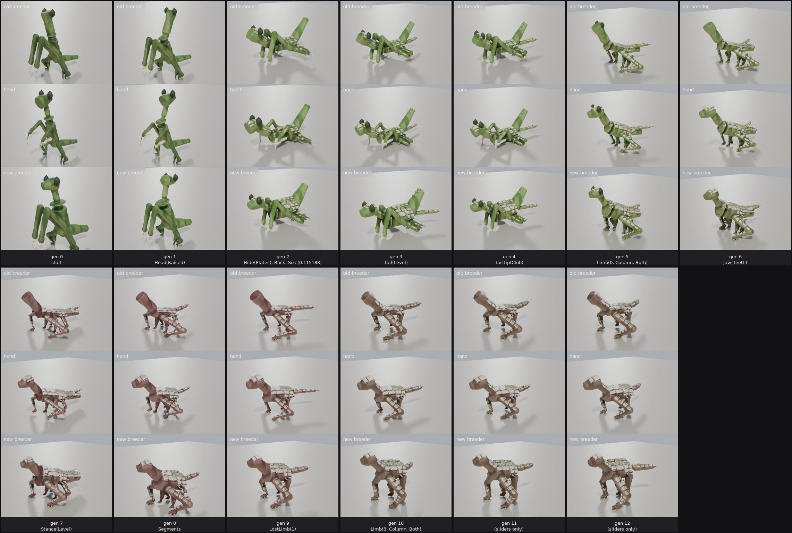
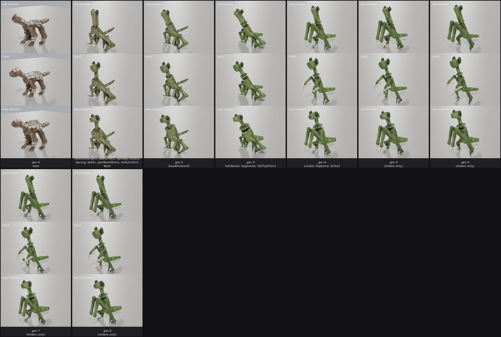

# 0032 — Crossbreeds edited by hand, and the breeder taught from the edits

*2026-10-24.* The owner, after 0031: *"Take each of the intermediate steps,
hand edit them to make each a reasonable creature in its own right. Once
that's done, we need to edit the crossbreeding algorithm to interpolate more
like the hand manipulated versions."*

## The hand edits

A stage of a line is a genome's body as the breeder builds it
(`sim::breed::build`). A hand edit is a short list of operations on that
body, applied before it is grown (`game::touch`):

| Edit | What it does |
| --- | --- |
| `Size(name, along, across, up)` | parts scaled about their own middles |
| `Move(name, x, y, z)` | parts moved, in the body's frame |
| `Aim(name, x, y, z)` | parts turned to a new direction about their joint |
| `Limb(pair, k)` | a limb pair longer or shorter below the hip |
| `Stance(pair, k)` | a pair's hips brought toward the middle line |
| `Fold(pair, upper, lower, foot)` | a pair posed segment by segment |
| `Chord(name, k)` | a flat part (a wing) deeper, its edge at the bone kept |
| `Drop`, `Shape`, `Knobs` | a part gone; a contour of its own; the growing's knobs |

`"torso"` names the torso's boxes; any other name matches parts by their
start (`"hind"` is both hind legs). A grounded body is stood back on the
floor afterwards.

The edits are written as data, not sculpted, so that across every stage they
are a record of what the breeder gets wrong. They turned out to be six
recurring groups (`game::touch::TOUCHES`), every stage of every line taking
one or more:

- **Heavy** (a four-legged Ridgeback-like body): the torso 1.7 times as
  deep and 0.8 as wide; the legs 0.85 as long and as thick, the hind hips
  brought in to 0.6 of the way out and the fore to 0.7; the head turned
  level, nose a little down, and moved ahead of its joint.
- **Flier** (any stage grown with its wings spread): the torso twice as
  deep and 1.3 times as wide; the head level; the wing's chord half as deep
  again; the arm under the wing 0.85 as long.
- **Feathered**: the arm under the feathers shorter again, the torso and
  head larger -- a bird's share of its own span.
- **Scythes** (a raptorial fore pair): the arms 0.6 as long and 0.7 as
  thick, folded at the chest, the head looking forward.
- **Stalk** (stood upright): the neck a stalk half as thick, the head wider
  and looking forward.
- **Stilts** (a level body hung with scythes and spindle legs): a body big
  enough to hang them from.

One fix turned up that was not a stage's but the growing's, and went into
it: the leg muscle the growing adds to a column leg (the deltoid, the thigh,
the calf) was sized off the leg's *world* bounds, which on a leaning bred
leg are mostly its length -- the "pills" 0031 showed on the bred Ridgeback's
upper legs. It is sized off the part's own thickness now (`grown::grow`), and
the raw rows below already have it.

Each tile is the breeder's body as it was before this note (top, "raw")
over the edited one (bottom, "hand"):

`GROWN_LINES=1 cargo test -p game --bin game grown_lines` writes both, the
breeder's as `<line>_<stage>_raw.obj`; `GROWN_STAGES=0,3` grows those stages
alone; `BRED_DUMP=<line>:<stage>` prints a stage's boxes with its edits; and
`art/lineage.py` takes `--yaw` and `--pitch`.

## The breeder taught from the edits

Each group was read as a rule about bodies, not about a stage, and moved to
where the rule belongs. Two places: the breeder (`sim::breed`), where it is
true of the hit boxes and the fight; and the growing (`game::touch::carry_head`),
where it is only how the body is drawn.

| The edit | Where it went | What it is now |
| --- | --- | --- |
| Torso 1.7-2x as deep | `build::proportions` | a standing body is 0.9 as deep as it is wide (was 0.45); a flier 0.6, and 1.2 as wide; a low-slung body stays flat |
| Wing chord 1.5x | `WingLook::chords` | every look's chords half as deep again |
| Wing arm 0.85x (0.72x feathered) | the spread wing in `build` | drawn 5/6 of the limb (3/4 feathered); the limb the posture balances on is unchanged |
| Scythe 0.7x as thick | `proportions` | a raptorial arm's girth 0.7 |
| Neck a stalk, head wider (upright) | `build`'s neck and head | the neck a third of the head's width, the head 1.3 times as wide |
| A changed limb keeps its old girth | `cross::feed` | every shared pair closes on the donor's proportions (a quarter as fast while it is another kind), and a limb that becomes another kind meets the donor's length and girth halfway |
| Head level, ahead of its joint | `game::touch::carry_head` | turned level, nose a little down, half a head forward |

Each tile below is the old breeder (top), the hand edit (middle), and the new
breeder with no edits (bottom):

The heavy bodies and the fliers now come out close to the hand's: a deep
body, a level head, wings with a chord. The Galewing line toward the Mantis
no longer ends with wing-thick arms, because the girth follows the limb's
kind.

### What the fight would not give

The breeder's bodies are the fight's hit boxes, and the cast's tests hold
them to the bestiary's contract. Three edits were tried in the breeder and
taken back out, because the contract broke:

- **The head carried level in the breeder.** The Ridgeback stopped landing a
  hit on somebody standing in front of it (`tests/duel.rs`): its bite and
  charge reach down along the neck's line. So the breeder keeps the head on
  the neck and the growing carries it level -- the one edit that is only how
  a body is drawn.
- **Shorter wings as limbs.** At 0.85 of their length the Galewing could no
  longer balance on its legs and walked on its wings (`tests/breed.rs`). So
  the wing is shorter only as drawn spread.
- **Scythes 0.6 as long.** Shorter, a mantis's parry and wing flare -- and at
  0.8, its pounce and ambush -- wound up alike, and a player could not tell
  which was coming (`tests/motion.rs`). The arm's sweep is how its strikes
  are read. The breeder keeps them long, and they still reach to the floor.

The tail stays as thick as it was (`Proportions::tail_th`) though the body
behind it deepened: a tail sweep is cleared by a jump (`tests/duel.rs`).

## What is left

The edits the breeder does not yet make are the table now
(`game::touch::TOUCHES`), and are what to teach it next:

- **Heavy legs**: 0.85 as long and as thick, the hips brought in. The one
  run that shortened column legs in the breeder also had a bred Ridgeback's
  stomp fall out of its contract (`tests/motion.rs`), and they were put back
  before the cause was pinned down; the hips are where the posture's balance
  puts them.
- **Feathered**: a larger body and head on the same span.
- **Scythes**: shorter, folded at the chest -- above. Of every edit, this is
  the one where the look and the fight want different bodies, and it needs a
  design decision rather than a constant: either the tells read off something
  other than the arm's sweep, or the mantis's arms are long.
- **Stilts**: a level body under scythes and spindle legs is still small.

Still not touched: backcrossing is a cliff (one cross and it is a mantis), and
the bred wing's feathers stand up as a comb.
