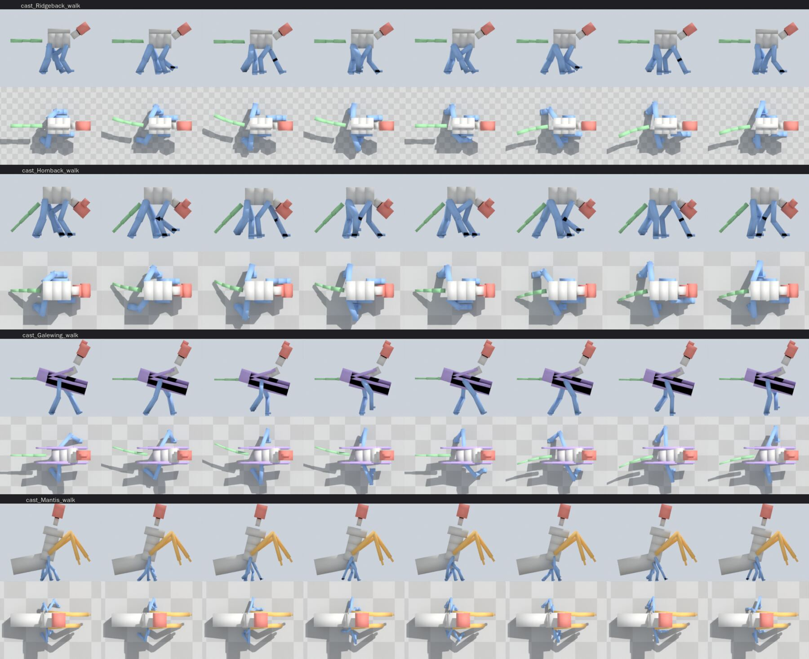
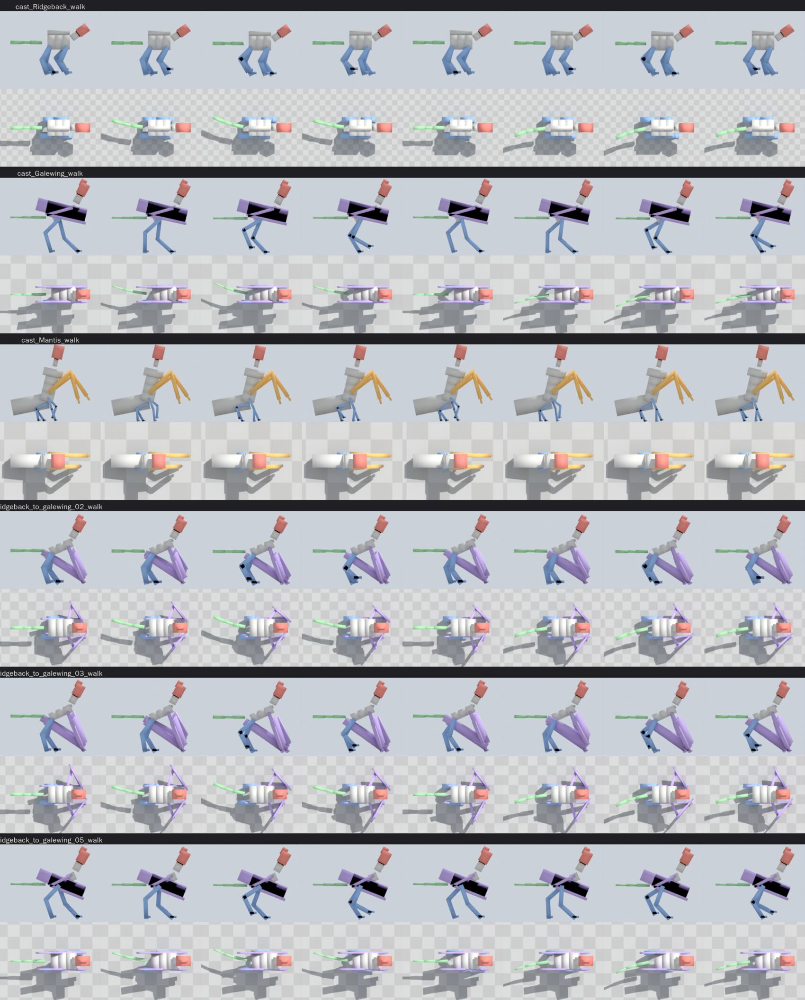
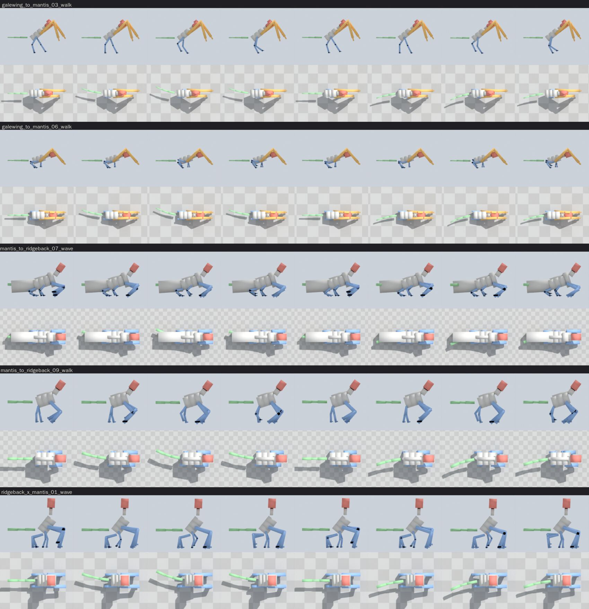
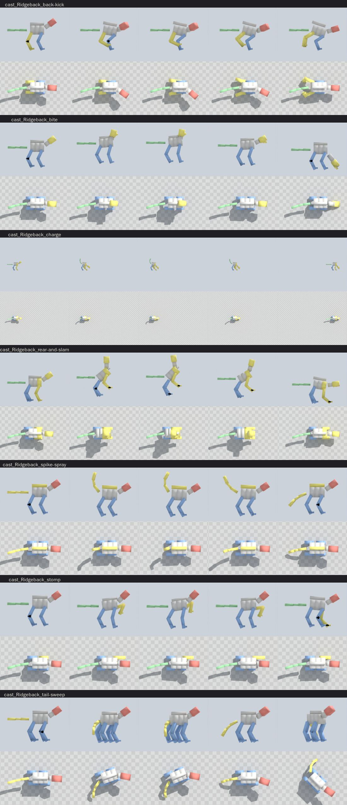
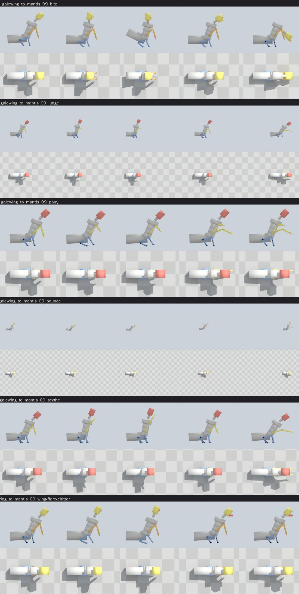
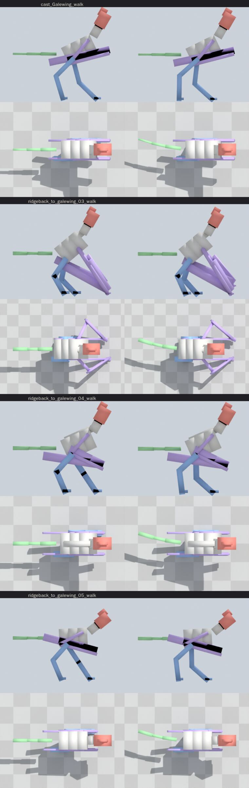
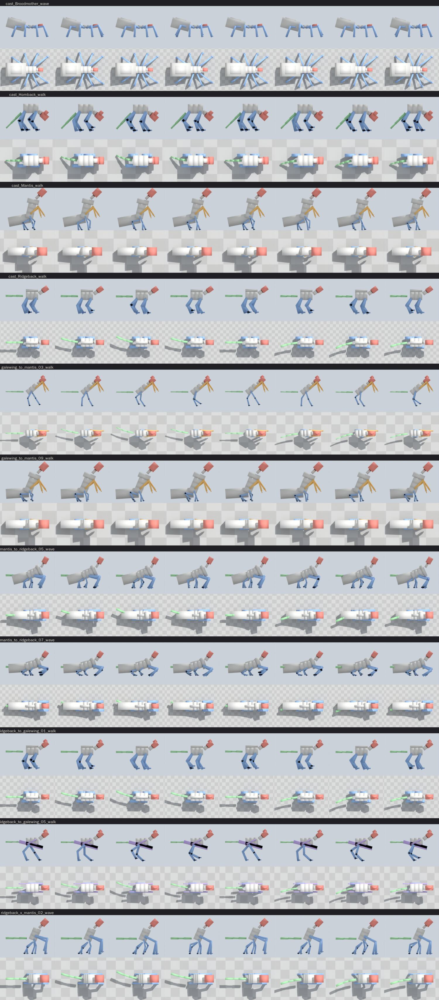
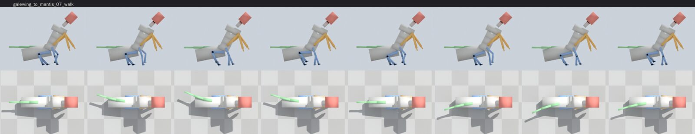
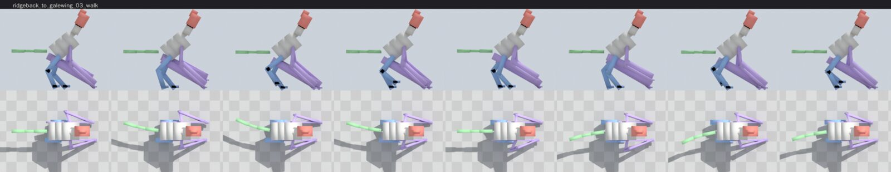

# 0033 — Bodies that can move

*2026-10-26.* The owner, on 0032's hand-edited crossbreeds: *"They don't look
like plausible creatures. The poses are insane, the body plans are jammed
together, and most of them would barely be able to move. Plausible movement
is key, then plausible attack patterns."* And: *"fix it in the sim breeder."*

## What was wrong

0032 judged each stage from one still, and reshaped the skin. Walked
(`BRED_GAIT=<line>:<stage>` or `cast:<Name>`, `art/blender.sh art/gait.py`:
the body's boxes through eight points of its slowest gait, side on over a
top view), the breeder's skeletons could not move -- not the crossbreeds
only, the cast's own genomes too:

- **Legs through each other.** The walk's stride was a leg's reach, up to
  nine tenths of a leg each cycle, on bodies whose fore and hind feet stand
  a leg apart or less: every step swept a fore foot back through the hind
  one.
- **Knees out sideways.** A two-segment leg bent to nine tenths puts its knee
  a fifth of the leg off the line; the fore elbow bent back and the hind
  knee forward, so they met under the belly, and a rule written to step
  colliding legs round each other (`out_of_the_way`) turned the hind knees
  two metres out from the body. Folded wings and held scythes counted as
  obstacles too, and turned every leg under them out.
- **Pairs on one spot.** The balance's last resort clamped each pair to the
  torso's end one at a time, so several pairs could land together.
- **Scythes and wings on the floor**: a folded arm resting its point on the
  ground, a wing held just short of planting with its wrist down there.
- The simulation's own account called all of this balanced: 0.7 to 0.9
  plausible, with a walk and a run.

## The checks

`crates/sim/tests/strides.rs`, `every_body_can_move`: the cast's genomes and
every stage of 0031's four lines, walked through sixteen points of the
slowest gait, measured off the built bones:

- on each side, a pair's foot stays ahead of the next pair's, and no leg
  segment passes within its thickness of another pair's;
- no knee or foot more than a fifth of the leg out to the side of its hip
  (a sprawling build, and a wing walked on, are allowed theirs);
- only feet, shins and the tail on the floor -- and a belly where the body
  rests on it, and a rear that drags;
- the mass over the feet that are down;
- every walking pair travels at least a twelfth of its leg a cycle.

41 of 59 failed when it was written. All pass now.

## What changed in the breeder

- **A stride no longer than the room between feet** (`locomotion::at`, and
  the crawl's): each foot keeps within half the clear ground to the next
  pair's, the same cadence carrying the same speed.
- **Every joint bends back** -- an elbow, and the hock a dog's or bird's
  hind leg shows -- **unless** a pair stands closer than two fifths of its
  leg to the pair behind it, an insect's legs off one short thorax, when it
  leads with its knee (`build::knee_ahead`).
- **Feet apart** (`posture`, `Solver::spread`): neighbouring pairs whose
  feet stand closer than a foot and a step each fan out, the front forward
  and the hind back, as far as the legs reach. Hips spaced at least their
  legs' thickness apart from the start.
- **The pairs move as one** in the balance's last resort.
- **Pitched to its legs**: a level body whose front pair stands taller than
  its hind tips to suit them, within its pitch's limit, instead of folding
  the long pair deep.
- **Out of the way** only of other standing legs, at the stride the gait
  now takes; folded wings and held arms are above the legs, not among them.
- **Clear of the floor**: a held scythe swings forward until its point is a
  tenth of the body's height up; a folded wing's band lies above its bone; a
  leaning wing stays short of the floor until it is planted.

Two moves were found not to reach somebody standing close: the **charge**,
whose head came down only once a big body was past them (it winds up head
down now), and the **gore**, whose toss went over a tall crossbreed's
target (it is aimed at standing height now).

## Carried like an animal

`every_body_is_carried_like_an_animal` asks the standing body two more
things: a level body tilted no more than a hyena's back on four legs (20
degrees) or a standing bird's on two (45), and a neck no steeper than a
horse's (55 degrees; 65 where the genome says the head is raised; an
upright body's head is on top of it, as a mantis's is). Necks went up to
vertical because the head was raised until it cleared the top of the back,
and a body as deep as it is wide put the top of the back high: a head now
rises a little above the spine and no further than a horse's
(`Solver::head`). Bodies stood at sixty degrees because a pitch slider bred
in from an upright body was taken whole by a level one: a level body's pitch
is held to its limit (`level_pitch_most`). `tests/posture.rs`'s "head above
the back" measures the back from the body's real depth now, not from a
depth half its width.

## Wings, scythes and the rest of the body

The owner, after the walks: *"Proceed on all fronts. Attacks, wings, etc. All
plausible at all stages."*

- **A folded wing lies along the body** (`build`, the held wing): the humerus
  back and a little down the flank, the forearm forward along it to a wrist
  at the front of the breast, the hand back along the flank -- in the body's
  own frame. It was placed in the world's, so a body tipped up wore its
  folded wing as a plank across it. Its band is no deeper than two fifths of
  the body (`fold_planes`).
- **A flier is deep through the keel**: as deep as it is wide and more (a
  bird's wing muscles hang from it); a thin one was dwarfed by its wings.
- **Armour is weight a wing must lift** (`plan::flight_margin`): a plated
  beast that has just grown wings does not fly, and so gets no stoop or
  talon pass.
- **Scythes three fifths as long** as a leg of the same share: a crossbreed's
  inherited from a wing reached two thirds of its body. What the arm's sweep
  did for readability the whole body does now (below).
- **A pair too short to reach the floor is held up**, not stood on: a limb
  just budding hung in the air and the weight was over nothing.
- **A toad's head weighs what it is**: a head that is the front of the body
  is built as deep and wide as the body, and was weighed as a small cube; its
  forelegs may stand under it, and the balance keeps the weight a quarter in
  from the ends of the feet (it was a fifth).
- **A body on its belly** rests on its deepest segment, and a paddling leg's
  knee bends up rather than through the floor.

## Attacks a body could make, and reads off its whole body

The owner: *"Attacks should include a whole body indicator for the most part
to keep them readable. An artificial indicator, like a specific bellow, can
be used in edge cases where that's hard."*

- **The whole body winds up** (`strike::gather`). A move whose windup moves
  only a limb, a head or a tail gathers the other way from where its strike
  goes -- drawn back before a lunge, sunk before a blow upward, turned away
  before a sweep -- rocking over feet that stay planted, until the trunk has
  moved a sixteenth of the body's length (`BODY_TELL`). The verdict's
  *legible* now asks for that as well as a silhouette's change
  (`Reading::body`).
- **A cry where it cannot** (`strike::Cry`): a move begun under the floor
  rumbles; a move the body cannot gather for, or two windups the eye cannot
  tell apart, cries -- the body's own voice first (a beak screeches, an
  insect chitters, a plated hide rattles, a maw bellows), each cried move of
  one body a different cry, and two moves that cry differently are not
  alike. 36 of the 379 damaging moves across the cast and the lines cry; the
  rest are told by the body.
- **A windup is stood on** (`strike::steady`): where a held windup puts the
  weight past the feet, the body rocks back over them first. A kick back
  throws the weight onto the forefeet before the hind feet leave the floor,
  and is not given to a body with no other legs to stand on.
- **Nothing through the floor but what strikes** (`strike::settle`): a move
  whose crouch takes a belly, a thigh or a jaw under the ground at any frame
  is lifted, its windup and strike together, and aimed again by what it
  reaches with.
- Moves fixed on the way: a charge's head is at its target height from the
  windup (it passed over somebody close) and high enough that a big jaw does
  not plough the floor; a stomp lifts one forefoot and keeps the other three
  down; a gore is aimed at standing height; an inflating toad swells where it
  stands.

`tests/strides.rs` holds all of it, for the cast and every stage of the
lines: `every_attack_is_one_the_body_could_make` (nothing but what strikes
and the feet into the floor; the weight over the feet through a held windup,
except a leap, a rush or a throw of the whole body) and
`attacks_are_read_off_the_whole_body` (nothing unreadable or alike, and no
more than a fifth told by a cry). `BRED_ATTACK=<line>:<stage>` exports a
stage's moves for `art/gait.py`.

## The rest made plausible

The owner, on the list this section was: *"Make the rest plausible."*

- **The Ridgeback's torso** is two fifths of its length on four legs
  (`build::proportions`; three tenths still on two, where a longer body
  tipped the Galewing onto its wings). That broke a crossbred stage
  (Mantis to Ridgeback, stage 7): its short middle pair capped how high
  the body stood, the long pairs either side folded under it so deep that
  a stride flipped a hind knee forward through the middle leg. **A middle
  pair that holds the body down is held up** (`Solver::hold_up_the_short`):
  where it leaves another pair standing at less than half its length, it
  is carried, and the pairs either side stand the body.
- **The pterosaur stage** (Ridgeback to Galewing, stage 3): a walking
  wing's elbow folds back along the flank and a little out, so the forearm
  comes down and forward to the hand, and the wrist is planted nearer the
  feet. Aimed straight out, the elbows stood up like a spider's.
- **A new leg arrives long enough to stand** (`cross::feed`): a walking
  pair grafted beside legs already standing comes three quarters as long
  as the shortest of them (never longer than the donor's), not half the
  donor's. At half, the Galewing fed toward the Mantis grew a middle pair
  as nubs, held them up, and stood on its hind legs alone for three
  stages; it stands on four now, scythes held up.

## Still not plausible

- A cry is a field on the move; nothing in the game plays or shows it yet,
  because bred bodies do not fight in the game yet. When they do, the cue
  belongs in `crates/sound/src/cue.rs` (a cry is a patch, like any sound).
- The pterosaur stage still plants its hands well ahead of its shoulders:
  its weight is forward (a long neck, big wings) and the hands are what
  catch it.

The hand edits of 0032 are retired (`game::touch::TOUCHES` is empty): they
reshaped boxes on bodies that could not walk.
