# Gallery — the opening, as built

Headless captures of `--hunt warden` (2026-11-03), for
[opening.md](../../opening.md) §5-§6: the way from the cell to the Warden's
keep, the climb up its outside, the spiral inside, and the fight. The first
blockout, superseded, is in [first-blockout/](first-blockout/README.md).

**From the fighter's own camera** ([level-design.md](../../level-design.md),
L10) wherever the fighter is walking: the scripted hunter (`DEMO=1`) walks
the way, and the camera is the fight's, its pitch held level
(`SHOT_PITCH=-0.08`; the demo leaves the mouse at its starting pitch, which
looks at the floor). The climb, the rampart and the spiral are the fight's
camera too, behind a fighter stood there (`SHOT_AT`, `SHOT_FACE`,
`SHOT_YAW`, `SHOT_PITCH`). **The overview alone is a camera placed by hand**
(`SHOT_EYE`), an establishing view, in the plain look (the brushed look's
haze washed it out); the rest are `--pretty`. Desktop renderer under a
software Vulkan driver, 1280 × 760 scaled to 960 wide, the HUD hidden
(`SHOT_BARE=1`). Player one is the Champion.

| | |
| --- | --- |
| 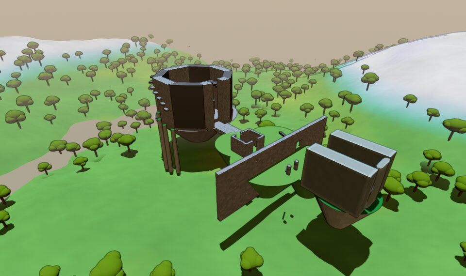 **From above** (placed by hand). The cell and cut between the rock (right), the yard, the ravine and causeway, the keep: twenty-nine metres of wall, the climb's pillars along its south side. | 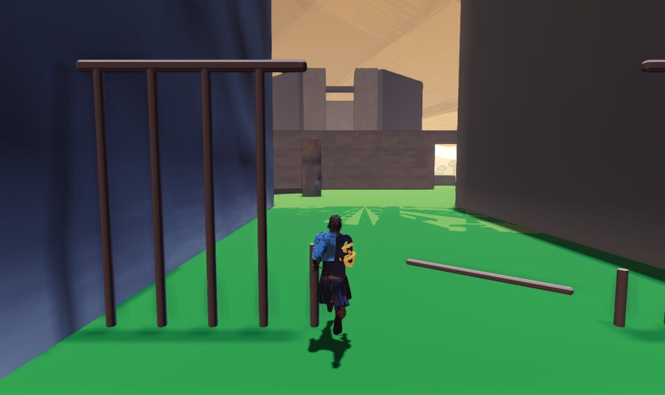 **The cell.** The bars torn out, one on the floor, and the keep already in sight down the cut. |
| 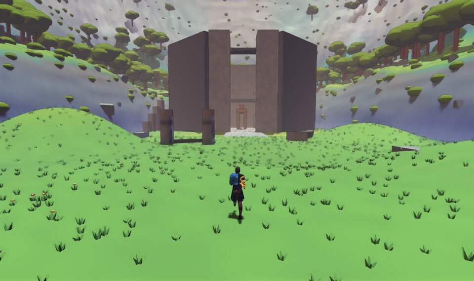 **Out of the cut**: the yard, the arch's posts, and the keep on the far side. | 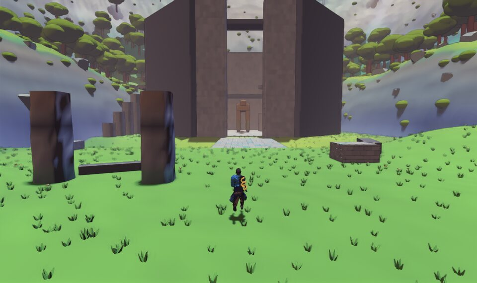 **The yard**, the causeway and the gate ahead; the climb's pillars to the left of the keep. |
| 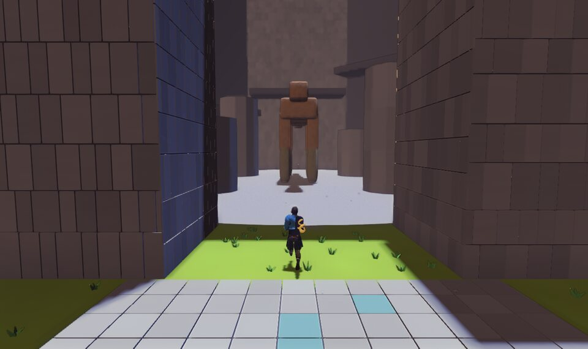 **The gate**, and the Warden asleep in the middle of its floor. | 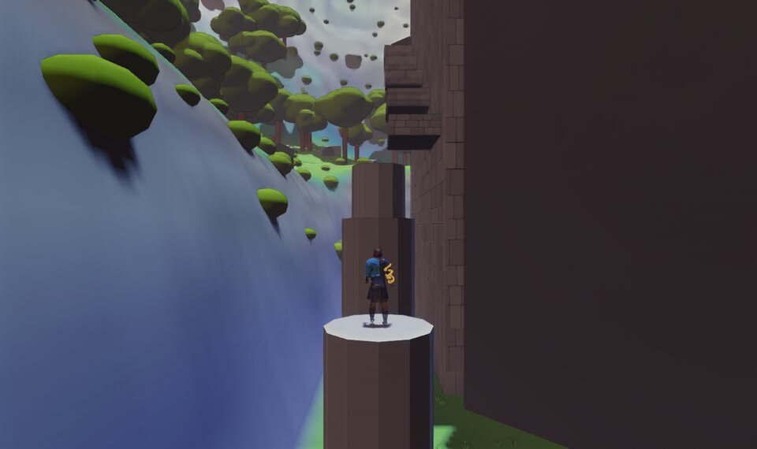 **The climb**: on the second of its four pillars, the wall's ledges above. |
| 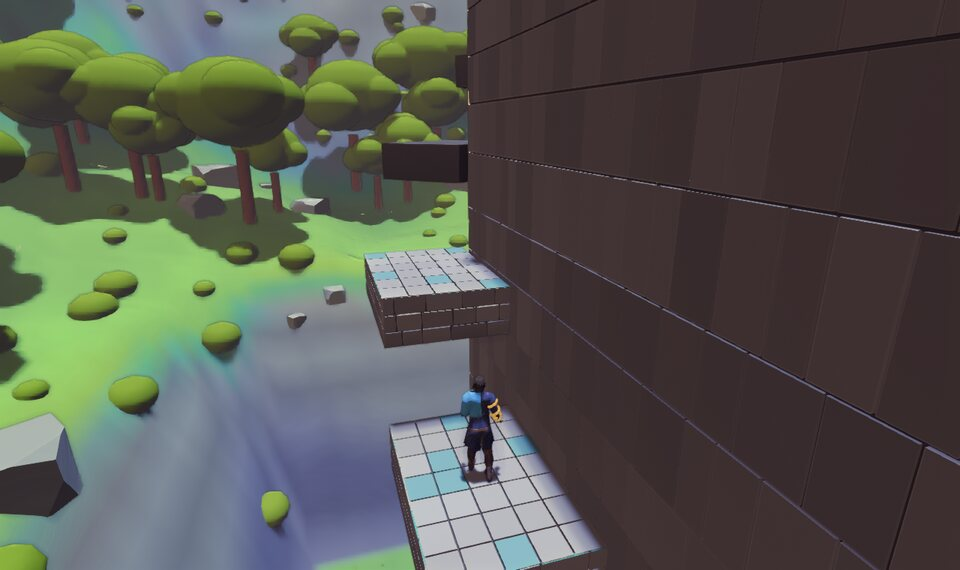 **Up the outside face**, twenty metres over the yard. | 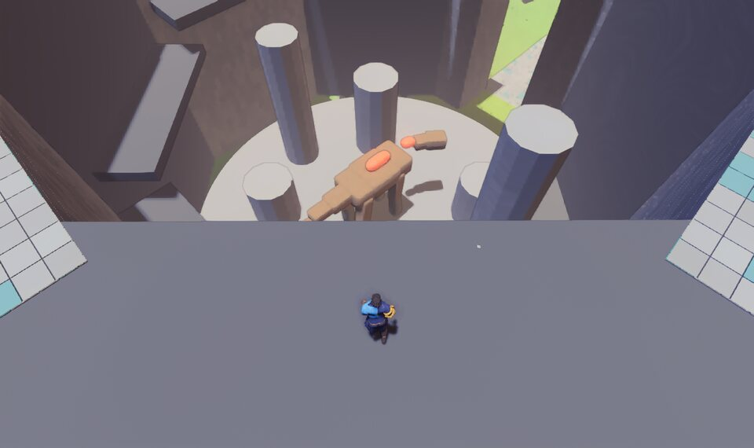 **The rampart**, twenty-nine metres up: the Warden asleep below, the soft place on its neck. Hit it from here and it goes over. |
| 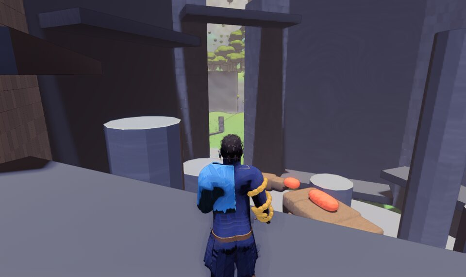 **The spiral inside**, partway up: a ledge on every face, the piers and columns below. | 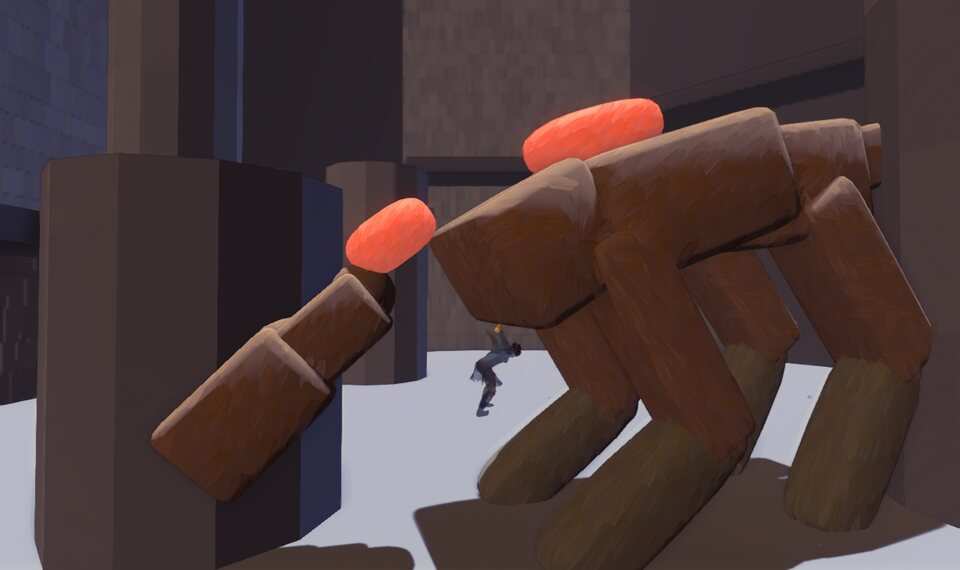 **The fight**: the hunter at its feet, the floor's way. |
| 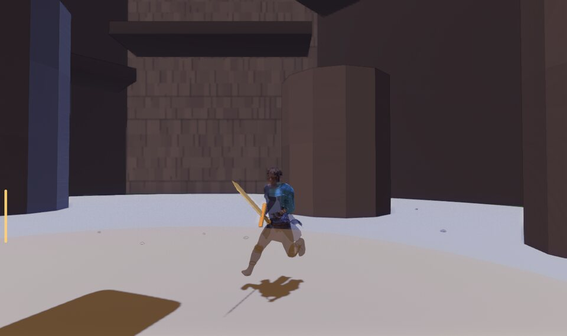 **The fight**, later: the hunter on the floor of the keep. | |

## How each was taken

All with `GAME_ARGS="--hunt warden --p1 champion --pretty"` (00 without
`--pretty`) and `SHOT_BARE=1`:

| Shot | Environment |
| --- | --- |
| 00 | `SHOT_FRAME=5 SHOT_EYE=-10,95,-80,85,0,0` |
| 01 | `DEMO=1 SHOT_FRAME=30 SHOT_PITCH=-0.08` |
| 02 | `DEMO=1 SHOT_FRAME=260 SHOT_PITCH=-0.08` |
| 03 | `DEMO=1 SHOT_FRAME=450 SHOT_PITCH=-0.08` |
| 04 | `DEMO=1 SHOT_FRAME=830 SHOT_PITCH=-0.08` |
| 05 | `SHOT_FRAME=5 SHOT_AT=90.75,-29,7 SHOT_FACE=0 SHOT_YAW=0 SHOT_PITCH=0.0` |
| 06 | `SHOT_FRAME=5 SHOT_AT=115,-27.25,22 SHOT_FACE=0 SHOT_YAW=0.3 SHOT_PITCH=-0.3` |
| 07 | `SHOT_FRAME=5 SHOT_AT=126.3,-16.3,31 SHOT_FACE=135 SHOT_YAW=2.36 SHOT_PITCH=-1.0` |
| 08 | `SHOT_FRAME=5 SHOT_AT=122.5,12.5,17.5 SHOT_FACE=200 SHOT_YAW=3.5 SHOT_PITCH=-0.25` |
| 09 | `DEMO=1 SHOT_FRAME=1300 SHOT_PITCH=0.02` |
| 10 | `DEMO=1 SHOT_FRAME=1700 SHOT_PITCH=0.02` |

## What the pictures do not show

- **The Warden moves like a big Ridgeback**: its body and its motion are
  the Ridgeback's, at 1.5 times the size, until it has clips of its own
  (opening.md, OPENING-12).
- **The fight from above**: the scripted hunter fights from the floor and
  never climbs, so no capture here is of the dive or of a toppled Warden.
