# Gallery — the opening, blocked out

Headless captures of `--arena warden` (2026-10-29), for
[opening.md](../../opening.md): the walk up to the first fight and the fight
itself, with fighters stood where each beat puts them. **A blockout**: the
tower is boxes, the Warden is boxes nothing collides with, posed rather than
alive, and every size is a first guess. They are here to judge how it
*looks*, since that is most of how it will feel.

Under `--pretty` (the brushed world and the painted cast) but for the
overview, which is the plain look (its haze washed the shaft out); the desktop
renderer under a software Vulkan driver, 1280 × 760 scaled to 960 wide, the
HUD hidden. Player one is the Champion; player two, where there is one, is
the Elementalist. The camera is placed by hand (`SHOT_EYE`), not the
fight's: a fighter's own camera turned up at something fourteen metres tall
walks into their head.

| | |
| --- | --- |
| 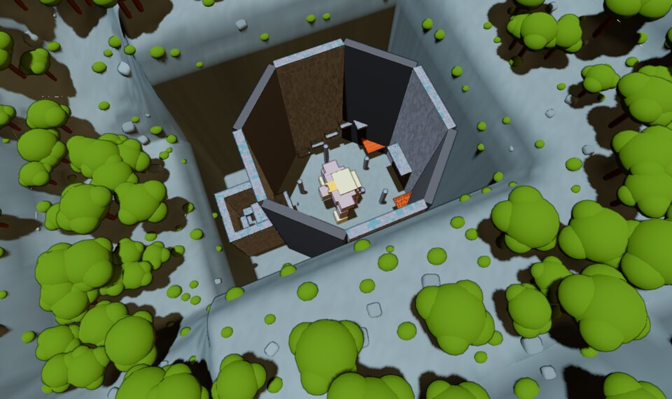 **The tower from above.** The shaft, forty metres across and forty-five deep, the Warden on its floor; the well beside it (lower left), twenty-two deep, the cell at its bottom. | 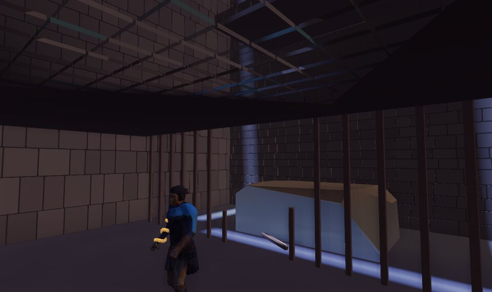 **The cell.** The roof broken over the well, the bars torn out in the middle, one lying on the floor, and what fell through the roof to climb on. |
| 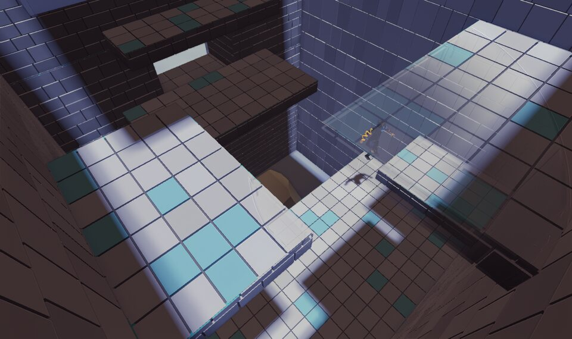 **The climb.** Up the well, a jump and a catch at a time: the cell's roof, a ledge on each wall, the window ledge, the door's landing. | 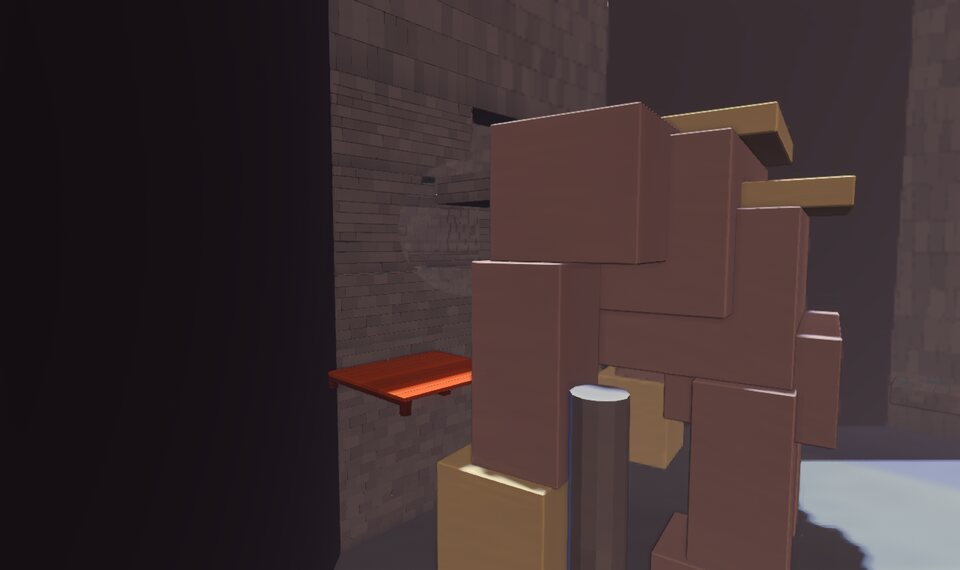 **The window.** Seven metres up the well, a window into the shaft, and the Warden's shoulder right outside it. |
| 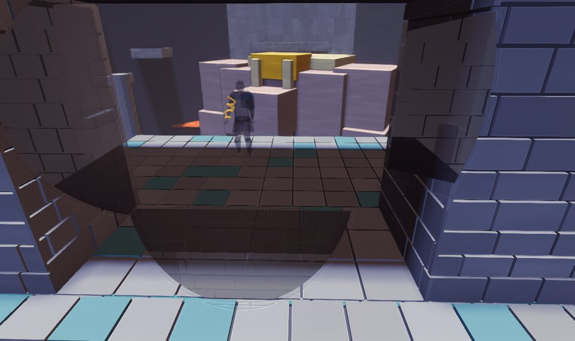 **The first meeting.** Out of the door onto the gallery, thirteen metres up, and it is below you. | 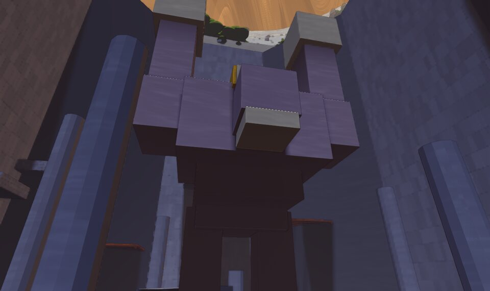 **On its floor.** Standing in front of it as it raises both fists. The cards stacked against you. |
| 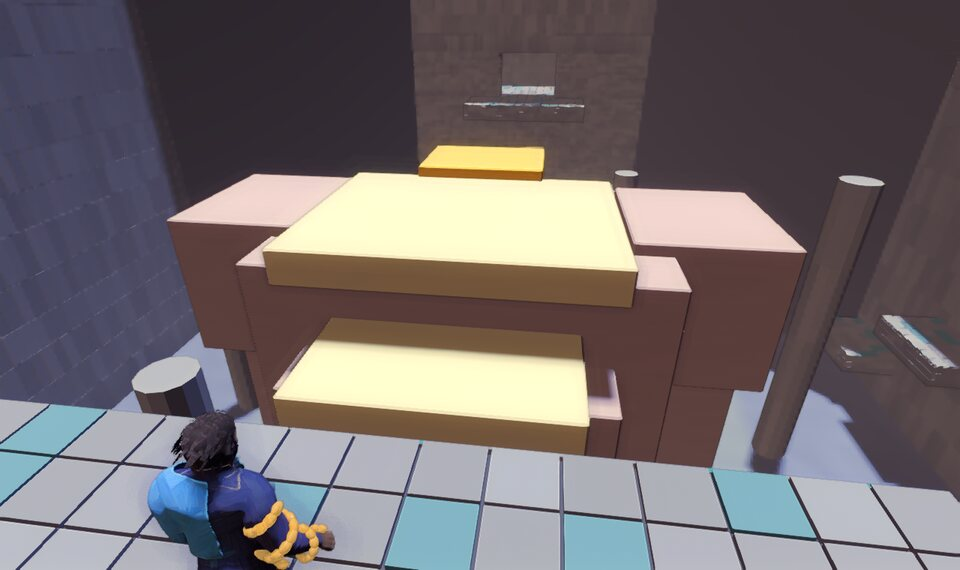 **The return ledge.** Fifteen metres up the west wall, over its back; the soft place (orange) at its nape, between the plates and the head. | 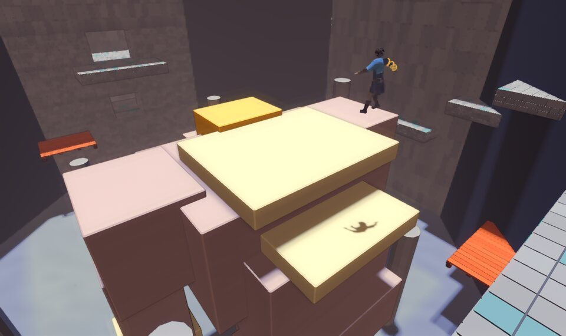 **The dive.** Off the ledge, over its back, onto the soft place. |
| 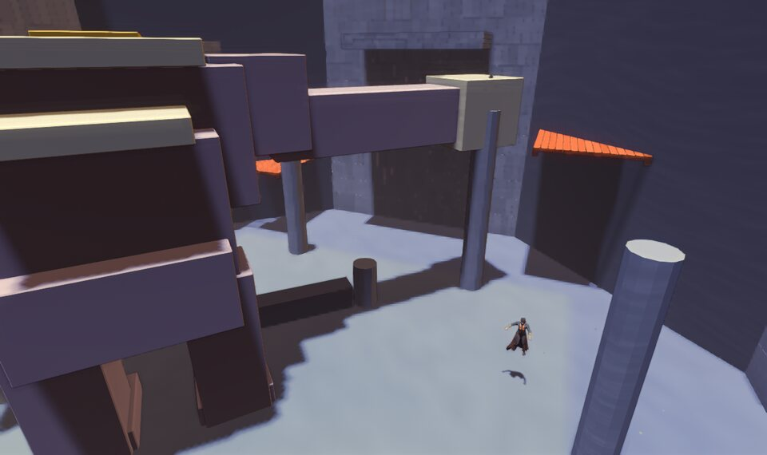 **It swats the perch.** Player one on a column eleven metres up, its arm sweeping across at them; player two in the air on the floor below. | 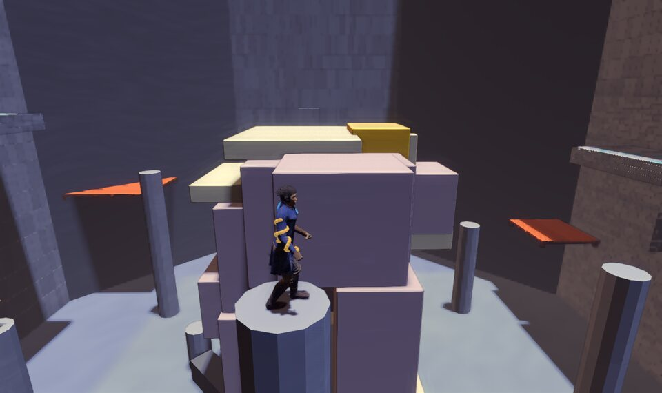 **From a perch.** Thirteen metres up a column, level with its back: the next jump. |
| 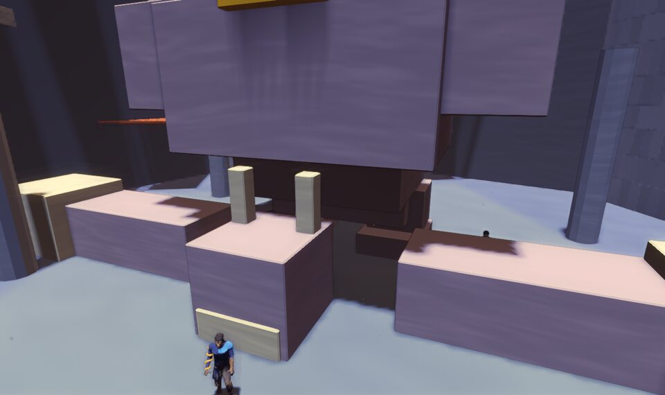 **Felled.** Its head on the floor, and the two of them at it. | |

## How each was taken

Every capture is `--arena warden --p1 champion --p2 elementalist --pretty`
(00 without `--pretty`)
with `DEMO=0`, `SHOT_FRAME=5` and `SHOT_BARE=1`, and these. Positions are
metres; `SHOT_FACE` is degrees round from `+x` toward `+z`;
`SHOT_WARDEN=x,z,yaw,pose`. A third number in `SHOT_AT` is the height to look
down from, for a spot under a roof or a landing.

| Shot | Environment |
| --- | --- |
| 00 | `SHOT_AT=14,3 SHOT_AT2=12,-4 SHOT_FACE=180,170 SHOT_EYE=16,112,-34,2,0,0` |
| 01 | `SHOT_AT=29.2,-0.8,2 SHOT_AT2=-18,-17 SHOT_FACE=165 SHOT_EYE=31.6,2.1,-3.9,25,2.6,1.5` |
| 02 | `SHOT_AT=27.5,-3.4,5.4 SHOT_FALL=1 SHOT_AT2=-18,-17 SHOT_FACE=90 SHOT_EYE=31.3,14,4.2,25.5,4.5,-1` |
| 03 | `SHOT_AT=23.0,0.9,10 SHOT_AT2=-18,-17 SHOT_FACE=180 SHOT_WARDEN=13.0,1.5,-10,stand SHOT_EYE=5,10.5,-17,21.5,8.6,0` |
| 04 | `SHOT_AT=17.6,0.6 SHOT_AT2=-18,-17 SHOT_FACE=180 SHOT_WARDEN=-1,-1,25,stand SHOT_EYE=24.5,15.6,-0.6,0,5,0` |
| 05 | `SHOT_AT=14,2 SHOT_AT2=-18,-17 SHOT_FACE=180 SHOT_WARDEN=2,0,0,slam SHOT_EYE=19.5,2.0,3.6,2,11,0` |
| 06 | `SHOT_AT=-18.4,0.5 SHOT_AT2=-18,-17 SHOT_FACE=0 SHOT_WARDEN=-8,0,0,stand SHOT_EYE=-19.7,18.2,1.8,-6,11,0` |
| 07 | `SHOT_AT=-12,0.5,16.5 SHOT_FALL=1 SHOT_AT2=-18,-17 SHOT_FACE=0 SHOT_WARDEN=-8,0,0,stand SHOT_EYE=-17,19.5,-7,-7,12,1` |
| 08 | `SHOT_AT=-11.26,-6.5 SHOT_AT2=-4,-10,1.6 SHOT_FALL=2 SHOT_FACE=45,90 SHOT_WARDEN=2,5,131,swat SHOT_EYE=12,14,-10,-5,6,-3` |
| 09 | `SHOT_AT=0,13 SHOT_AT2=-11.26,6.5 SHOT_FACE=-90,-30 SHOT_WARDEN=0,0,0,stand SHOT_EYE=0.6,15.9,17.6,1,11,0` |
| 10 | `SHOT_AT=7.6,3.6 SHOT_AT2=2.5,-6 SHOT_FACE=200,120 SHOT_WARDEN=0,0,30,down SHOT_EYE=15,7,2,1,3,0` |

## What the pictures do not show

- **Anything moving.** The Warden is a pose. Whether its moves read, and
  whether the perches it breaks change the fight, needs it built.
- **The see-through patches** round a fighter (02, 03, 04) are the game
  keeping a small box between its camera and its fighter from hiding them
  (`game::window`): with the camera placed by hand they fall where the
  fight's camera would not put them.
- **The land round the tower** is the arena's rim, which grows the valley's
  woods: the tower should be cut into bare cliff, and is not yet.
