# Gallery — the opening, as built

Headless captures of `--hunt warden` (2026-11-04, the floating island, its walls raised to barriers), for
[opening.md](../../opening.md) §5-§6: the way from the cell to the Warden's
keep, the climb up its outside, the spiral inside, and the fight. The first
blockout, superseded, is in [first-blockout/](first-blockout/README.md).

**From the fighter's own camera** ([level-design.md](../../level-design.md),
L10) wherever the fighter is walking: the scripted hunter (`DEMO=1`) walks
the way, and the camera is the fight's, its pitch held level
(`SHOT_PITCH=-0.08`; the demo leaves the mouse at its starting pitch, which
looks at the floor). The climb, the rampart and the spiral are the fight's
camera too, behind a fighter stood there (`SHOT_AT`, `SHOT_FACE`,
`SHOT_YAW`, `SHOT_PITCH`). **The overview alone is a camera placed by hand**
(`SHOT_EYE`), an establishing view, in the plain look (the brushed look's
haze washed it out); the rest are `--pretty`. Desktop renderer under a
software Vulkan driver, 1280 × 760 scaled to 960 wide, the HUD hidden
(`SHOT_BARE=1`). Player one is the Champion.

| | |
| --- | --- |
|  **From above** (placed by hand). The floating island: rock masses narrowing beneath, the cell and cut between rock (right), the yard with its curtain wall and chapel, the gap and the causeway, the keep and its climb's pillars rising from the ground below. |  **The cell.** The bars torn out, the keep already in sight down the cut. |
| 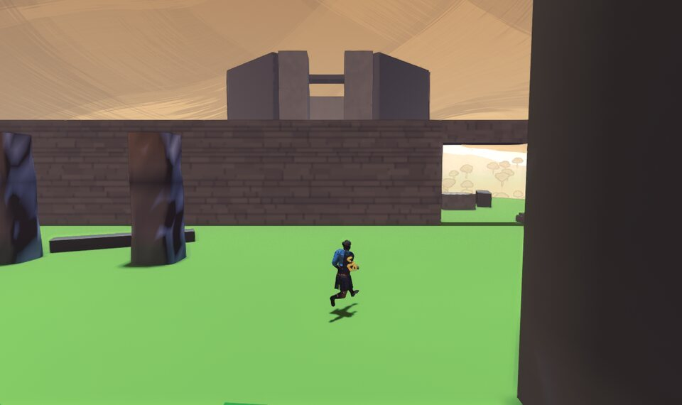 **The curtain wall** across the yard, twelve metres, from the drop to the drop: the only way past it is the gap off to the north. | 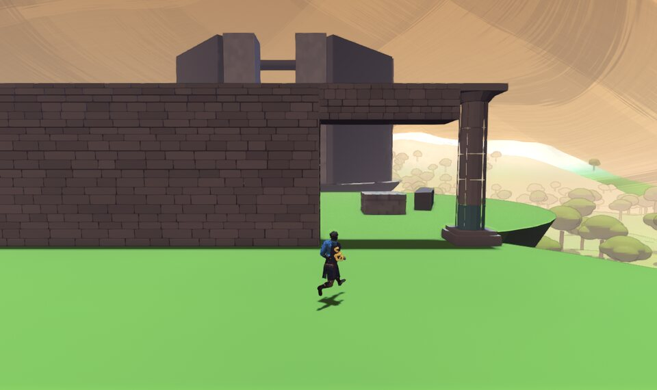 **Through the gap**, against the island's edge: the drop to the right, the keep framed ahead. |
| 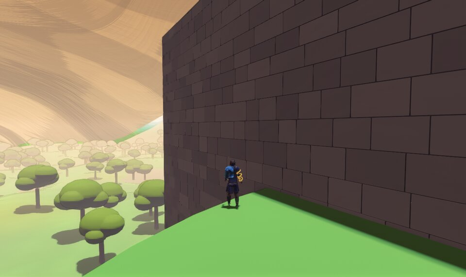 **The curtain wall's end**, at the island's southern edge: it runs on out over the drop. There is no way round. | 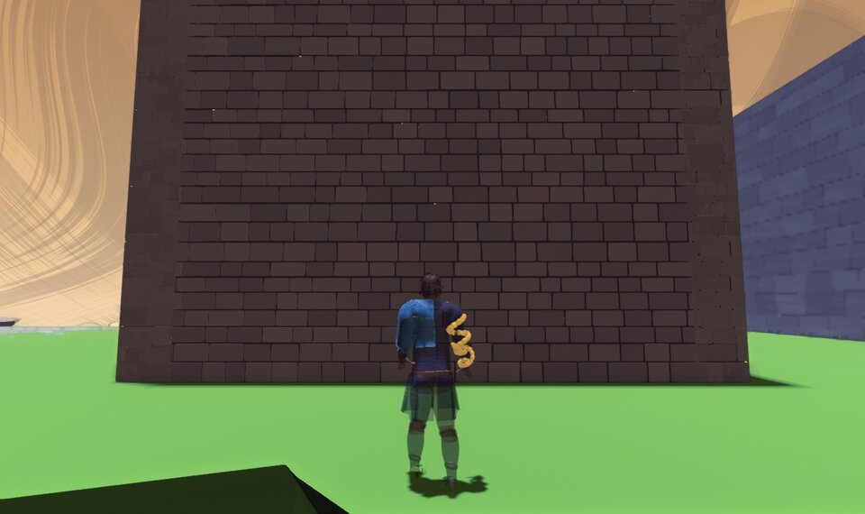 **A chapel wall** from outside: nine metres, nothing to catch. |
| 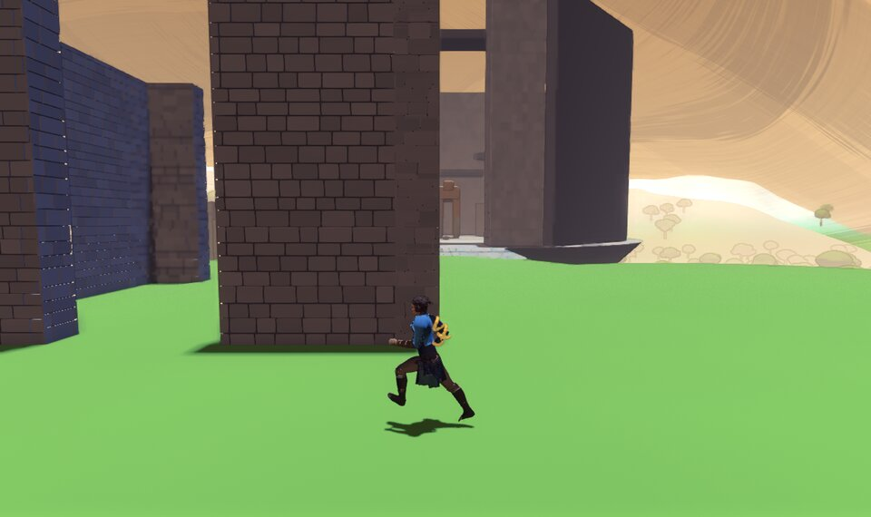 **The chapel**, roofless, nine metres to its walls' tops: in at one door, out at the other, the keep hidden in between -- or round it, never over. | 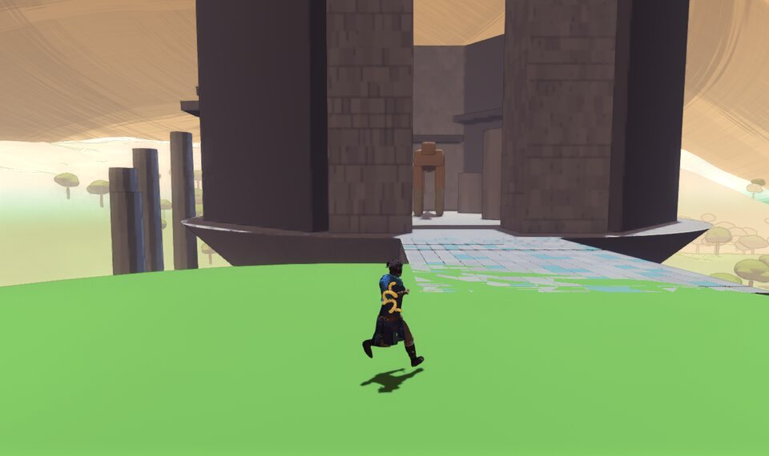 **The causeway** to the keep's island, its gate open, the Warden asleep inside. |
| 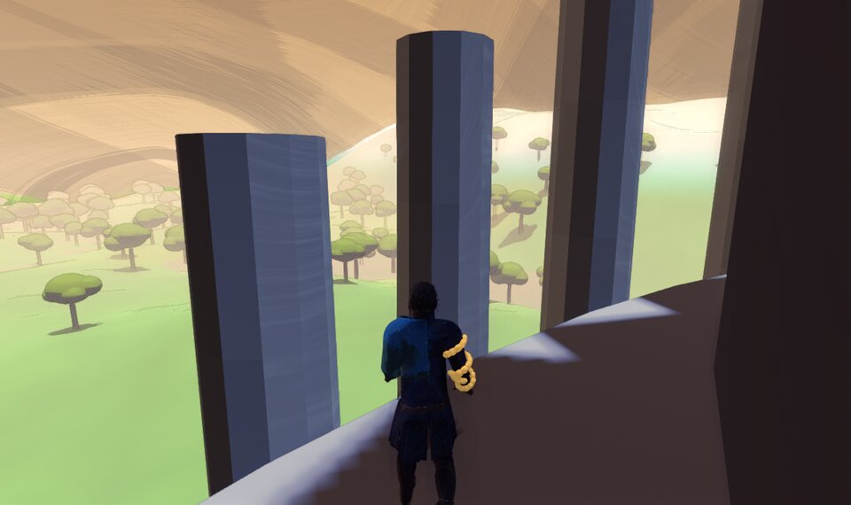 **The foot of the climb**, on the keep's lip: the pillars rising out of the drop. | 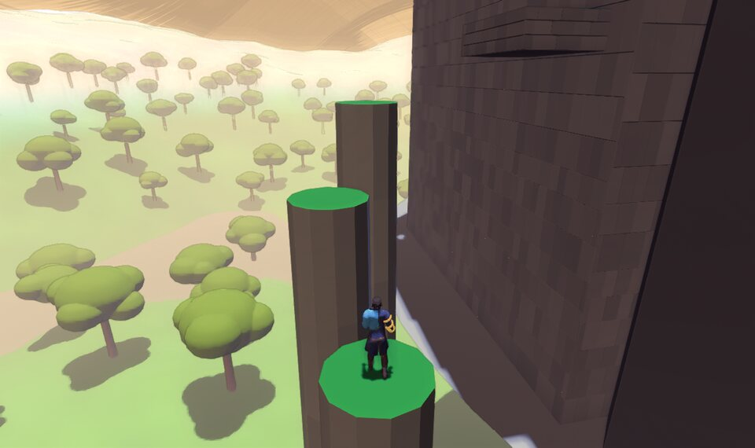 **On the pillars**, over the drop: miss one and you are off the island. |
| 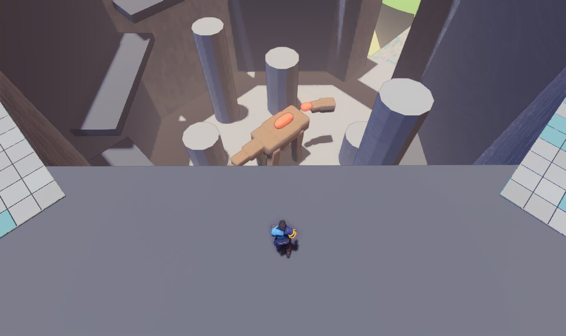 **The rampart**, twenty-nine metres up the keep: the Warden below, the soft place on its neck. Hit it from here and it goes over. | 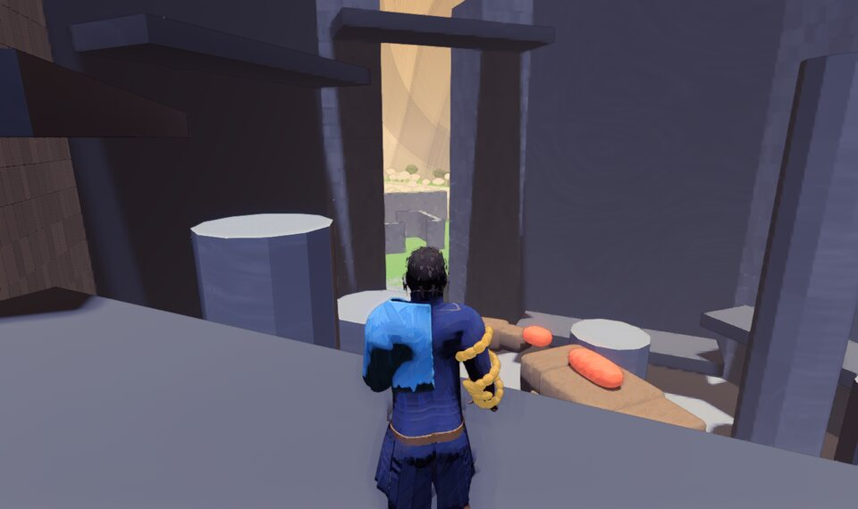 **The spiral inside**, partway up. |
| 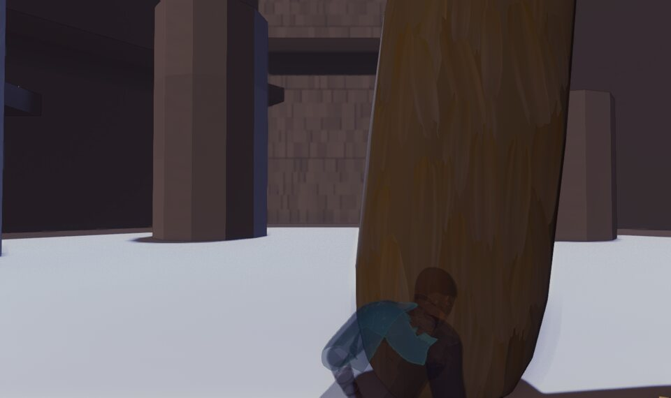 **The fight**: the hunter at its feet, the floor's way. | |

## How each was taken

All with `GAME_ARGS="--hunt warden --p1 champion --pretty"` (00 without
`--pretty`) and `SHOT_BARE=1`. Heights in `SHOT_AT` are the world's: the
island's top is thirty metres up.

| Shot | Environment |
| --- | --- |
| 00 | `SHOT_FRAME=5 SHOT_EYE=-35,105,-95,70,25,0` |
| 01 | `DEMO=1 SHOT_FRAME=30 SHOT_PITCH=-0.08` |
| 02 | `DEMO=1 SHOT_FRAME=230 SHOT_PITCH=-0.08` |
| 03 | `DEMO=1 SHOT_FRAME=330 SHOT_PITCH=-0.08` |
| 04 | `DEMO=1 SHOT_FRAME=560 SHOT_PITCH=-0.08` |
| 02b | `SHOT_FRAME=5 SHOT_AT=26,-27,30 SHOT_FACE=-60 SHOT_YAW=-1.0 SHOT_PITCH=-0.05` |
| 04b | `SHOT_FRAME=5 SHOT_AT=48,-21,30 SHOT_FACE=90 SHOT_YAW=1.57 SHOT_PITCH=0.1` |
| 05 | `DEMO=1 SHOT_FRAME=820 SHOT_PITCH=-0.08` |
| 06 | `SHOT_FRAME=5 SHOT_AT=94.5,-24,32 SHOT_FACE=-90 SHOT_YAW=-1.3 SHOT_PITCH=-0.2` |
| 07 | `SHOT_FRAME=5 SHOT_AT=97.5,-33,37 SHOT_FACE=0 SHOT_YAW=0.2 SHOT_PITCH=-0.35` |
| 08 | `SHOT_FRAME=5 SHOT_AT=126.3,-16.3,61 SHOT_FACE=135 SHOT_YAW=2.36 SHOT_PITCH=-1.0` |
| 09 | `SHOT_FRAME=5 SHOT_AT=122.5,12.5,47.5 SHOT_FACE=200 SHOT_YAW=3.5 SHOT_PITCH=-0.25` |
| 10 | `DEMO=1 SHOT_FRAME=1500 SHOT_PITCH=0.02` |

## What the pictures do not show

- **The Warden moves like a big Ridgeback**: its body and its motion are
  the Ridgeback's, at 1.5 times the size, until it has clips of its own
  (opening.md, OPENING-12).
- **The fight from above**: the scripted hunter climbs onto its back but
  never up the keep, so no capture here is of the dive from the rampart or
  of the topple it opens with.
