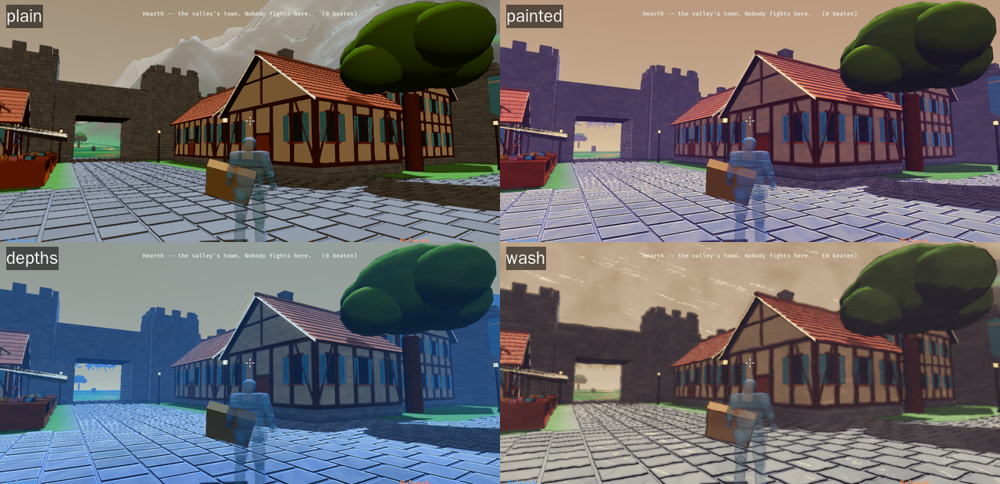
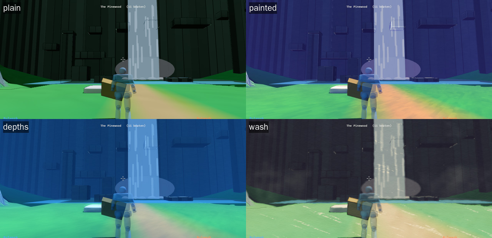
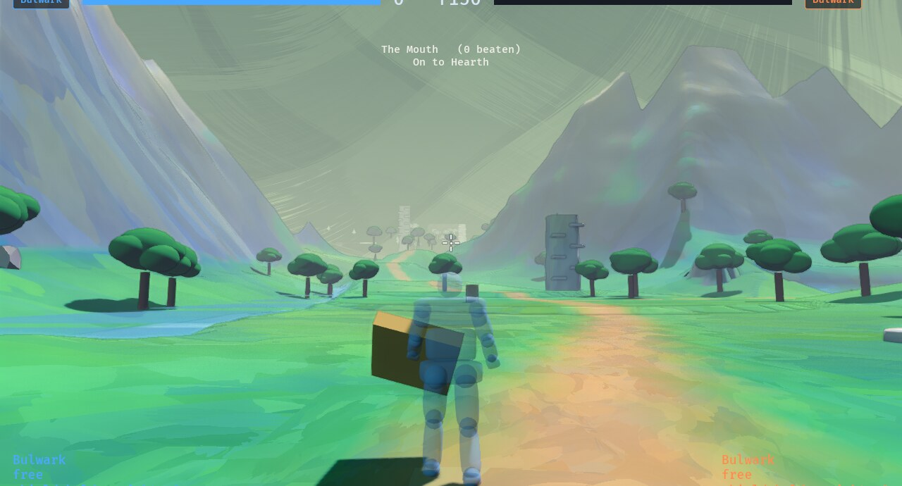
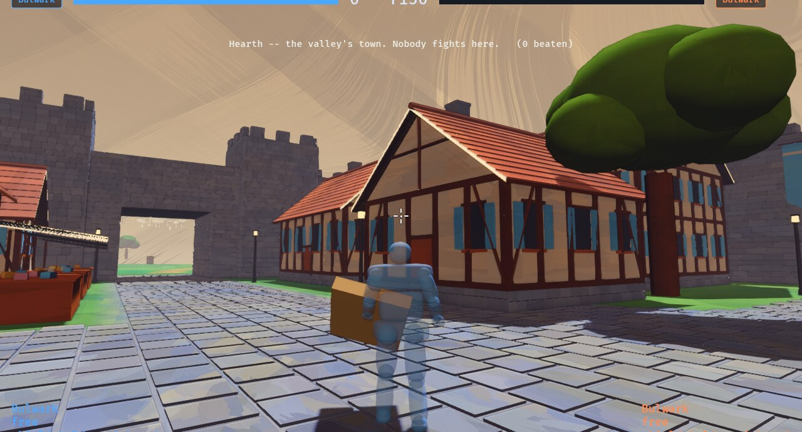
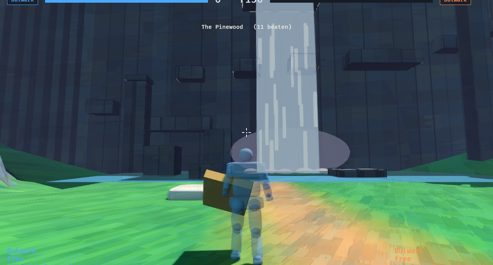

# Painting -- how the picture is laid down

[forms.md](forms.md) decided what a thing *is* (masonry, a dyke, a log, a
rock). This decides how it is **painted**: how its light turns to shade, what
colour the shade is, how thick and what colour the air is, which edges catch
the light, and whether there is paper under it all.

The owner's brief (2026-10-14): *a watercolored, almost brushed look at colour
gradients; something that would ship in a high-budget indie game.* Then two
references, which moved the target away from literal paint-on-paper:

- a painted 3D town at dusk (chunky faceted stones with pale tops, soft
  hand-painted gradients on every face, violet shade, warm and teal lights,
  a coloured haze the distance sinks into, dark foreground rocks), and
- a flat-layered 2D scene in one hue (silhouettes, layers separated by air,
  shafts of light), and then
- **Guild Wars 2's concept art**, which is the one the owner named outright:
  *broad brushstrokes amid more classic 3D character art ... made to work
  better in 3D and in motion.* Broad flat-brush strokes, hard-sided, each its
  own colour; dry-brush ends breaking into bristles and bare paper; the
  subject crisp inside it.

## Where it lives

| Half | File | Space | What |
| --- | --- | --- | --- |
| The numbers | `look::wash` | -- | every treatment, as one table of knobs (`Wash`), `--look <name>` picks one |
| On the surface | `game/src/paint.wgsl` | world | the light in a few soft tones with a brushed border; violet shade, warm light; brush **dabs** laid in rows on every face; pigment wandering over metres; tops paler; dilution |
| In the air | `game/src/wash.wgsl` `brush` | screen + depth | the painted-surface filter (anisotropic Kuwahara); corners shaded; **edges caught and creases darkened** (from the depth); near things darkened; height haze in the sky's own colour; glow; sun shafts; the grade |
| On the paper | `game/src/wash.wgsl` `paper` | screen | the watercolour looks only: paper distortion, granulation, dry brush, paper relief |
| Broad strokes | `look::strokes` (what a stroke is, drawn as tiling sheets: four rigidities by six angles), `game/build.rs` (bakes them into a PNG in the binary), `game/src/paint.wgsl` `strokes`, `broad_strokes` (reads them: four texels a pixel); `wash.wgsl` `broad` | world; sky directions | flat-brush strokes fixed to every surface and kept a constant size on screen; the sky's strokes on its own directions. The dry-brush frame (`framed`) is off |
| Stones | `game/src/shapes.rs` `cut_rock` | mesh | a rock as its box with corners sliced off by planes: flat facets, still inside the box |

The surface half is handed to `paint.wgsl` as shader defs (thousandths), chosen
once per run. The air and paper halves are a uniform on the camera, with the
camera's height, axes and lens and the sun's place on screen kept current by
`wash::follow`.

**Both passes read the depth prepass the outline asks for**, so on the browser
build (WebGL2 cannot sample depth) only the surface half is drawn -- the
strokes, their direction, the contour colour -- and none of the air.

## Brushwork that holds still

A brush laid over the screen -- the obvious way to paint a picture -- swims:
the strokes stay put while the world slides under them (the "shower door").
GW2's look in motion needs the opposite, so each kind of stroke is fixed to
what it paints:

- **On a surface**, the strokes are in world space, so they move with the
  wall. A stroke a fixed number of metres long would shrink to a pixel in the
  distance, which is backwards for painting (the distance is where the
  strokes are broadest), so the length is chosen from the distance in powers
  of two and the two nearest are cross-faded. A stroke stays about the same
  size on screen at any range, and changes scale by fading rather than
  popping. The idea is Bénard et al., *Dynamic 2D Patterns for Shading 3D
  Scenes* (2010).
- **In the sky**, the strokes are laid on the sky's own directions (azimuth
  and elevation from the camera's axes), so they turn with the world.
- **The frame** is the one thing that belongs to the screen, so it is laid on
  the screen.
- **Crisp near, painted far**: the brush filter's radius grows with distance
  (`crisp`, `painted_from`), so the fighters and the ground they are on stay
  3D and the brushwork lives behind them.

## Which way, and how freely (2026-10-15)

On the owner's word: *strokes on the path should follow the path, strokes on
a hill should point uphill; exactly parallel and uniform is right for brick or
cut stone, along its lines, and the closer to natural the more variation in
size and angle; the grass's strokes much larger, with more variation in size,
colour, shape and angle.*

So every stroke is now placed one by one (`paint.wgsl` `strokes`): a few to
each cell of a grid on the surface, each with its own place, angle, length,
width, curve, tapered dry ends, shade and two colour shifts, the topmost
covering a point being the one seen. Two things decide them:

- **Which way** (`stroke_way`): along a direction the mesh gave (a road --
  the way square to the gradient of the distance from its middle,
  `land::tile_mesh`), else uphill on a slope, along the courses on upright
  built work, and on the flat a direction that wanders slowly.
- **How freely** -- *rigidity*, 0 to 1, with a size: at 1 the strokes sit on
  the grid, parallel and alike; at 0 they are scattered, turned, sized and
  coloured freely. Carried in the mesh's second texture coordinates
  (`land::ground_stroke`, `shapes::lay_natural`), read off the face where a
  mesh says nothing: upright is built, flat is open ground.

| Surface | Rigidity | Size |
| --- | --- | --- |
| Grass, peat | 0 | 2.4 |
| Earth, sand, snow, ash | 0.2 | 1.6 |
| Bare rock, cliffs, boulders | 0.25 | 1.1 to 1.3 |
| A road | 0.45 (along it) | 1.0 |
| Water | 0.5 | 1.8 |
| Timber | 0.8 | 0.7 |
| Dressed stone | 0.9 | 0.6 |
| Unmarked, upright (walls, plaster) | 0.85 | 0.7 |

## Colour that follows the land (2026-10-15)

On the owner's word: *add some blue and red -- in the colour-theory sense,
like salt in cookies -- in a smooth overlay that follows the contour of the
terrain, so deeper colours bring out its curves.*

The land's **bend** (`land::bend`) is its curvature: how far the ground round
a point stands above or below it, at eight metres and at twenty-four, squashed
to -1 on a crest and 1 in a hollow. It is measured on a 4 m lattice when a tile
is built (nine height samples a lattice point; per vertex it kept the
mountains from streaming in) and rides in the last component of each vertex's
tangent. `paint.wgsl` multiplies a hollow's colour toward `hollow` (deeper,
cooler: blue-violet) and a crest's toward `crest` (warmer: red-orange), by
`rich`. The bend is smooth over metres, so the tint is.
`land::bend_tests::the_land_bends_by_degrees` holds the scale: the first one
was ten times too strong and tinted all the land alike.

**Deeper, and on stone too** (the owner, the same day). The tint is
multiplied and also a little *added*, since a multiple of nearly black is
still nearly black. Hollows go toward a deep violet-tinged shade
(`[0.68, 0.64, 0.96]`), crests toward red-gold (`[1.24, 0.97, 0.78]`); a
first, bluer hollow turned the Commons -- a floor in a bowl of rim -- blue
all over, so the narrow scale now leads the broad (0.7 to 0.3).

Rocks, cliffs, standing stones, spires, dry-stone walls, floating islands and
basalt are not height fields, so their bend is their own (`shapes::bend_of`):
corners welded, each point's neighbours' middle measured along its normal
against the stone's own usual bend (a boulder is convex all over, so a ridge
is *sharper than usual*), smoothed over the surface, plus the painter's habit
for stone -- warm toward the top, deeper toward the foot and the undersides,
which is all a flat facet has. `shapes::tests::a_stone_bends_by_degrees`
holds it. The Waterfall's basalt barely shows it: that rock is nearly black
and in its own shadow, which wants a palette or a light, not seasoning.

## Built on open source

| From | What we took | Licence |
| --- | --- | --- |
| [MNPR](https://github.com/semontesdeoca/MNPR) (Montesdeoca et al., Expressive 2018) | the watercolour model: colour as transmittance to a pigment density, edge darkening, pigment turbulence, pigment application over a paper heightmap (granulation, dry brush), paper distortion, paper relief, dilution; and **the paper scan** (`paper.jpg`) | MIT |
| [Acerola's Post-Processing](https://github.com/GarrettGunnell/Post-Processing) (after Kyprianidis et al., GPU Pro 2010) | the anisotropic Kuwahara filter, eight sectors; its structure tensor gathered in place rather than in three passes | MIT |

Notices are in `crates/game/THIRD_PARTY.md`.

## The candidates

Run any of them with `--look <name>`; shots with
`DEMO=0 SHOT_FRAME=150 SHOT_PITCH=0.1 SHOT_YAW=<y> GAME_ARGS="<place> --look <name>" ./scripts/screenshot.sh`
and a wait of 100 s under the software renderer (the land streams by frame,
and a slow frame loads fewer tiles -- a 45 s wait leaves mountains out).

| Look | After | In a line |
| --- | --- | --- |
| `plain` | -- | as it was |
| `painted` | reference one | soft painted tones, violet shade, warm light, brush dabs, caught edges, coloured height haze, glow, cut stones, almost no line |
| `depths` | reference two | the same pushed to one hue (blue) and to layers: thick air, dark foreground, strong shafts |
| `wash` | the first brief | transparent watercolour on paper: pooled edges, granulation, dry brush, wavering sepia line |
| `brushed` (the target; opt-in) | GW2's concept art | crisp near, broad flat-brush strokes far and on every surface, sky strokes. Retuned on the owner's word (2026-10-15: *not paper texture; big areas are too busy, make the strokes much bigger for large uninterrupted areas*): strokes a fifth of their distance long, no fine marks over them, no paper frame -- so a big area is a few strokes and a small thing sits inside one |

## How it was made, in order

The look was found by building candidates in the real renderer and showing the
owner screenshots of the same frames, not mockups. Each step below is a round:
what was asked, what was built, what the owner said.

1. **Brief: "watercoloured, almost brushed at colour gradients".** First pass:
   a surface half (light in soft tones with a brushed border, cool shade, warm
   light, wandering pigment) and a screen half (pigment pooling at edges,
   colour bleed, paper grain, a paper-coloured vignette, a wavering sepia
   line), as three presets. Too dark, muddy, smoky edges.
2. **Owner: "find open source and start from there".** Ported MNPR's
   watercolour chain and its paper scan, and Acerola's anisotropic Kuwahara.
   The `wash` look is that, and it is a fair watercolour.
3. **Owner sends references** (a painted dusk town; a one-hue layered 2D
   scene). The target was never paint on paper: it was *painted surfaces,
   coloured light, atmospheric depth*. Built `painted` and `depths`: height
   haze in the sky's own colour, near things darkened, contact shading from
   depth, glow, sun shafts, a split-tone grade, edges caught and creases
   darkened from the depth, brush dabs on surfaces, cut stones.
4. **Owner: "GW2's brush aesthetic", then "like this but working in 3D and in
   motion".** Built `brushed`: crisp near and painted far, broad flat-brush
   strokes fixed to the world at a constant screen size (Bénard et al. 2010),
   sky strokes on the sky's directions, a dry-brush frame.
5. **Owner: "I don't mean paper texture; big areas are too busy, make the
   strokes much bigger".** Frame off, strokes three times larger, all fine
   marks over them removed. *This was the turn*: the look is a few broad
   strokes over large areas and clean small things, not texture everywhere.
6. **Owner: strokes should follow the path and point uphill; rigid for
   brick, varied for nature; grass much bigger and freer.** Strokes placed one
   by one with a direction field and a rigidity per surface.
7. **Owner: "a pinch of blue and red, following the contours".** Colour that
   follows the land's curvature; then deeper, and on rocks and cliffs.

## What did not work, and why

Kept so nobody walks into the same wall twice. Most of these cost a round.

**Look and direction**

- **Literal watercolour on paper** (paper grain, granulation, pooled edges,
  a paper vignette, sepia line). Technically sound -- it is MNPR -- but it was
  not what the owner meant by "watercolour". He meant painterly colour
  gradients, and paper read as a filter over a game. It survives as `wash`.
- **The paper-coloured vignette** read as smoke or fog at the edges, at every
  setting tried; a hard ragged edge read as damage. Dropped.
- **The dry-brush frame** (the picture's edges breaking into bare paper, after
  the GW2 concept art): the first version's bristles were two axis-aligned
  noises and read as a glitch grid; drawn before the outline, the outline was
  drawn over the bare paper. Fixed both, and the owner still did not want
  paper. Off (`frame: 0`), code kept.
- **Uniform filters** (`painted`, `depths`): they recolour the scene but the
  surfaces still read as flat CG fills. A filter cannot invent brushwork the
  geometry does not have; the strokes had to be on the surfaces.
- **Small dabs everywhere** (`grain`): reads as camouflage or stucco, "too
  busy". The rule that came out of it: *stroke size follows the size of the
  uninterrupted area*, and fine marks only where something is genuinely
  detailed.

**Technique**

- **Screen-space strokes swim.** Any brush laid over the screen stays put
  while the world slides under it. Strokes are in world space on surfaces and
  in direction space on the sky; only a frame may be screen-space.
- **World-space strokes of a fixed size** shrink to noise in the distance,
  which is backwards for painting. Size from distance in powers of two,
  cross-faded (and the fade loses contrast mid-way: divided back by
  `sqrt(t^2 + (1-t)^2)`).
- **Rows of strokes** (the first flat-brush): nearly square cells read as a
  mosaic, "Minecraft". Long thin strokes (5:1) fixed that, but rows still
  look combed; individually placed strokes with jitter scaled by rigidity are
  what reads as painted.
- **Swirly brush marks** came from turning the stroke direction by a noise of
  the same position; iso-lines curl into wood grain. Turn a little, slowly.
- **Rotating the stroke frame per pixel by a direction field** scrambles
  strokes far from the origin (a small turn at 500 m shifts the grid
  metres). The grid is fixed to the plane the surface faces; only each
  stroke's angle follows the field.
- **Banded light ("tones") with a hard border** looked like toon shading,
  not paint; it needs a soft border pushed about by a brush noise, and at
  `brushed`'s strength it is mostly a soft gradient.
- **Edges caught from the depth** first lit every fold between two triangles
  of the land; thresholds had to rise (0.002 to 0.008 relative depth). On
  cobbles the effect at 0.9 made them glassy; 0.25 in `brushed`.
- **The haze** at first sampled the sky by "depth is zero" -- but the sky is a
  dome mesh 480 m out, so it found nothing and the air went pure tint
  (violet). The sky is "past the dome" now. Its first density hid the
  mountains completely.
- **The curvature scale** for the contour colour was first ten times too
  strong: pinned at plus or minus one almost everywhere, a flat tint. And the
  24 m scale reads a whole arena floor in its rim as one hollow, which turned
  the Commons blue all over: the 8 m scale leads now and the hollow colour is
  deep violet-grey rather than blue. Both are held by tests.
- **A convex stone measured absolutely** is all ridge. Measured against its
  own median bend, it has ridges and hollows.
- **Multiplying a tint into a near-black rock** changes nothing; the contour
  colour adds a little as well. The Waterfall's basalt is still too dark to
  season: that wants a lighter rock or light on it, not more tint.

**Cost** (2026-10-16: *"this is crushing my computer"*, one day after it
became the default)

- **Working the strokes out per pixel.** The first `brushed` evaluated
  thirty-six candidate strokes a pixel in the surface shader, a dozen hashes
  each, for every painted pixel of every frame. Under the software renderer
  the surface pass went from 98 ms to 440 ms. It also made the shader big
  enough that compiling a variant of it stalled the game, which is what a
  class change did. The field is a pure function of the surface and
  self-similar across distances, so it is **baked**: `look::strokes` draws
  four tiling sheets (one a rigidity), `game/build.rs` writes them to a PNG at
  compile time, and the shader reads two texels. A stroke a metre long is
  64 texels; a sheet is 512 square.
- **A dense Kuwahara.** Radius seven at full anisotropy is an ellipse of some
  eight hundred taps a pixel, with an 81-tap blurred structure tensor before
  it. The screen pass was about a second a frame under the software renderer
  -- three times the surface pass. Now forty-nine fixed taps over the ellipse
  (four rings and the middle), one Sobel for the tensor, a smaller reach
  (4.5 px, was 7) and the ellipse stretched by no more than half. The owner
  judged the mountains *better* at the smaller reach: crisper.
- **Turning the baked sheet's lookup.** The first baked version pointed the
  strokes along the field by turning the texture lookup about the world's
  origin. A lookup turned about the origin moves by the distance from the
  origin times the change in angle, and the field wanders a few degrees
  between neighbouring pixels: seven hundred metres out, that is metres, and
  every stroke on the ground smeared into a thin streak along the field --
  the owner: *"the grass looks better in the old one"*. The town's walls were
  fine, since their direction is constant. The sheets are now drawn at six
  angles (`look::strokes::ANGLES`) with the same strokes turned about their
  own middles, and the lookup is never turned.
- **Blending two angle sheets.** The obvious way to pick between the two
  nearest angle sheets is to blend them by the angle's place between them.
  But strokes overlap, and a turn changes which is on top: measured, only
  half the texels keep their stroke across one thirty-degree step
  (`every_angle_holds_the_same_strokes`), so a blend mixes two different
  strokes on the other half -- the soft look again. Each stroke now carries a
  phase in the sheet's fourth byte, and a pixel shows the earlier sheet
  until the angle's place passes the phase of the stroke there, then the
  later: hard strokes, and no seam, since every stroke switches at its own
  moment.
- **The season judged at the corners** (the splats' first day). A quad's
  in-season weight was worked out per vertex and interpolated: a
  sixty-metre stroke whose far corner was in season painted the feet, where
  that length is three octaves out. Per fragment, from the fragment's own
  distance, with the corners only culling what can never be in season.
- **A hardware depth test for the splats.** One-sided: a wide stroke's flat
  quad on a slope cuts through the air in front of the ground as much as
  under it, and the air half passed. The fragment reads the prepass depth
  and keeps itself within a tolerance of the ground both ways.
- **Blending the two levels.** Alpha-blending the strokes of the level
  coming in over the level going out replaced where the original adds, and
  with a depth nudge for the topmost rule the two levels fought over one
  depth buffer. The two levels are always one even and one odd, so each
  parity gets a texture of its own, replaced in painter's order, and the
  surface shader adds the two.
- **The tile's stroke sizes sampled every frame** (the first push of the
  splats, 2026-10-16). `follow` asked the ground of every tile in the
  stream, sixteen points of ten land samples each, every frame, to know
  which levels could be in season on it. The owner's Mac: a frame that
  climbed from 45 ms to 100 over the minute the land reach (300--700 m)
  takes to fill in, and stayed there, while the brush at the pixel held
  33--36. Sampled once a tile now, and `follow` is a few flops a tile.
- **Every tile placed the frame the stream brought it.** A near tile is
  forty thousand strokes, three quarters of them the finest level, about
  20 ms on this box with nothing else running; the stream brings in
  twenty-four tiles a frame. Placed nearest first under a 2 ms budget now,
  at least one a frame, so a step onto a new tile is one frame's hitch
  of a tile. Next if it still shows: the finest level in quarters, or
  placing on the compute pool.
- **The splats on in a look with no broad strokes.** `splats::on` asked
  only whether the look was painted, so `painted` (`broad: 0`, which
  never reads the targets) placed and drew every stroke anyway -- and at
  its `broad_size` of 0.05, two levels finer at every distance than
  `brushed`. Under the software renderer (`scripts/profile.sh`, the demo,
  60 s) it was 255 ms of a 775 ms frame, and the part that climbed as the
  land filled in (133 ms to 259 while `wash brush` held at 254); the
  owner's machine, the same shape: 35 ms climbing to 54, against plain's
  16.7. Off unless the look lays broad strokes now: 570 ms, flat. Done
  in the same change, unmeasured because the software renderer charges
  per fragment and these save vertices: a tile out of the view's frustum
  is not drawn, and a tile walked away from drops levels two finer than
  it needs rather than keeping them to the edge of the stream.
  `brushed` measured the same before and after (515 ms and 553, within
  the demo's run-to-run spread); its splats still climb, 100 ms to 290,
  as the far land arrives -- quads behind a hill are rasterised and
  thrown away in the shader, since there is no depth test.
- **Four corners a stroke.** The placer wrote each stroke's quad as four
  vertices of seventeen floats; one instance of twenty now, and the
  shader makes the quad, a quarter of the bytes and of the placing.
- **A render-world-only target.** The screen-sized texture was made with
  `RenderAssetUsages::RENDER_WORLD`, which unloads it from the main world
  the frame after it is extracted, so the size check found nothing and
  remade it every frame, and the paints kept binding the first. Kept in
  both worlds, and the paints are marked changed the frame *after* a
  remake, since a bind group built the same frame binds the old texture.
- **Baking the painting into the land, near the eye.** Two days were spent
  on this and the owner's judgement ended it: the land within 20 m of the
  eye got the original brush baked into a texture a tile (`look::strokes::
  Brush`, worked out once per cell; 0.65 s a tile on four cores; 1024
  texels, five megabytes with mipmaps; `near.rs`, all in the history at
  #164). It was crisp and it looked *stamped on*: "a computer splotched
  flat shapes onto the ground", where the original "looks like a painter
  painted it". The difference is not resolution. A bake fixes a stroke's
  size to the world, so strokes shrink with distance like a decal; the
  painting's brush is the same size on the *screen* everywhere, as a brush
  is on a canvas, which only the pixel can do. The sheets have the same
  flaw in a milder form (they are scaled by distance, but hold six angles
  and sixty-four texels a stroke) and read as simpler and flatter. So the
  brush is worked out at the pixel, the sheets are the fallback, and no
  bake of the painting is worth trying again unless it keeps the brush on
  the canvas rather than on the ground.
- **A table of the Kuwahara's sector weights.** Each tap's eight sector
  weights depend only on the tap, so a table of them looked like a free
  saving over working them out per tap. Under the software renderer the pass
  went from 279 ms to 465 ms: a constant array indexed per tap costs more
  there than the arithmetic it replaces. Reverted; left as a note because it
  is the first thing a profiler-minded reader will try.
- **Too few taps.** Twenty-five taps (three rings of eight) was tried first,
  and the owner's word was that the grass looked *"plain and unfinished"*:
  with three samples a sector the variance that picks the calmest sector is
  noise, so the filter averaged three samples along the ellipse's long axis
  and smeared the grass into thin streaks. The baked strokes themselves were
  fine (look at the sheet before suspecting the bake: `target/.../out/strokes.png`).
- **Hunting for the sky's colour per pixel.** The haze read the top of the
  picture -- twenty-seven depth reads and up to as many colour reads -- in
  every pixel, to find one number a frame. The camera's fog already holds it
  (`sky::fog`): it rides in the uniform now.
- **A pass that only copied.** The paper pass ran for every look and, for
  `brushed`, wrote the picture back unchanged. It is in the graph only for a
  look with paper or a frame.
- **Noise nobody could see.** A 4 % mottle and a 6 % wobble on the light's
  border cost five noise lookups a pixel. Off in `brushed`.
- **Measured** under the software renderer (`scripts/profile.sh`, the
  Mouth, 1280 x 760; shares between passes are what to read, not the
  milliseconds):

  | Pass | `plain` | `brushed` before | `brushed` after |
  | --- | --- | --- | --- |
  | surface (`main_opaque_pass_3d`) | 98 ms | 440 ms | 135 ms |
  | screen (`wash brush`) | -- | ~1000 ms (untimed then; the remainder) | 316 ms |
  | outline | -- | -- | 26 ms |
  | whole frame | 294 ms | 1633 ms | 619 ms |

  The "after" column is the forty-nine-tap screen pass with the strokes
  baked; the angle sheets that fixed the grass afterwards read four texels
  a pixel where that read two, which is below what this measurement can
  tell apart. Under the software renderer a frame of `brushed` is now about
  twice `plain`; on a GPU the two full-screen passes (`wash brush`,
  `outline`) are the cost to watch, since the surface pass is nearly plain's.

- **Making it the default before measuring it.** `--profile` and
  `scripts/profile.sh` were there the whole time. The passes this added did
  not register with the profiler, so even a measurement would have shown the
  cost as "elsewhere"; they do now (`wash brush`, `wash paper`, `outline`).

**Engineering traps**

- **A uniform whose Rust and WGSL layouts differ** draws a black screen with
  no error (a `Vec3` pad aligns to 16 bytes in `encase`). The uniform is all
  `Vec4`s now.
- **A shader that fails to compile is silent** in this game (no log plugin):
  the picture just goes black or a thing vanishes. `cargo run --release -p
  game --features bevy/bevy_log` prints the error; otherwise, look at a
  screenshot after every shader change.
- **Per-vertex height sampling** (nine samples a vertex for the curvature)
  slowed land streaming so the mountains never loaded; a 4 m lattice per
  tile, read between, costs forty times less.
- **Captures under the software renderer** (`lavapipe`) take 100 s and more;
  the land streams by *frame*, so a heavier look loads fewer tiles in the same
  wait and mountains go missing. Use `WAIT=300` for the valley's wide shots.
  It is not a bug in the look; on a GPU there are many frames a second.

## Picking it back up

- **Run it**: `--look brushed` (the game is `plain` by default);
  `painted|depths|wash` are the others, `?look=` on the web.
- **The brush is drawn as splats** (`crates/game/src/splats.rs`,
  `splats.wgsl`; [exploration/0020](exploration/0020_brush_splats.md)):
  every stroke of every tile of land in sight is placed once on the CPU
  (`look::strokes::place`, the same strokes `strokes_exact` finds) and
  drawn as a quad lying on the ground, in a pass of its own after the depth
  prepass, with the original's inner loop as its fragment shader. Two
  screen-sized textures, one for even levels and one for odd, since the two
  levels in season at a pixel are one of each and the original adds them;
  within a level the topmost stroke wins by painter's order. A fragment
  keeps itself only on its ground (the prepass depth, both ways) and only in
  season at *its own* distance, which is what makes a sixty-metre stroke on
  a far slope not paint the feet. `paint.wgsl` reads the two textures at
  its pixel in place of the hundred-stroke search. Measured under the
  software renderer, which charges per fragment: the surface pass 45 ms
  where the brush at the pixel is 144 (plain 98), and the splat pass 260 ms
  for 4.3 million fragments (4.4 a pixel) -- a cost a GPU makes nothing of
  (half a millisecond at 1080p) and the software renderer makes everything
  of. The picture is the original's to a pixel difference of 3.7%, all of
  it at stroke edges. `--exact <m>` is the brush at the pixel within so
  many metres, `--exact 0` the sheets alone; both keep the old paths.
- **The brush at the pixel** (`paint.wgsl` `strokes_exact`,
  `broad_exact`): the painting, as the owner first saw it. Every stroke the same size on the screen
  whatever its distance, as a brush is on a canvas, with its dry ends and
  bristles decided per pixel. The sheets (`look::strokes`, `strokes`,
  `broad_strokes`) approximate it, and `--exact <m>` reads them beyond so
  many metres (`--exact 0`: everywhere), for a machine that cannot afford
  the brush. Measured under the software renderer (the Mouth, 1280 x 760,
  with the forty-nine-tap screen pass): the surface pass is 254 ms with the
  brush everywhere, 204 ms within 20 m, 119 ms on the sheets alone, 98 ms
  plain; the whole frame 691, 646, 556, 294. The brush costs a quarter of a
  frame over the sheets, and the sheets cost the painting.
- **On the owner's Mac** (2026-10-16, `--profile`, retina window, the
  Mouth): `plain` 23 ms a frame, `brushed` 36--39 ms, with the brush at the
  pixel. Metal gives no per-pass GPU times, so the 13 ms is one number;
  by the software renderer's shares it is mostly the screen pass (the
  49-tap Kuwahara and the outline, at four times the pixels of a 1280-wide
  window) rather than the brush, and `plain`'s own 23 ms is a million
  triangles casting shadows into four cascades, most of them "grown
  giants" 250--450 m off. Next for the frame: the screen pass at half
  resolution, and what casts shadows at that distance.
- **With the splats, on the Mac** (2026-10-16, the first push): `brushed`
  45 ms in the first seconds, climbing to 100 as the land filled in (the
  dead end below); `--exact 999` 33--36 ms steady; `--no-wash` took about
  10 ms off either. So the screen pass is 10 ms at retina, and the brush at
  the pixel is cheaper on that GPU than the surface pass's share here
  suggested. The splats' own steady cost is the next measurement, now the
  climb is gone.
- **Measure it**: `./scripts/profile.sh target/p.log 45 --arena mouth --look
  brushed` prints every pass's cost under the software renderer every two
  seconds, the painted passes (`wash brush`, `outline`) among them; compare
  the last reading against `--look plain`. Shares between passes are what
  to read.
- **Change a stroke**: `look::strokes::field` is the stroke; the sheets are
  redrawn by the next build (`cargo build` reruns `build.rs` when `look`
  changes), and `cargo test -p look strokes` holds that they tile, cover and
  vary. To look at them: `target/debug/build/game-*/out/strokes.png`.
- **Take shots**: `DEMO=0 SHOT_FRAME=150 SHOT_PITCH=0.1 SHOT_YAW=<y>
  GAME_ARGS="<args> --look <name>" ./scripts/screenshot.sh <out.png> <wait>`.
  The frames used throughout: Hearth (`SHOT_YAW=0.6`, no args) for
  buildings; the Mouth (`--arena mouth`, wait 300) for grass, path and
  mountains; the Waterfall (`--arena pinewood --open`, `SHOT_AT=772,-4`) for
  cliffs; the Commons (`--arena commons`) for standing stones and a rim.
- **Turn a knob**: every number is a field of `look::wash::Wash`, one row per
  look. The surface ones reach `paint.wgsl` as shader defs (thousandths),
  the rest as the camera's `wash::Wash` uniform.
- **Say what a surface is**: `land::ground_stroke` (rigidity and size by
  ground material), `shapes::lay_natural` and `shapes::lay_bend` (a mesh of
  natural stone), and for a direction, the first texture coordinates.
  Unmarked meshes are read by their faces: upright is built, flat is open.

### Open, in rough order of what would help most

1. **Light.** Most of the dusk-town reference is its lighting: warm lamps and
   glowing windows against violet air. The places are lit by one midday sun.
   A dusk sky per place and lamps that light their surroundings would do more
   than any further brushwork.
2. **The Waterfall cliff** and other dark basalt: a lighter, warmer rock so the
   contour colour and the strokes can work on it, and less of a box grid.
3. **Brick and paving locked to their joints**: strokes on masonry are level
   but not aligned to the actual courses; the town's paving is not marked as
   dressed stone yet and is brushed as open ground.
4. **Steep land**: strokes are laid on the plane a surface most nearly faces,
   so a 45-degree slope gets stretched strokes in the projection.
5. **The browser build** draws the surface half only (the passes need the
   depth prepass WebGL2 cannot sample). A depth-free fallback, or depth
   written by the main pass.
6. **Cost on a real GPU.** Measured only under the software renderer, where
   the shares between passes are what to read (see "Cost" above). The look
   stays opt-in until it has been played at speed on the owner's machine.
7. **In motion**: everything is built to hold still under a moving camera,
   but it has only been judged in stills.
8. **Characters** are untouched by the surface half (they are not drawn in
   `Paint`) and only lightly by the passes. GW2's subject-crisp-in-a-painting
   is the intent, but the fighters may want a painted treatment of their own.
