# The valley — a world to climb with a friend

*Built 2026-10-08, from [exploration/0006](exploration/0006_valley.md), and
**unplayed**. Where this and the note differ, this is what was built and
the note is how it was argued.*

***One map since 2026-10-09.*** *The places are no longer joined by seams you
stand in to be teleported: they are laid out on one map, and you walk from
the town to the Saddle and into every room. How, and the tiles and distance
loading that make it cheap, is [atlas.md](atlas.md); what changed here is
marked below.*

* The code is `crates/sim/src/valley.rs` (the
rules), `crates/sim/src/arena/{hearth,ring,mouth,bank,shelves,pinewood,saddle,highlands}.rs`
(the places), and `crates/game/src/valley.rs` (what is drawn and said).*

**The valley is where the game starts.** `cargo run -p game` puts both
players in Hearth's square. `--versus` is the proving ground as it always
was; `--hunt <creature>` and `--arena <name>` start what they always
started. In the browser the query string does the same (`?versus`).

| Key or flag | What it does |
| --- | --- |
| *(nothing)* | Start in Hearth |
| `V` | Back to Hearth from anywhere, both of you, with the journey kept |
| `--dev` | Also shows how much of the map is loaded, under the place's name |
| `--versus` | Start in the proving ground instead |
| `--open` | Every waystone lit, as if every creature had been beaten: for walking the whole valley without the fights |
| `--arena mouth` (and `bank`, `shelves`, `pinewood`, `saddle`, `hearth`, `ring`, `needle`, `great_wood`, `deep`, `high_plane`) | Start in that place, in the valley |

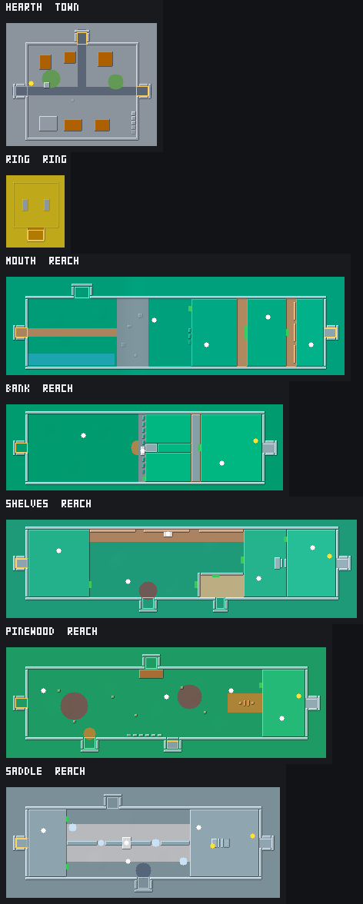

*The plan sheet: `cargo run -p look --example valley` draws every place from
above in one picture, the climbs' heights as shades and the seams as
colours.*

---

## 1 · The shape: a valley, with rooms off it

One climb from Hearth's gate to the Saddle, **one map** of land since
2026-10-09 ([atlas.md](atlas.md)): a road winding up a valley between
mountains, a river in its first meadow and a tarn under the Shelves' north
slope, woods thickening into the Pinewood and thinning into the Saddle's
snow. The creatures' arenas are **rooms** in clearings off the road, each at
the end of a side path and ringed by its rim's bank, so every fight is the
arena it was tuned in. Hearth sits at the bottom of the climb, the Ring north
of it and the Long Valley west, where the Siegeshell walks toward the town.

**Hearth is a market town** (rebuilt 2026-10-09, `sim::arena::hearth`): a
paved street gate to gate through a square with a well and two trees,
half-timbered houses under tiled roofs, an inn, the hall, the armoury, a
barn, market stalls, lamps, and the bell tower, inside a crenellated wall
with towers at its corners and either side of its gates. Its buildings and
props are tables the collision is made from and the renderer draws from
(`game::town`), so a roof you see is a roof you land on.

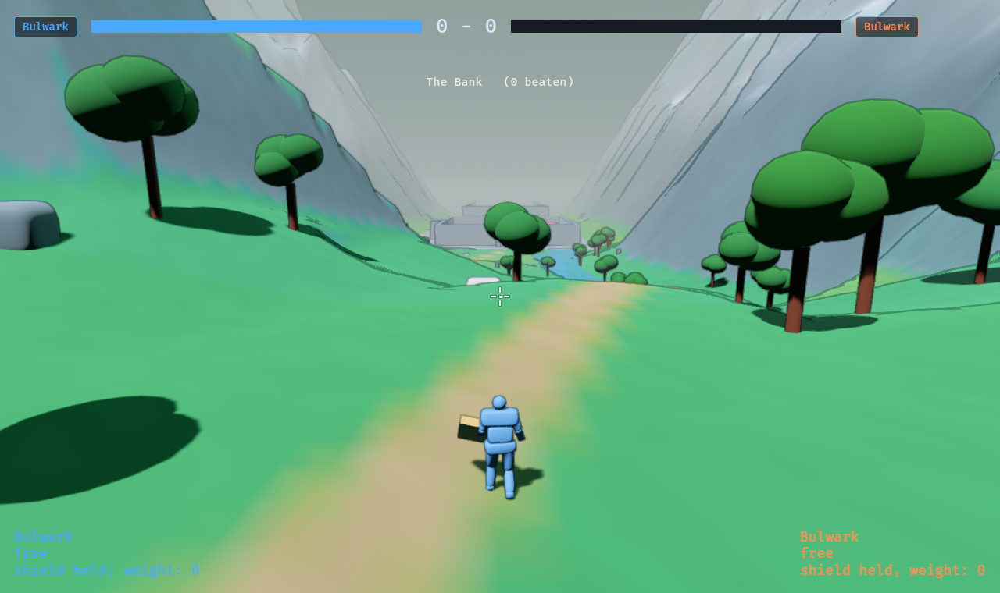

### 1a · The Needle and the Great Wood (2026-10-15)

From [exploration/0019](exploration/0019_spire_wood_and_the_deep.md), the
owner's brief to make the valley a place to play in. Both are south of the
town, on one road that leaves the Mouth's just outside the east gate, crosses
the river on a footbridge, and runs on south. `--arena needle` and
`--arena great_wood` start at either.

**The Needle** (`sim::arena::spire`, `tests/spire.rs`): Hearth's tower, on a
plaza under the town's south wall -- the square was too full of town for it.
A round shaft of pale stone nine metres across at its foot and 315 m tall,
carrying an **inverted dome 90 m across and 35 m deep**, its rim over the
town's south roofs; on the dome's top, 353 m up, **ruins**: broken walls,
column stumps, two arches, a fallen column, a cistern. The way up:

- **The climb, since 2026-10-22, in short sections with lifts between**
  (§3, "Stones that move"; the owner: "the user shouldn't traverse but
  maybe half the current height of the tower manually"):
  - **the stair** up the shaft's south face to 40 m: blocks four metres
    apart zig-zagging east and west of the south, so none is over the one
    under it -- a landing for most classes, a catch for the rest -- to a
    landing with a cairn. Until 2026-10-22 it went the whole height, 78
    blocks alike.
  - **the first lift**, 40 to 120 m: two cars side by side south of the
    face, one going up while the other comes down, two seconds' wait at
    either end.
  - **the round**, 120 to 170 m: fifteen floating stones about ten metres
    out from the axis, circling the tower counterclockwise nearly twice --
    gaps of three to six and a half metres, rises of two to five, five
    pins a metre and a quarter across, a long hop, a drop, a catch of five
    up, a rest with a cairn halfway.
  - **the second lift**, 170 to 276 m.
  - **the crown of the shaft**, 276 to 315 m: two stones east to **the
    shuttle**, a stone that runs ten metres east and back fast, which you
    run along and jump off at its fastest across twelve and a half metres
    to a rest (a cairn) that no plain jump reaches from where it stops;
    **the stack**, three tunnels stacked 6.5 m apart north of the rest,
    each turned round by a wall jump -- out of the mouth, off a wall across
    the way, back over the mouth on to the tunnel's own roof, which is the
    next tunnel's floor; and **the ferry**, a stone that goes by south of
    the stack's top at eleven metres a second and carries you sixty metres
    west and twelve up to the tower's face, to a stone a catch under the
    shaft's top. About 165 m of the 353 are climbed by hand.
  From the shaft's top you climb on inside **the chimney**, and up the
  chimney's ledges, north and south wall by turns, to a **lip stone** set in
  its mouth: a ring's edge is not caught from inside its hole, a block's is.
- **The corkscrew**: stones jutting a quarter turn and eight metres apart --
  the mechanic band -- and **balconies** every forty metres, three boards
  round the shaft (never across the stair), a cairn on every other.
- **The lantern**: four columns on the shaft's top carrying the dome, gaps
  between them to step through.

The rim overhangs the shaft by forty metres, which no jump goes round from
below: the way onto the dome is through it. The roost -- a Galewing on the
dome, a fight (VALE-5) -- is a range (§1b).

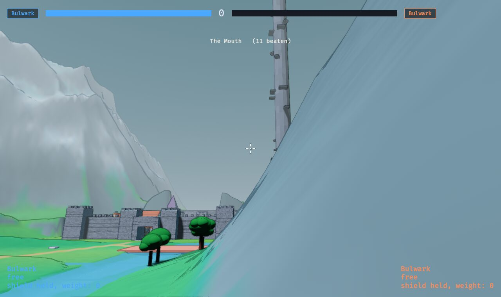

**The Great Wood** (`sim::arena::wood`, `tests/wood.rs`): a clearing four
hundred metres across past the Needle, and in it **fourteen giant trees 13
to 20 metres across and 100 to 200 tall**, sized against what the classes do
rather than the plain jump ("however big you're thinking of, probably triple
that").

**The trees are grown** (`sim::valley::trees`, the owner's ask of the same
day: "a procedural generator ... using some nature mimicking algorithm ...
roots that wrap around the landscape ... a few versions ... in a specific
place in the world where the tree grows"). Each is grown **where it stands**,
from a site: the land under and round it, and its neighbours. Three kinds,
each one of the ways botanists describe a tree growing:

| Kind | How it grows | What it is to climb |
| --- | --- | --- |
| **Sentinel** (seven) | Massart's model: one leader straight up, and tiers of three limbs off it, each tier turned from the last by the **golden angle** (137.5°, the angle leaves are set round a stem), lower limbs drooping, upper ones rising, a cone of a crown | **a spiral stair**: tiers two metres apart for the first forty metres, the nearest limb of the next tier a short turn round, 2--4 m across at the bark -- `tests/wood.rs` climbs the Great Tree's with every class and the plain jump -- then six apart above, for the mechanics |
| **Elder** (four) | an oak: a short trunk under a dome of a crown grown by **space colonisation** (Runions et al., 2007) -- points scattered through the room the crown may fill, each pulling the nearest bud toward it until a branch reaches it, so branches compete for space and fork | broad limbs to walk out along, forking |
| **Strangler** (three) | a banyan: the same, held toward the level, under a crown wider than it is tall, and **prop roots** dropped from its great limbs to the ground | the props are pillars to climb into a roof |

For all three: **the pipe model** (da Vinci's rule) -- a branch is as thick as
everything it carries, its cross-section the sum of its children's -- so they
taper as real ones do and the limbs low down, which carry most, are the ones
you stand on. **A tree answers its place**: its crown is pushed off its
neighbours' toward the open side and downhill, where the light is; a limb that
would grow into the hillside lifts off it; no branch grows into another tree.
**Roots wrap the landscape**: buttresses flaring up the trunk's foot, then
roots running out over the land node by node, a third buried, further
downhill than up, round a neighbour's foot rather than into it.

What is drawn is the skeleton (`game::grove`: a tapered tube a segment, a
clump of leaves at each twig's end, bark and leaves by kind from
`look::Palette::grown_bark`); what is stood on is built from the same skeleton
(`trees::solids`): its steep parts round slices, its gentle ones turned boards
a step apart, nothing thinner than 45 cm (a broadleaf's, 90 cm and more) --
you fall through a twig. The boxes are hidden from the renderer
(`Atlas::hidden`), which draws the tree. About ten thousand of them for the
Wood, the busiest tile under an Elder's crown about two hundred and thirty;
the frame at the Great Tree's foot costs a fifth of its budget.

**The second pass** (2026-10-16, from play: "it needs to be easier to tell
where you can stand ... the vines often get blocked by a branch ... wider
spaces as checkpoints ... I want the canopy to be a reward"; the vines
themselves went the same day, below):

- **What bears you looks it.** A limb you can stand on (`trees::stood_on`,
  the rule the boxes are built by) is worn pale on top
  (`look::Palette::grown_footing`); one you cannot stays bark all round.
  Leaves hang -- needles in drooping tufts, a broadleaf's in rounded clumps,
  fewer and smaller than the first pass's flat sprays, which read as ledges
  -- except where they are a floor.
- **Shelves.** A Sentinel's first six-metre tier, forty metres up, and every
  seventh after it, grows **bracket fungus** where its limbs would be: three
  lobes 8.4 m across, each the next step of the spiral and a checkpoint, a
  cairn on the first. The stair's last limb comes out from under one and is a
  plain jump below it.
- **No vines** (2026-10-16, the owner: "the vines are just awful to get
  stuck in"). The Sentinels' vines went; the spiral stair is the way up a
  Sentinel, and `tests/wood.rs` climbs the Great Tree's with every class.
- **A broadleaf's canopy is a roof**: concentric terraces of leaves 4.5 m
  wide, each 30 cm under the one inside it, and a **lip** 1.4 m up round the
  edge, so it is hard to walk off. A **hanging root** drops off every lip to
  the ground, where nothing of any tree is in its way (`wood::ladders`, where
  a liana hung until 2026-10-16), with **bracket fungus** up it either side by
  turns, four metres apart -- a catch at the hands for the Bulwark -- the top
  one two metres under the lip: climbed, you step in over it.
  `tests/wood.rs` climbs every one with every class.
- **Quicker ways up** (2026-10-22, the owner: "the forest needs some more
  entertaining and artificially shortened ways up"). A broadleaf's hanging
  root no longer goes the whole way: its fungus runs about three and a half
  metres apart to **a landing** 36 m up (`wood::LANDING_UP`, a cairn on
  it), where until then thirty-odd shelves went on to the lip. From the
  landing:
  - **an Elder's updraft**: a column of rising air over the landing to four
    metres over the lip, at 16 m/s (`Updraft, rising speed`, 8 until
    then): step off into it, ride it up, drift in over the lip. Seven
    seconds up the tallest.
  - **a Strangler's spring**: a stone beside the landing, out from the roof,
    that shoots up 21 to 31 m in under three seconds to stop nine metres
    under the lip -- past every plain catch from there -- so the way on is
    a jump off it while it is still rising, its speed added to the jump's.
    Late in its rise is the window: about a fifth of a second for the
    Champion on the shortest, most of a second for the Dual mage.

  And **a hoist up most Sentinels** (`wood::ways_up`): two cars outside the
  trunk, where nothing of any tree is in their way, from a fungus landing
  overlapping a lobe of the first shelf (the stair's top) to one level with
  the highest, a cairn on it -- 126 m up the Great Tree, 84 m up three
  more; three Sentinels have no column clear of their limbs and keep the
  climb. Where each goes is searched out round the grown trees, so it moves
  if they grow differently. `tests/wood.rs` climbs every broadleaf's fungus
  to its landing and on to its roof by the updraft or the spring, and rides
  every hoist, with every mover; on paper no plain jump catches a lip from a
  landing or from a spring stopped at its top.
- **The camera passes through a tree** rather than being pulled in by every
  branch (`Terrain::seen_around`) -- as it does everything small in the
  valley since 2026-10-20 (see "What holds the camera off" below) -- and the
  trees are drawn with a window cut
  along the line from the eye to the fighter (`game::paint`'s `cut`), so
  nothing of a tree hides you. The window is cut in the depth prepass as
  well as the colour (`Paint::window`, `paint_prepass.wgsl`), and the
  windowed paint culls its back faces there too: cut in the colour alone,
  the depth of the wood stayed in front of the fighter and the window came
  out the colour of the sky -- a white hole (2026-10-16). A clean hole read
  as a bite out of the tree, so the wood it cuts away is drawn again
  see-through over it (`Paint::ghost`): a trace of it in the middle (10%),
  thickening to solid over a long soft rim, drawn only for the trees the
  line from the eye to the fighter comes near. The outline is handed the
  same window and draws no ring round it (`cut.wgsl`'s `by_window`): the
  window is the camera's, not a hole in the tree, and nothing about it
  should say otherwise.
- **What holds the camera off** (2026-10-20, from play). Only a box at least
  `Camera held off by a box this thick` (1 m) on its thinnest side and
  `... this broad` (4 m) on its middle one keeps the camera out of it
  (`Solid::holds_the_camera`): a wall, a crag, a terrace, a cliff -- and the
  land, and the town's buildings and props, which the town draws whole.
  Everything smaller -- a platform, a step, a post, a rail, a thin slab, a
  trunk -- the camera passes through, and neither pulls the drawn arm in
  nor holds the aimed-from eye under it as a ceiling. Each is drawn in the
  same windowed paint as the trees, with its ghost shown while the line from
  the eye to the fighter comes near it (`game::window`). Pushed by every
  small thing, the camera jumped as you stepped on and off blocks, and
  between something overhead and something underfoot it zoomed in and out
  with every small turn of the mouse; what holds it off wants to be large
  and plain, so that it moves rarely and smoothly when it does.

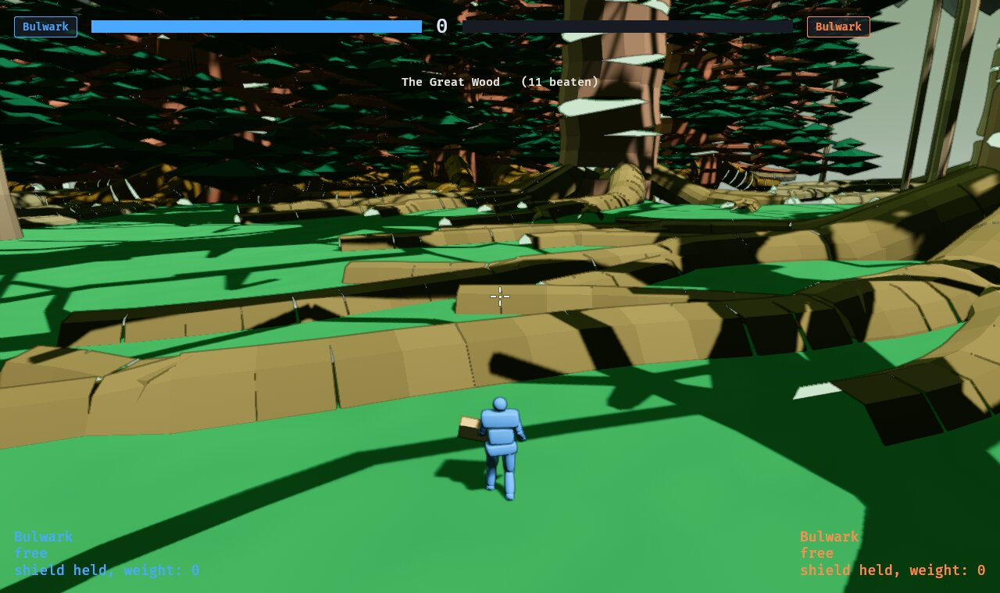

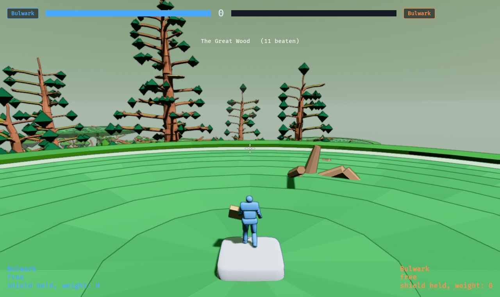

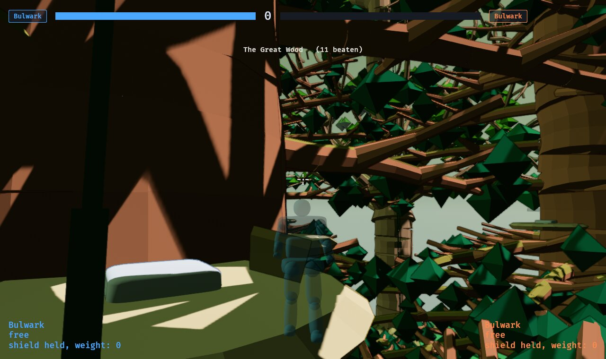

### 1b · Ranges: creatures out on the land (2026-10-15)

`sim::valley::ranges`, `tests/ranges.rs`. **A range is a room without
walls**: a place of the map with an arena of its own, so its creature fights
in its own coordinates and is kept inside its own bounds, but its floor is the
land -- a pocket of meadow fifty metres off the road, the Wood's clearing, the
Needle's dome -- and nothing rings it. Walking into one wakes it, as walking
into a room does; walking more than `Hunt, held this far outside its room`
away puts it back to sleep. The road never passes through one
(`the_road_never_wakes_a_range`): you see them from it and choose.

| Range | Where | What | Temperament | Temper |
| --- | --- | --- | --- | --- |
| **Wood's Edge** | the Great Wood's clearing, by its entrance | the Hornback herd | skittish | 0 |
| **South Bank** | across the Mouth's river from the road | the Gnawers | hunting | 0 |
| **Upper Meadow** | the Bank, south of the road | two Ridgebacks | peaceful | 0 |
| **Glade** | the Pinewood, north of the road | the Pair | territorial, 14 m | 2 |
| **Snowfield** | the Saddle, south of the road | a Ridgeback | hunting | 3 |
| **Roost** | the Needle's dome, 353 m up | a Galewing, circling the ruins and perching on the tallest stump | territorial, 32 m | 1 |

**Temperaments** (VALE-4, "depends per creature"): *hunting* comes for you;
*territorial* watches until somebody is inside its ring, or hurts it;
*peaceful* starts nothing, and hurt, fights back; *skittish* never fights, and
hurt, the herd runs to the far side of the range from whoever started it. A
held creature is held in the moment it takes to notice you (`Brain::grace`),
a held pack in its calm; a hurt is noticed as the creatures' health, all of
it, falling (`Journey::stock`). **The temper rises with the distance from
Hearth** -- the same Ridgeback is temper 0 on the Bank and 3 on the Saddle.

**Beaten, a range rests** for `Range, rests after it is beaten` (300 s,
VALE-3 "after a while") and then is back; **lost**, nobody wakes outside --
there is no outside -- and everybody stands up on their last cairn.

**The roost is stacked**: it is over the Needle's plaza, so it is a place only
between the dome's top and forty metres over it (`PlanPlace::band`,
`Atlas::place_for`); on the plaza underneath you are in the Needle, and the
stair and cairns there are the Needle's. Climbing out of the chimney onto the
ruins wakes the Galewing (`tests/spire.rs`).

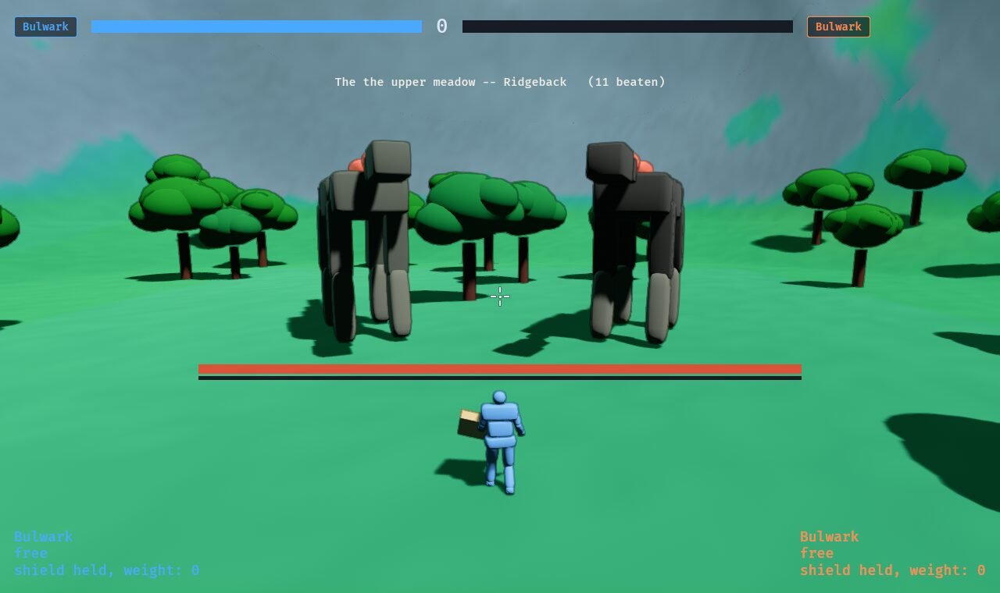

### 1e · Creatures that leave their range (2026-10-19)

From [exploration/0023](exploration/0023_roaming.md), `sim::valley::roam`,
`tests/roam.rs`. **A creature is no longer kept in its range or room once it
has a reason to leave**: after its egg it follows the carrier anywhere on the
map, and never stops until it is beaten or the egg is dropped or taken back;
roused, or a hunter, it follows whoever walks off -- for `Roam, gives up after
this long far from home` (20 s) once it is 15 m out, or until it is 160 m out,
less for a territorial (60%) or peaceful (35%) one -- then gives up and walks
home at half its gallop, starting nothing. Home with somebody near, it
settles; home with nobody near, or out of everyone's reach on the way, its hunt
is over. Out of its bounds it travels by a short look-ahead that will not climb
land too steep to climb or a step over 0.6 m, goes round trees and crags and
through a room's doorway, and fights as at home within 18 m of whoever it is
after.

**The world moves with a hunt in it** now: `World::shift` moves creatures,
critters, packs and their lore, and the hunt remembers its home (`Journey::den`)
and reads its arena through it (`arena::Den`). While a hunt is out, the world
runs in the coordinates of the nearest place with an origin of its own -- a
room, a range, the town -- rather than a reach's, which is the map's: a
creature's lore keeps points in sixteen-bit centimetres, and the Saddle is
900 m from the map's origin. **One live hunt**: a chase through another range
does not wake it; once the chase is over, a range somebody is standing in
wakes. Beaten far away, a creature's trophies drop where it fell and its home
range rests; lost far away, everybody stands up on their last cairn and it
took its egg back.

### 1c · The Deep (2026-10-15)

`sim::arena::deep`, `tests/deep.rs`, `--arena deep`. The ask: "ways down
[that] lead to caves with monsters ... twist about and form kind of a maze
and keep going down and down until they open in to big spectacular caverns
with crystals". **The land is one surface**, so nothing can be under it: the
Deep is a place with its own floor, **a pit sunk 140 m** south of the
Shelves' road, past the mountains, and **a lid of rock** laid over it at the
road's height, out to where the mountains round it rise through it. From the
road by the second pass a path runs south through a notch to a stone plain
among peaks; in the plain is the mouth. Under the lid everything is solids:

| Level | Over the pit's floor | What | Who |
| --- | --- | --- | --- |
| **The mouth** | 140 m | a shaft through the lid, walled down to the Upper Warren | -- |
| **Upper Warren** | 110 m | a maze of tunnels fourteen metres wide, ten cells by eight, every cell reached by one way | Gnawers, hunting, temper 1 |
| **Middle Warren** | 80 m | another, its way in under the last's way out | the Pair, territorial, temper 2 |
| **Lower Warren** | 50 m | a third | Gnawers, hunting, temper 2 |
| **The Caverns** | 0 | the pit's floor, 160 by 128 m under a vault 47 m up: crystal columns up to 36 m, crystal spears down from the vault, shards hung in the air stepping down from beside the shaft, a lake on crystal sand | the Hornback herd by the lake (skittish), two Ridgebacks (hunting, temper 3) |

Each warren's way down is a shaft at the far end of its maze from its way
in, **walled** from the floor it goes through to three metres over the one
below (since 2026-10-16, when each shaft's vine went). **Down is a wall
slide**: drop in and push into a wall and the slide is a fall cancelled --
`tests/deep.rs` slides every one from the mouth to the Caverns' floor unhurt
-- or go ledge to ledge. **Up is the ledges**, four metres apart and
zig-zagging between the north and south walls, a catch at the hands across
the shaft for the plainest jump; the last is a step under the rim of the wall
it is on (`tests/deep.rs` climbs every shaft with every class). The Caverns'
shaft has a slot through its west wall at 35 m on to the first crystal
shard. The mazes are a fixed draw, so both machines dig the same tunnels;
`tests/deep.rs` walks each from its way in to its way down. Walls round the
pit's edge seal the space under the lid from the land's crater round the pit.
Cairns on every warren's floor by its way in, and one by the lake. Crystal is
a material of its own (`Material::Crystal`, `violet` and light).

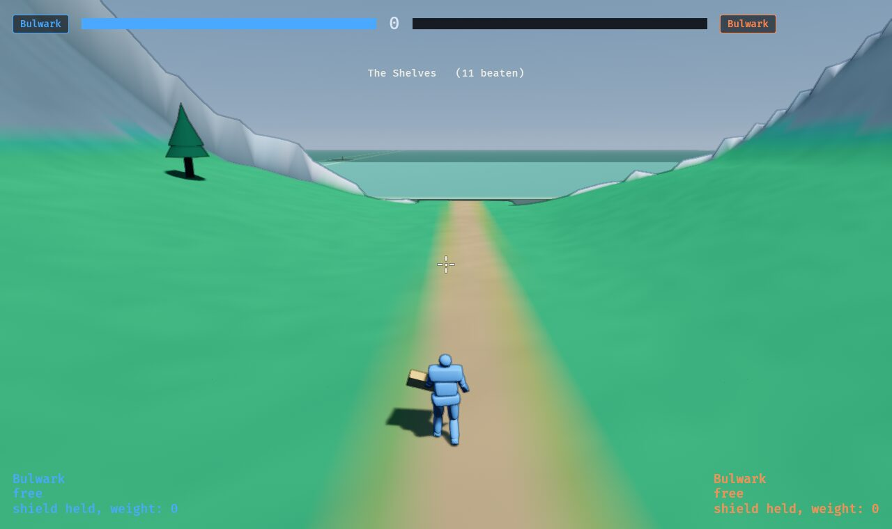

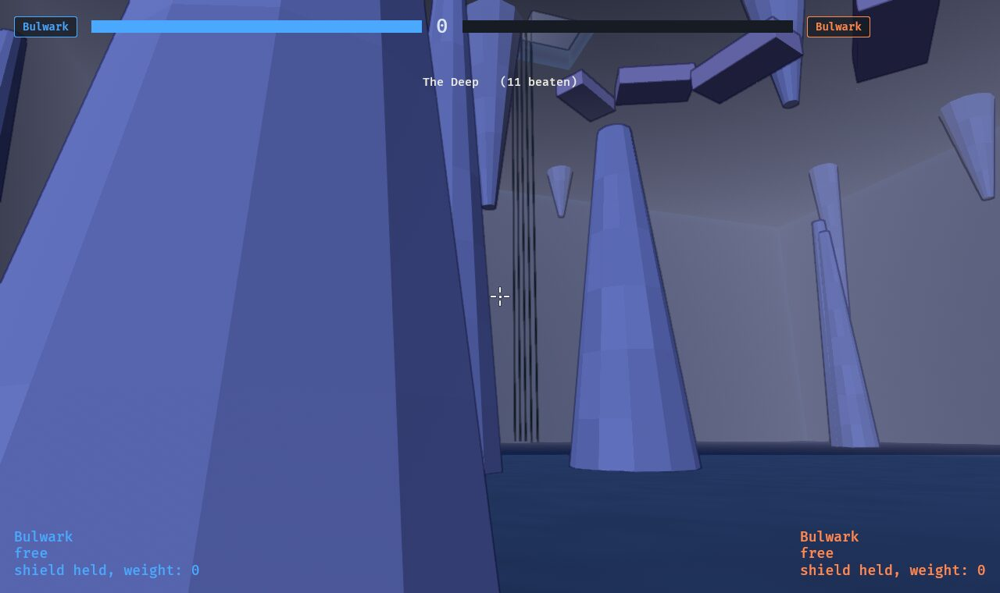

### 1d · The High Plane (2026-10-15)

`sim::arena::heights`, `tests/heights.rs`, `--arena high_plane`. "Sections
that lead up ... to full separate planes with different creatures there",
and asked whether that should be a table mountain or islands in the sky,
"both":

- **The plane** is a table mountain 260 by 220 m with its floor **300 m
  up**, north of the Bank behind the valley's mountains (they top out near
  190 m). Its rim holds the land up to its edge -- a lip a metre and a half
  high -- and the land falls three in one below it, so from the valley it is
  a flat top over the ridges, and what is drawn is what is stood on (a pad
  above the land with no rim would be drawn at the mountains' height under
  an invisible floor). Standing stones, boulders, a cairn where each route
  arrives, and its own creatures (§1b): **Sky Meadow**, two Ridgebacks,
  peaceful, temper 1; **Eyrie**, a Galewing, hunting, temper 2; **Sky
  Shrine**, the Mantis, territorial, temper 2.
- **The Sky Road** -- the islands -- leaves the Needle's dome 353 m up: 22
  turf islands, stones and precision stones (1.4 m across) over the town,
  the Mouth and the mountains, coming down gently to the plane's south-west
  corner. Gaps of 8 to 22 m with a drop of a metre or two, a rise of three
  now and then: the mechanic and expert bands, "treacherous" as asked. A
  cairn on every big island. Its stretch over the mountains is a place of
  its own, **the Sky Road**, so its cairns belong somewhere.
- **The Hanging Stones** climb from the Bank's road -- rebuilt 2026-10-16,
  when their vines went, again **2026-10-20, to the Sky Road's
  difficulty** (§3), and **2026-10-22 into short sections with things that
  carry you between them**: **the column**, a turn of eleven stones round a
  square west of the foot (41 to 88 m), a lift to 150 m and straight off
  it **the riser** -- two walls rising 24 m together, kicked between -- and
  eight stones to its top at 203 m; and **the span** north over the
  mountains to the plane's edge: a gully and a stretch of stones and pins,
  **a ferry** caught going by and ridden ninety-five metres up the
  mountainside, two **turn-arounds** out of tunnels across the slope, a
  lift and the last stones on to the lip. Until 2026-10-20 it was fifty
  identical stones 4.2 m apart and a span of identical steps, sized for
  the Bulwark's catch; until 2026-10-22, forty hops round the square and a
  span of twenty-eight broken by three gullies, every metre by hand.
  `tests/heights.rs` jumps every plain hop, kicks across the gully, rides
  every lift, the riser and the ferry, and turns round every turn-around
  with every mover, and holds every tool hop to the envelope.
- **Harder than the Sky Road**, both optional (2026-10-20, "a few that are
  more difficult still than that"): **the Crown**, a climb off the plane's
  floor to a turf island fifty metres over it, 354 m up -- the highest place
  in the valley, a cairn on it -- and **the High Line**, a shortcut across
  the Sky Road's middle on six stones a metre or two across, nineteen to
  twenty-two metres apart, bowed out to the north-west of the road it skips
  (§3).

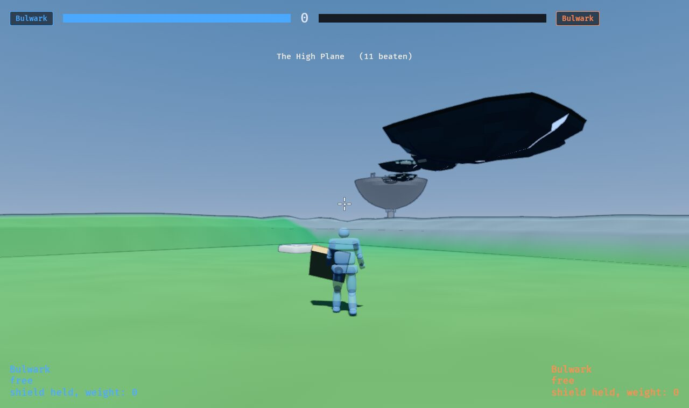

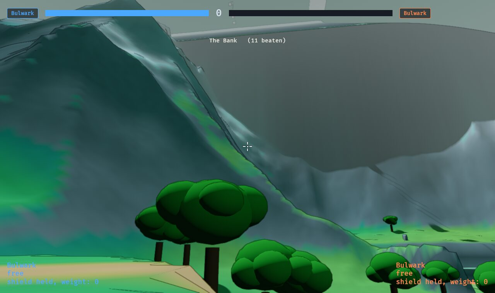

**Crystal** and the **floating islands** are drawn as what they are: crystal
violet and faceted, a hanging slab of turf as an island of turf on rock
(`game::forms::form_of`), in the valley as on a course.

| Place | The road | Rooms off it | The way on |
| --- | --- | --- | --- |
| **Hearth** | — | **the Ring** (north), **the Long Valley** (west, under the fifth waystone) | the east gate |
| **The Mouth** | Out of the gate between low hills into a river meadow fifty metres wide; a crag with a cairn; the road climbs the scree, sixteen metres in two bends, to the Lip | the low meadow (Hornback herd), up a side path north | the Lip |
| **The Bank** | A broad upper meadow; the old stair as a crag; the road climbs the bank, twenty-one metres | the den (Gnawers), north | **first waystone**, a pass between two shoulders of hill: one of the herd, the den |
| **The Shelves** | A long open bowl with a tarn under its north slope; a crag by the shore; the road climbs out | the Mire (Mireback) and the Pan (Sandmaw), down side paths south | **second waystone**: one of the Pan, the Mire |
| **The Pinewood** | Pines thick on both sides and up the slopes; a crag among them; the road ends at a pool under **the Waterfall**, a basalt cliff twenty-two metres tall, and goes on from its top (§3) | the Den (the Pair) south, the Hollows (Broodmother) north, the Highlands (Ridgeback) up a side path south four metres higher | **third waystone**: two of the Pair, the Broodmother, the Ridgeback |
| **The Saddle** | A snowy alpine meadow between peaks; the highest crag; the road ends at a view | the Cliffs (Galewing) over a bridge north, the Ashwood (Veilstalker) south, the Shrine (Mantis) up a switchback north-east behind the **fourth waystone**: one of the Cliffs, the Ashwood | — |

The tiers are world.md §3's, and the gates are exactly what that table says
(`valley::tier`). **The Ridgeback has a room of its own**, the Highlands: the
proving ground's floor plan on a moor, so meeting it in the valley is the
fight it was tuned in, and `arena::for_species` still sends `--hunt ridgeback`
to the proving ground.

Not built from world.md §2: the Crossing (the herd's escort mode stays a
`--hunt hornback-escort` fight). A room is visible from its side path now,
but its creature is not put on its marks until you walk in.

### 1f · The Sleeper (2026-10-22)

The owner: "take one of the mountains, make it a sleeping terrestrial
dragon. Make it subtle, mostly art for now. The dragon itself should
essentially be the mountain, and its dragon-like features should be just
discernible only from certain angles. Maybe it wakes up eventually."

**The mountain north of the Pinewood, east of the High Plane, is a beast
asleep** (`sim::valley::dragon`). It is the land, not a creature and not a
box: a height added to the mountain wherever its body lies, before the
land's noise and crags go over it, so it wears the same rock and snow as
the range round it, and what is drawn is what a foot would stand on.

**Its shape is a real model, posed** (2026-10-23; the owner: "build an
actual model ... or better pull one that's open source. Lay that dragon
out in the pose we need it. Then write a script to build the terrain
definition from that"). Two hand-built bodies came first -- a table of
joints posed like a statue, then a tarrasque of mounds that read "like a
sick dog" -- and judging them was blind to the steps between. Now:

1. **The model**: Drummyfish's CC0 low-poly dragon, rigged, 2,416 vertices
   on 58 bones (`assets/sleeper/`).
2. **The body** (`scripts/sleeper/sculpt.py`; the owner: "tone down all
   the spikiness ... keep the big spikes along the back"; "remove the
   wings"; "make the face more tarrasque-like"): the wings cut off; the
   mesh smoothed everywhere but the row of tall spikes down the back, so
   the rest of its spines melt into the body; the head pressed toward a
   short, broad egg -- a blunt, heavy skull, its horns and crest drawn in
   -- and its mouth shut. Then (the owner: "make the neck thicker ... add a
   row of prominent spikes on its back, make the spikes on its back legs
   smaller"): the neck pushed out from its bones, thickest at the
   shoulders; the hind legs' spikes smoothed a little rather than held;
   and a new row of blade-like spikes down the middle of the back from
   the neck to the tail, tallest over the shoulders and hips, each riding
   the skin under it.

   **It also stands** (`pose.py`'s `standing`; "make it stand on two
   legs", then "the pose and proportions should be like a T rex with
   bigger arms"): a T. rex's stance -- the body near level, balanced over
   the hips on long, heavy thighs (1.5 times the dragon's, and swollen),
   swung forward until the feet stand under its centre of mass -- worked
   out from the mesh, not guessed; up on its toes; a longer, thicker tail
   ending in a club; a thicker neck and a head 1.3 times the size; and
   forelimbs thin beside the legs but long enough to reach the ground
   stretched (`pose.py` prints the reach: 1.06 of the shoulder's height),
   hanging when relaxed and leaving the body further forward than the
   dragon's did. The throat is drawn in rather than thickened, so
   it hangs no bib down the chest. This is how it will be when it wakes. `python3
   scripts/sleeper/pose.py` draws it standing and asleep on one sheet.
3. **The pose** (`scripts/sleeper/pose.py`): from the last frame of the
   model's own "Die" clip, every bone *aimed* along a world direction --
   the neck round to the left so the head lies back along the left
   shoulder, under the left forelimb; the forelimbs at half size, out of
   the shoulders; the upper hind leg drawn up along the flank; the lower
   one under; the tail curled round the right side; and the whole body
   rolled 22 degrees onto its right side.
4. **The shape** (`scripts/sleeper/terrain.py`): the posed model sized to
   300 m, squashed to 60 % of its height, turned to face 200 degrees (a
   little west of south) and centred at (790, 400); the highest point of
   it over every 2 m cell; sunk 18 m into the mountain; every wall settled
   to a slope of 1.4 at most, as scree settles against a cliff; softened a
   cell. It writes `crates/sim/src/valley/sleeper.bin`, which the
   simulation reads.
5. **The sheet** (`cargo run --release -p look --example sleeper`, then
   `python3 scripts/sleeper/sheet.py`): the three side by side from four
   directions -- the posed model, its shape alone on flat ground, and the
   mountain with it in, from the simulation's own heights -- so each step
   is judged on its own.

`SHOT_EYE=200,120,-130,370,-80,80 SHOT_AT=128,10 GAME_ARGS="--arena
high_plane --open"` looks down on it in the game from 120 m over the
plane's edge.

**Waking it** is not built (§6, item 8).

## 2 · The rules

All of them are in `World::step_valley` and `sim::valley::open`, and all
of them only run when the world is the valley (`Journey::on`). Outside it
nothing here happens and nothing here is hashed, so every pinned fight
hashes as it did.

- **A seam** is the mouth of a passage or a notch where two places meet, and
  seams come in pairs (`tests/valley.rs` checks every pair). Since
  2026-10-09 it is a doorway, not a trip: **you walk through it**. The world
  runs in the coordinates of the place the first fighter on their feet is
  in, and moves into the next place's when they cross (atlas.md). Every
  doorway is walked through by `tests/valley.rs`.
- **You no longer have to go together.** The rule that a seam fired when
  everybody stood in it, or one had held it for `seam_hold`, went with the
  teleport: there is nothing to go *to* that the other cannot walk to after
  you. The two of you can be apart; one live hunt at a time.
- **A waystone** gates a seam that leads on. It is lit when enough of its
  tier have been beaten, counted from the journey's bitmask. An unlit one's
  doorway is **a wall**, drawn as a dark slab, and the screen says what it is
  waiting for; it stands only while nobody is on its far side, so going back
  down is never gated.
- **What has been beaten** is the journey's, and a creature gets there two
  ways: a hunt won in the valley, and each player's trophies. A trophy is
  off the snapshot, so the game sends each one on the wire as a trip byte
  (`Destination::Credit`) and both peers credit it on the same frame. The
  pair's journey is the union of both players' trophies: the note's "the
  more travelled of the two", and world.md §5's "a locked place is locked to
  the lone player, not to the pair".
- **A cairn** is a snow top. Touch one and it is your checkpoint, and out of
  a fight you are rested (health back) -- in one it rests nobody, but it
  still counts: the Needle's top cairn is on the roost, which is awake by the
  time anybody reaches it (2026-10-20).
- **Fast travel** (2026-10-20): the Esc menu lists every cairn you have
  touched, by place and height, and a click stands you -- and whoever you
  play with -- on it, as your checkpoint. Out of a fight only. Which cairns
  you have touched is your own record, kept beside your trophies
  (`game::cairns`, by where each cairn is on the map, so a change to the map
  does not lose them); the world hears only which cairn, as a trip on the
  wire (`Destination::Cairn`, its place in `valley::cairns`). In `--dev`
  every cairn is listed (`tests/valley.rs`,
  `fast_travel_stands_everybody_on_any_cairn`).
- **Nobody dies in a reach.** A fighter whose health runs out — a fall
  costs what the fall rule says, free to 9 m and 25 a metre past it — is
  stood on their last cairn, or on the place's arrival marks if they have
  touched none, with their health back.
- **Peace.** In the town and the reaches the two of you cannot hurt each
  other: `World::pvp()` is false, and every place that used to ask "is this
  versus" asks that instead. **The Ring is the one place for fighting each
  other** (the ask was "make sure Hearth has an arena for PvP"): the proving
  ground's square to the centimetre, sand for earth, rounds as versus plays
  them, the dummy or the sparring bot as player two when nobody has the
  second keys. Hop its south wall and walk into the door to leave.
- **A room starts its hunt** when anybody walks into it. Win it and the
  place goes quiet: the round does not restart, and you walk out the way you
  came. Lose it and you wake outside, at the seam you went in by. You can
  run, but since 2026-10-19 its creature follows you out of the door (§1e)
  until it gives up and goes home; only then is the hunt over, unwon, and a
  walk back in starts it again.
- **A room has ground round it.** Most rooms are walled with low walls,
  which ended the world when a room was all there was. On one map a room has
  six metres of ground round its walls and a cliff round that.
- **Player two, unplayed,** is not in the valley: kept a kilometre under the
  place's floor where nothing reaches it, rather than a body lying at every
  seam. In the Ring and in a room the second seat plays as it always has.

The journey is a few bytes of the snapshot: whether this is the valley, the
beaten bitmask, the seam you came in by, and each fighter's last cairn (a box
of the map, by its index there).

## 3 · Climbing, as built

**The road climbs on foot** since the valley became land: every rise on it
is a slope a body walks up, and the whole road, and the way into every room,
is walked from end to end by `tests/valley.rs` (`the_whole_road_can_be_walked`,
`every_room_can_be_walked_into`) -- **but for the Waterfall**.

**The Waterfall** (since 2026-10-10, the owner's ask: "a tall waterfall jump
section on the main path"): at the head of the Pinewood, past the Highlands'
path, the road ends at a pool under a cliff of basalt twenty-two metres tall
with the falls down its middle, and goes on from the top to the third
waystone. **It is the one stretch of the main route that is jumped, not
walked**: out of the pool on three column tops, up the right of the falls,
three level leaps behind the falling water, up the left to the lip -- a cairn
at the foot and on each of its two shelves, and one on the top. **Since
2026-10-20 it is sized for the five movers, not the Bulwark**: the ledges and
column tops are 2.3 to 2.7 m along the face where they were 3 to 4, and the gaps
between them longer -- 4.3 to 6 m on the way up the sides at +1.5 to +2.1,
6 and 6.4 m behind the falls -- every one inside the Champion's and the
Blood mage's plain catch (the shortest jumpers: 6.7 m at +2) with half a
metre or more to spare, and landed by the Dual mage. It is still a plain
climb, because it is the main road; the height, the small tops and the
water (which pushes down, so the curtain is no way up) are what make it
hard.
It is one table (`sim::arena::waterfall`) and the same cliff is a jump course
of its own, `--arena waterfall`; [courses.md](courses.md) §1c has the hops.
`tests/waterfall.rs` jumps every hop with every class in the valley and checks
the cliff cannot be walked round; the road test walks to the pool, back a
way, and on from the top.

**The climbs are crags beside the road**: a pillar of rock with ledges up one
face, each a rise of 3.6 m and a metre and a half across from the last (2.2 m
and a metre until 2026-10-16), and a cairn on its top — a view, a checkpoint,
and a jump every class makes with a plain running jump caught at the hands
(`REQUIRED`, checked against `sim::envelope::widest_caught`): the Bulwark
hangs from each ledge and climbs, the best jumpers land. The vine down the
crag's other face is gone.

**No vines** (2026-10-16). The owner: "remove all vines in the game. We now
have ledge grabs and wall jumps, and the vines are just awful to get stuck
in." Everything a vine carried is climbed with the catch or the wall jump
now: the Needle's stair, the Deep's walled shafts, the Hanging Stones' column
and gullies, the broadleaves' hanging roots. **The spacing rule moved with
it**: a required hop used to be inside the Bulwark's plain *landing*; it is
inside its plain *catch* now, with 30 cm to spare -- landed is the quick way,
caught and climbed the forgiving one. Measured off the plain running jump
(`envelope::off_the_edge`, ledge reach 2.3 m over the feet):

| Rise | Bulwark lands / catches | Champion | Dual mage |
| --- | --- | --- | --- |
| level | 5.2 / 6.0 m | 6.7 / 7.5 | 8.9 / 10.1 |
| +2 m | 4.1 / 5.3 | 5.7 / 6.7 | 8.0 / 9.2 |
| +3 m | -- / 4.9 | 5.1 / 6.4 | 7.6 / 8.7 |
| +4 m | -- / 4.3 | 3.9 / 5.9 | 7.1 / 8.2 |

**A gully** (`sim::arena::gully`, 2026-10-16: "make some sections where the
intended pathway is to wall jump"): a drop twelve metres long between two
walls three metres apart, standing twelve metres over the takeoff so their
tops are no ledge, with a landing two metres down. No class's plain running
jump carries it -- the Dual mage's, the longest, about nine metres caught --
and every class crosses it by kicking from wall to wall: run along one side
of the takeoff, jump, drift into the wall beside you, and press jump each
time you touch one, *holding forward*, because the stick into a wall is a
slide and a slide bleeds the run away. Measured on the bench's gully lanes
(`--arena bench`): five kicks carry everybody over 12 m; the Bulwark tops out
there, the rest of the roster makes 15 to 18. The Hanging Stones' span has
three (four until 2026-10-20); nothing on the road needs one.

**The routes up to the plane, at the Sky Road's difficulty and past it**
(2026-10-20). The owner: "There's a section from the needle over to the
high meadow that's the only thing resembling challenging. I want more jump
sections to be closer to that difficulty, and a few that are more difficult
still than that. It's an actually fun challenge because there's variety in
the jumps and it forces you to learn class's mobility tools." The Sky Road
is the benchmark: gaps of six to twenty-one metres, mostly falling one and a
half to four, a rise of three onto a stone a metre and a half across, and
eighteen metres and two up. Off the road the routes are now built to it, as
tables of hops (`sim::arena::heights`) that each say what they ask: **a
plain hop** every mover makes -- most of them at the very edge of the
shortest jumpers' catch -- or **a tool hop**, past every mover's plain jump
with its airdodge thrown at its best:

| Rise | Champion | Blood mage | Reaver | Elementalist | Dual mage |
| --- | --- | --- | --- | --- | --- |
| level | 7.5 / 8.9 m | 7.7 / 9.0 | 8.7 / 9.8 | 9.1 / 9.9 | 10.1 / 10.5 |
| +2 m | 6.7 / 8.1 | 6.8 / 8.3 | 7.9 / 9.3 | 8.1 / 9.4 | 9.2 / 10.0 |
| +4 m | 5.9 / 7.0 | 6.0 / 7.2 | 7.1 / 8.4 | 7.3 / 8.6 | 8.2 / 9.5 |
| +6 m | 4.4 / 4.9 | 4.5 / 5.1 | 6.0 / 7.1 | 6.1 / 7.2 | 7.2 / 8.5 |

*(The widest gap caught at the hands, plain / with the airdodge, off
`envelope::off_the_edge`. The tools `sim::envelope` measures: the Dual
mage's second jump catches 24 m level and 18 m at +6; the Champion's vault
peaks at 7.2 m and carries 24; the Elementalist's one-stone jump peaks at
26. The Reaver's dash jump carries 7.4 m past where she dashed to, the
Blood mage's tools are not measured, and nor is the Elementalist's reach
along the flat.)*

| Section | Where | Hops | Tools it is meant for | Main road? |
| --- | --- | --- | --- | --- |
| **The column** | the Bank's road, 41 → 203 m | 22 (since 2026-10-22): a turn of eleven -- plain catches 3--5.5 m out at +3 to +5, precision stones a metre across, one **high** hop of 9 m up -- to a rest; **a lift**, 62 m; **the riser**, 24 m of kicking between two rising walls; then a catch, a pin, a rest, a **long** hop of 13 m, two pins and a catch to the top. A rest with a cairn before each tool hop | high: the Elementalist's stone, the Champion's vault, the Dual mage's second jump, the Reaver's Gallows, the Blood mage's wings; long: the second jump, the vault, the Reaver's and the Blood mage's | no |
| **The span** | north over the mountains, 203 → 305 m | 20 (since 2026-10-22): a gully; long hops of 14 and 17 m rising 2 and 4; a zig-zag of precision stones; **a ferry** caught going by, 95 m up the mountainside; **two turn-arounds** across the slope; **a lift**, 24 m; six plain stones on to the lip | the same | no |
| **The Crown** | on the High Plane, 304 → 354 m | 14: long hops of 15--22 m, level to +4, onto stones one and two metres across; two high hops of 10 m, past the Champion's vault; plain hops at the edge of the catch; one rest | the Dual mage's second jump and the Elementalist's stone for the high ones; the second jump and the vault for the long ones; the Reaver's and the Blood mage's, unmeasured | no: a summit, a cairn, a view |
| **The High Line** | across the Sky Road's middle | 7, every one a tool's: 19--22 m, two of them rising two, onto stones one and two metres across | the Dual mage's second jump, the Champion's vault (by the numbers), and whatever carries the others over the Sky Road's longest | no: a shortcut past seven of the Sky Road's stones |
| **The Waterfall** | the main road, the Pinewood's head | 14, all plain: smaller tops, gaps of 4.3--6.4 m | none: every mover's plain jump | **yes** |

`tests/heights.rs` holds each hop to its table: every plain hop is inside
every mover's plain catch on paper and jumped by the stand-in player, every
gully is kicked across, and every tool hop is past every plain jump and
inside the reach of at least two of the measured tools on the Hanging
Stones (one on the Crown and the High Line). The Crown's hardest hop and
the High Line on the whole leave the Dual mage's second jump less room than
the Sky Road does, on smaller stones. **Every difficulty here is a guess,
unplayed.** The tools that are not measured -- the Reaver's, the Blood
mage's, the Elementalist's along the flat -- were taken on the owner's
word that every class has one; whether each class can actually make each
tool hop wants a person to try it.

The Needle's climb and the Deep's shafts are left without a tool hop: the
Needle is the one way to the Sky Road for anybody who has not learned a
tool yet (the corkscrew round it is the mechanic band), and a shaft is the
way back out of a dungeon, which should not trap a class. Since 2026-10-22
the Needle is not a plain climb of identical stones, though (below).

**Stones that move** (2026-10-22, `sim::drift`). The owner: "A lot of the
sections are super long, as I requested, but they're repetitive and don't
give enough variety to make them interesting ... Short to medium length,
interesting sections that give some variety, then a moving platform, then
another section. The idea with the jump sections continues to be they need
to look longer, more exacting, and more difficult than they really are."
And: moving stones in the challenges themselves, and sections where the
wall jump is the way. So the long climbs are broken up by **drifts** --
boxes that go back and forth between two stops on a fixed clock, eased in
and out, where the frame number says and nowhere else (nothing about one is
in the snapshot, so a rollback puts it exactly where it was). Near a
fighter a drift is a solid like any other. **It carries what is on it** --
standing on it, hanging from its edge, against its side -- and **a body
that leaves it keeps its speed**, so a jump off a rising lift goes higher
and a jump off a fast stone carries. **A wall that is moving is a lift**:
neither rule against a ladder asks about it while it moves (waiting at a
stop it is a wall like any other), so two walls rising together are climbed
by kicking between them for as long as they rise.

| Kind | Where | What it asks |
| --- | --- | --- |
| **A lift**: two cars side by side, half a cycle apart | the Needle (40 → 120, 170 → 276 m), the Hanging Stones' column (88 → 150) and span (24 m up the mountainside) | stepping on; it waits two seconds at either end |
| **The shuttle**: a stone that runs ten metres and back in a second and a bit | the Needle's crown | run along it as it goes and jump off its front at its fastest: 12.5 m to the rest, past every plain jump from where it stops |
| **A ferry**: a stone that goes by beside you from out of reach, fast, and carries you a long way | the Needle's crown (62 m west to the face at 11 m/s), the Hanging Stones' span (95 m up the mountainside) | a jump sideways on to a stone going past at eleven or twelve metres a second |
| **The riser**: two walls across a slot, rising 24 m together | the Hanging Stones' column | into the slot as they set off, and kicked up between them -- a slide is slower than they rise, so stopping leaves you behind -- to a stone off the top |
| **A turn-around**: a tunnel's mouth, a wall across the way 2.5 m on, and the tunnel's roof 6.5 m up as the landing | the Needle's stack (three, stacked), the Hanging Stones' span (two, across the slope) | out of the mouth, off the wall, back over the mouth: the roof keeps a jump from being the way up |
| **A hoist**: a lift's pair of cars beside a Sentinel's trunk | four of the Great Wood's Sentinels (126 m up the Great Tree, 84 m up three more) | stepping on at the first shelf |
| **A spring**: a stone that shoots up beside a landing and stops short | the Great Wood's three Stranglers | ride it and jump off while it is still rising: nine metres short of the lip where it stops |
| **An updraft** (not a drift: a column of air, `valley::Vent`, now with a foot) | the Great Wood's five Elders, from their landings | step off into it, ride it, drift in over the lip |

**Measured on the bench** (`arena::bench::TURNS`, 2026-10-22): every mover
turns round 6.5 m off a wall 2.5 m out, and none comes back over the mouth
without the wall -- running out and steering back, or standing at the very
edge and jumping straight up for the roof's rim; a metre higher is past the
Champion and the Blood mage; the Reaver alone steers back unaided, and only
up to 4.5 m. A flue -- two still walls three metres apart -- takes nobody
higher than a jump (3.6 m to 5.3): the ladder rules spend the kicks, which
is why the tall climb between two walls is the riser's, and moves.

`tests/spire.rs` and `tests/heights.rs` ride every lift, jump off the
shuttle, catch and ride every ferry, kick up the riser and turn round every
turn-around with every mover, through the stand-in player (`tests/pilot`),
and check the tricks are tricks: no plain jump makes the shuttle's gap from
where it stops or reaches a ferry where it waits (on paper, airdodge and
all), and no turn-around is made without its wall. `tests/drifts.rs` holds
the mechanism: where a drift is, a rider carried and keeping its speed, a
ride replayed bit for bit. **Unplayed**: every timing is a guess -- how
long a lift waits, how fast the shuttle and the ferries go, how fast the
riser rises against a slide.

**The mountains are the edge**: ground steeper than `terrain_steepest` is a
wall you slide back down, so the valley needs no boxes to keep you in it
(atlas.md §The land).

Updrafts (`PLACE.vents`) are still a prop the movement reads, and no place of
the valley has one now: the Saddle's ridge they crossed is gone. Falling
water is the other way about: a body in a waterfall's sheet is pushed down
(`valley::sheet_on`, `tuning::falls_push`).

## 4 · What is drawn and said

`crates/game/src/valley.rs` draws, for a place that is in the valley:

- the land, tile by tile out to the fog, with its road worn in, its water,
  its trees and rocks (`game::land`, `game::stream`);
- every seam to a room, and every waystone's pass, as a signpost: a slim
  pillar of light and a pool at its foot, lit or dark (`Palette::beacon`).
  Where one reach runs on into the next there is nothing to mark;
- a dark waystone's doorway as a slab of its grey, while it is shut;
- each waystone's light on its stone's top;
- from Hearth's wall, the reaches themselves, as far as the fog lets you
  see. (The painted ridges that stood in for them went when the valley
  became one map.) Only what is within the sky's reach is drawn
  (`game::stream`, atlas.md);
- one line under the scoreboard: the place, how many creatures the journey
  has beaten, and while somebody stands in a seam, where it leads or which
  waystone is dark.

## 5 · Measuring it

The note said the instrument is a pair's replay, not a search, and the
harness reads one now. `cargo run -p hunt --bin replay -- <tape>` on a tape
recorded in the valley prints **THE VALLEY**: every place visited, how long
the pair spent there, falls, and how each was left — by which seam, and
whether both were in the next place when the world moved into it
("together") or not ("apart"). `crates/hunt/tests/replay.rs` walks two fighters out of
Hearth's gate and into the Mouth and checks the report says so.

The target was **three minutes end to end for a runner who knows it, five
for a pair who does not.** The five reaches are 974 m end to end with about
125 m of climbing, close to the note's arithmetic for three minutes. Nobody has run it yet.

## 6 · Open

1. **Nobody has played it.** Every height, gap and hold is a first guess
   sized against the jump envelope. Record a pair's run (`Y`) and judge it.
2. ~~**The Bulwark sets the gaps.**~~ **Not since 2026-10-20**: the Bulwark
   is not considered for any movement section (the owner: it "is by far the
   least developed class and has really poor mobility"). Until then every
   required hop was within its plain jump, which made them easy for
   everyone else. The gaps are now sized for the other five
   (`sim::class::MOVERS`), and the hard sections are sized to *need* a
   class's tools (§3, the Sky Road and after). **Done for the Hanging
   Stones, the Waterfall, the Crown and the High Line on 2026-10-20**; the
   Needle's stair, the chimney, the Deep's shafts, the crags and the Great
   Wood's stairs are still the old plain catches, sized for the Bulwark --
   the stair and the shafts on purpose (§3), the rest because nobody has
   got to them.
3. **Whether each class makes each tool hop.** `sim::envelope` measures the
   Dual mage's second jump, the Champion's vault and the Elementalist's
   stone; the Hanging Stones', the Crown's and the High Line's tool hops are
   held to those and to the owner's word for the rest. The Reaver's Gallows
   and dash, the Blood mage's wings and chain and the Elementalist's reach
   along the flat have no measure, so a hop one of them cannot make would
   not show. Play each route with each class -- and if a hop proves to belong
   to one class, it is a hard route's to have, not the Hanging Stones'.
4. **The Siegeshell does not come to you.** World.md §3 wanted the bells to
   ring in Hearth when the Shrine's waystone lights. It is walked to, by the
   fifth waystone, from either end.
5. **The armoury, the bot's corner and the hunter's notes** in Hearth are
   solids with nothing in them yet.
6. **The seam hold** is gone with the teleports (2026-10-09), and its knob
   with it.
7. **One map**: everything [atlas.md](atlas.md) §Open lists -- how the joins
   read, the sky changing at a doorway, the Long Valley's loop.
8. **The Sleeper wakes?** (§1f; the owner: "maybe it wakes up
   eventually. That'd be fun.") Nothing of it moves yet. What waking could
   be, cheapest first: a breath -- mist off its nostrils on the frame
   clock, renderer only; an eye that opens when somebody stands on the
   High Plane's edge; then a shrug that sends rocks down its flanks, which
   is the first thing that would be the simulation's. A dragon that gets up
   is a creature the size of a mountain, and its body is the land: it
   would need the land to be a function of the frame where it lies, the
   way a drift is (`sim::drift`), which nothing is yet.
